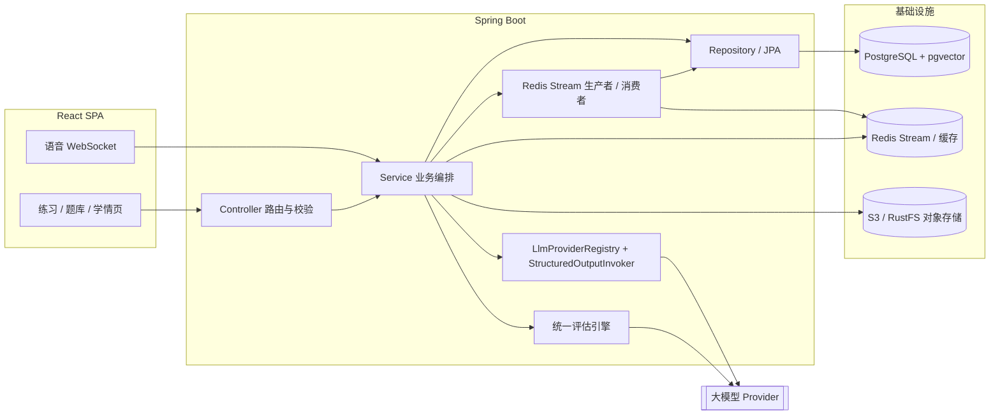

<div align="center">

**智能刷题平台** — 面向高中生的在线刷题与测评平台（语文 / 数学 / 英语）

[](https://openjdk.org/)
[](https://spring.io/projects/spring-boot)
[](https://react.dev/)
[](https://www.typescriptlang.org/)
[](https://www.postgresql.org/)
[](LICENSE)

</div>

---

## 项目简介

本平台把「出题 → 作答 → 批改 → 学情反馈」这条链路的重复劳动交给大模型：学生按学科与难度发起练习，系统自动生成题目、逐题批改并给出得分与改进建议；教师或教研人员可以上传课程资料，由平台解析后自动构建题库与答疑知识库。

当前开放三门学科：**语文 / 数学 / 英语**，每门学科下按高考知识板块划分，覆盖现代文阅读、古诗文阅读、函数与导数、数列、语法填空、阅读理解、写作等考点。

> 本仓库由开源项目 [interview-guide](https://github.com/Snailclimb/interview-guide)（AI 面试官平台）二次开发而来，采用 AGPL-3.0 许可。来源与修改说明见文末「来源与许可」。

## 当前进度

项目正从「AI 面试官平台」迁移到「智能刷题平台」，分阶段推进，避免改名与功能开发互相干扰：

| 阶段 | 内容 | 状态 |
| --- | --- | --- |
| 一 | 品牌与元信息（应用名、容器名、库名、Bucket、图标、文档） | 进行中 |
| 二 | 数据库表名与 JPA 实体类（`practice_sessions` / `practice_papers` / `paper_analyses` / `oral_practice_*`） | 已完成 |
| 二 | 后端包名与 Java / 接口命名（`interview.guide`、`InterviewService`、`/api/resumes` 等） | 待开始 |
| 三 | 学科体系：Skills 由 11 个计算机方向替换为语文 / 数学 / 英语 | 已完成 |
| 四 | Prompt 模板改名与语数英语境改写（批改与汇总 Prompt 已改为学科阅卷语境，其余待做） | 进行中 |
| 五 | 前端页面 / 路由 / 组件改名 | 待开始 |
| 六 | 后端测试与 RAG 评估资产换学科数据 | 待开始 |
| 七 | 教育内核：知识点体系、错题本、掌握度模型、学情看板、个性化推题 | 待开始 |

阶段三完成后学科内容已经落在 `app/src/main/resources/skills/`；Prompt 模板、前端页面文案与测试资产仍是原项目语义，正按上表逐阶段替换。

## 功能一览

- **AI 出题**：按学科 + 难度 + 题量生成练习，支持「按教材 / 资料出题」与自定义考纲解析
- **在线作答与批改**：逐题作答，统一评估引擎分批批改并汇总报告，输出得分、评语与改进建议
- **资料答疑（RAG）**：上传课程资料 → Tika 解析 → 分块向量化 → pgvector 检索 → 带出处的问答；检索范围可选「全部资料 / 某个分类 / 指定资料」
- **口语练习**：WebSocket 实时语音（ASR / TTS），面向朗读、背诵、口头讲题场景
- **试卷分析**：上传做过的试卷 / 练习册（有文字层的 PDF、Word、txt）→ 异步结构化切题 → 自动生成一次练习 → 逐题作答后由统一评估引擎批改，并导出 PDF 解析报告
- **练习安排**：学习计划 / 考试排期的日历管理与提醒
- **多模型管理**：DashScope、DeepSeek、Kimi、GLM 及 OpenAI 兼容接口的注册与运行时切换，API Key 加密落盘

## 技术栈

| 分类 | 技术 | 版本 | 用途 |
| --- | --- | --- | --- |
| 后端 | Spring Boot | 4.1.0 | 应用框架 |
| 语言 | Java | 25 | 开发语言（虚拟线程） |
| AI | Spring AI | 2.0.1 | 多模型接入、结构化输出、工具调用（2.0.0 的流式工具调用分片合并有缺陷） |
| AI | Spring AI Agent Utils | 0.10.0 | Skill 资源加载与 Advisor 扩展 |
| 存储 | PostgreSQL + pgvector | 16 / 0.8 | 关系数据 + 向量检索（维度 1024，COSINE） |
| 缓存与异步 | Redis + Redisson | 7 / 4.0.0 | 缓存、Redis Stream 异步任务 |
| 文档 | Apache Tika | 2.9.2 | 资料解析 |
| 导出 | iText 8 | 8.0.5 | PDF 报告 |
| 映射 | MapStruct | 1.6.3 | Entity ↔ DTO 映射 |
| 接口文档 | SpringDoc OpenAPI | 3.0.2 | Swagger UI |
| 语音 | DashScope SDK | 2.22.7 | Qwen3 实时 ASR / TTS |
| 对象存储 | AWS S3 SDK | 2.29.51 | 兼容 MinIO / RustFS |
| 前端 | React + TypeScript + Vite | 18.3 / 5.6 / 5.4 | 单页应用 |
| 前端 | TailwindCSS + lucide-react | 4.1 / 0.468 | 样式与图标 |
| 构建 | Gradle | 9.6.1 | 后端构建 |

## 系统架构



分层约定：`Controller -> Service -> Repository`。Controller 只做路由、校验与委托；`@Transactional` 只出现在 Service 层且范围最小；对外统一返回 `Result<T>`，不直接暴露 Entity。

## 核心工程能力

这些是重构期间刻意保留不动、也确实值得讲的部分：

- **Redis Stream 异步任务流水线**：`AbstractStreamProducer` / `AbstractStreamConsumer` 模板统一了消费者组、ACK、死信与幂等；消费者带心跳，卡死任务由调度器按 `pending / processing` 阈值自动恢复；每轮任务带 `attempt_id` fencing token，旧消费者即使迟到也写不进终态。
- **可重复注解限流**：`@RateLimit` 支持 Global / IP / User 三维度与多次标注，底层用 Redis Lua 脚本保证计数原子性。
- **结构化输出与降级**：`StructuredOutputInvoker` 统一封装 JSON Schema 约束、重试与兜底，业务代码不重复实现重试。
- **统一评估引擎**：分批批改 + 二次汇总 + 兜底重试；批次失败时按问答组二分重试并共享额外调用预算，避免单批失败拖垮整场批改。
- **RAG 全链路与评估基线**：查询改写 → 向量检索 → 阈值拒答 → 带引用生成；配套可复现的评估数据集与基线报告（`app/src/test/resources/rag-eval/`），支持开启 / 关闭改写做对照实验。
- **多 Provider 运行时切换**：模型配置加密落盘，支持热加载与连通性测试。
- **可观测性**：Micrometer 埋点覆盖 AI 调用、异步任务与限流。

## 快速开始

### 环境要求

| 依赖 | 版本 | 必需 | 说明 |
| --- | --- | --- | --- |
| JDK | 25 | 是 | 后端开发与运行 |
| Node.js | 18+ | 是 | 前端构建 |
| pnpm | 10.26 | 推荐 | 前端包管理器（`packageManager` 已指定） |
| Docker | - | 推荐 | 一键启动 PostgreSQL / Redis / RustFS |

不使用 Docker 时，需要自备 PostgreSQL 16（含 pgvector 扩展）、Redis 7 与 S3 兼容存储。

### 1. 克隆与配置

```bash
git clone https://github.com/wansitong11/smart_quiz_platform.git
cd smart_quiz_platform

cp .env.example .env
# 编辑 .env，至少填写 AI_BAILIAN_API_KEY（DashScope 文本 / 语音共用）
```

### 2. 启动依赖服务

```bash
docker compose -f docker-compose.dev.yml up -d
```

启动后 PostgreSQL 监听 `5432`、Redis 监听 `6379`、RustFS（S3 兼容）API 监听 `9000`、控制台监听 `9001`。首次访问控制台需用 `.env` 中的 `RUSTFS_ACCESS_KEY` / `RUSTFS_SECRET_KEY` 登录并创建 `smart-quiz` Bucket（应用启动时也会尝试自动创建）。

### 3. 启动后端

```bash
./gradlew :app:bootRun
```

默认端口 `8080`，接口文档在 `http://localhost:8080/swagger-ui.html`，启动时自动执行 Flyway 迁移。

### 4. 启动前端

```bash
cd frontend
pnpm install
pnpm run dev
```

开发服务器监听 `5173`，`/api` 与 `/ws` 由 Vite 代理到 `http://localhost:8080`（可用 `VITE_API_PROXY_TARGET` 覆盖）。

### 5. Docker 一键部署

```bash
docker compose up -d --build
```

前端容器监听 `80`，由 Nginx 反向代理后端 API 与 WebSocket。

## 目录结构

```
smart_quiz_platform/
├── app/                                  # 后端 Spring Boot 应用
│   └── src/main/
│       ├── java/interview/guide/
│       │   ├── common/                   # AI 调用、限流、异步模板、评估引擎、异常与统一响应
│       │   ├── infrastructure/           # 文件解析、S3 存储、PDF 导出、Redis、MapStruct 映射
│       │   └── modules/                  # 业务模块
│       │       ├── interview/            # 练习（出题 / 作答 / 批改）
│       │       ├── knowledgebase/        # 题库与资料库（含 RAG 答疑）
│       │       ├── interviewschedule/    # 练习计划 / 排期
│       │       ├── resume/               # 试卷 / 材料上传与解析（待改造为试卷解析）
│       │       ├── llmprovider/          # 多模型 Provider 配置
│       │       └── voiceinterview/       # 口语练习（WebSocket 语音）
│       └── resources/
│           ├── application.yml           # 应用配置
│           ├── db/migration/             # Flyway 迁移脚本
│           ├── prompts/                  # StringTemplate Prompt 模板
│           ├── scripts/                  # Redis Lua 脚本
│           ├── skills/                   # 学科定义与知识点资料（语数英）
│           └── voice-interview-opening.yml
├── frontend/                             # React 前端
│   └── src/{api,components,hooks,pages,types,utils}
├── docker/                               # 数据库初始化脚本
├── docs/                                 # 改造清单、交接说明与设计文档（不随 Git 跟踪）
├── docker-compose.yml                    # 完整部署：前端 + 后端 + PostgreSQL + Redis + MinIO
├── docker-compose.dev.yml                # 本地开发依赖：PostgreSQL + Redis + RustFS
└── .env.example                          # 环境变量示例
```

## 数据库表名

表结构由 Flyway 管理（`app/src/main/resources/db/migration/`），表名与 JPA 实体类已统一为教育语义：

| 表名 | 实体类 | 语义 |
| --- | --- | --- |
| `practice_sessions` | `PracticeSessionEntity` | 练习 / 测验场次 |
| `practice_answers` | `PracticeAnswerEntity` | 逐题作答记录 |
| `knowledge_base_questions` | `KnowledgeBaseQuestionEntity` | 题库（资料库自动出题结果） |
| `knowledge_bases` | `KnowledgeBaseEntity` | 课程资料库（RAG 检索源） |
| `practice_papers` | `PracticePaperEntity` | 上传的试卷 / 练习材料 |
| `paper_analyses` | `PaperAnalysisEntity` | 试卷 / 练习材料解析报告 |
| `study_plans` | `StudyPlanEntity` | 学习计划 / 考试排期 |
| `oral_practice_sessions` | `OralPracticeSessionEntity` | 口语练习场次 |
| `oral_practice_messages` | `OralPracticeMessageEntity` | 口语练习对话消息 |
| `oral_practice_evaluations` | `OralPracticeEvaluationEntity` | 口语练习评估结果 |
| `rag_chat_sessions` / `rag_chat_messages` | `RagChatSessionEntity` / `RagChatMessageEntity` | 答疑会话与消息 |
| `vector_store` | — | pgvector 向量存储 |
| `llm_provider_config` / `llm_global_setting` | `LlmProviderEntity` / `LlmGlobalSettingEntity` | 模型 Provider 配置 |

`skill_id`（学科）与 `resume_id`（试卷外键）等列名暂时保留，等后端接口与前端页面改名时一并调整。

## 学科体系

一个学科对应 `app/src/main/resources/skills/` 下的一个目录，目录名即 `skillId`；学科内按知识板块划分，每个板块声明 `key` / `label` / `priority`（高频必考 / 常规考点 / 每次必出）以及要注入 Prompt 的参考资料。

| 学科 | skillId | 知识板块 |
| --- | --- | --- |
| 语文 | `chinese` | 现代文阅读、古诗文阅读、语言文字运用、名篇名句与整本书阅读、写作 |
| 数学 | `math` | 集合不等式与向量、函数与导数、数列、三角函数与解三角形、立体几何与解析几何、概率与统计 |
| 英语 | `english` | 语法与语法填空、词汇与词义辨析、完形填空、阅读理解、书面表达 |

参考资料统一放在 `skills/_shared/references/`，通过 `shared: true` 跨学科共享。

写学科内容时有两个硬约束：`ref` 路径只支持小写字母、数字、点、下划线和斜杠（中文文件名会被静默忽略）；单个资料文件超过 3000 字符会被截断，因此资料要写成高密度知识点大纲，单文件控制在 2500 字符以内。

## 试卷分析链路

学生上传自己做过的试卷或练习材料后，平台把它变成一次可批改的练习：

```
上传材料 → 异步任务（Redis Stream）→ 结构化切题 → 生成 PAPER 来源的练习
        → 逐题作答 → 统一评估引擎批改 → 报告 / 错题本 / 掌握度统计
```

各环节的复用与新增：

| 环节 | 实现方式 |
| --- | --- |
| 上传、校验、哈希去重、对象存储 | 复用原有文件链路 |
| 文本解析 | 复用 Tika（`DocumentParseService`）；图片与扫描件暂不支持 |
| 异步任务、心跳、fencing、卡死恢复 | 复用 `AbstractStreamProducer` / `AbstractStreamConsumer` 与恢复调度器 |
| 结构化切题 | 新增：`PaperQuestionExtractionService` + `prompts/paper-question-extraction-*.st`，按题号正则预切块、分批调用模型、合并去重并做一致性校验 |
| 题目落库 | `practice_sessions.paper_json` 存一棵试卷层级树（唯一数据源），逐题作答落 `practice_answers`，会话来源标记为 `PAPER` |
| 批改与报告 | 客观题（单选/多选/填空）走确定性判分：直接与标准答案比对，多选漏选给部分分、错选不得分，纯客观题试卷**不调用大模型**；主观题复用统一评估引擎，按参考答案与评分标准踩点给分 |
| 作答交互 | 按题型渲染控件：单选点选、多选多选、填空输入框、简答/作文文本框；材料未标明题型时由模型判定、后端兜底改写 |
| 解析摘要 | `paper_analyses` 保存题量、卷面总分、知识板块分布、解析告警与生成的练习会话 ID |

切题结果的组织方式：`questionIndex` 按树中题目顺序从 0 递增，题干保留原题号与选项，`category` 是知识板块标签，`keyPoints` 是该题考点，`fullScore` 是该题分值，`referenceAnswer` 与 `scoringRubric` 直接作为批改依据，`analysis` 是题目解析（1～3 句、40～90 字，讲清为什么选这个答案）。缺参考答案的题目会用「暂缺」占位并写入解析告警。

客观题虽然是确定性判分（不调用模型），评语也会带上解析：`选择错误：你选了 B，正确答案 C。` + `解析：…` + `考点：…`；老数据或模型没给解析时，退回「考点 + 评分标准」，至少不会只剩一句对错。

### 试卷层级树

一份试卷的层级关系（大题 → 小节 → 材料/小题）存成树，落在 `practice_sessions.paper_json`，扁平题目列表由 `PaperTree.flattenQuestions()` 在运行时派生，存储里只有这一份数据，不会出现"材料丢失"或两份数据漂移：

```
切题 → paper_json（PAPER → SECTION → MATERIAL / QUESTION）
     ├─ flattenQuestions()  → 批改 / 缓存 / 历史去重
     ├─ contextOf(index)    → 主观题批改上下文（小节标题 + 材料原文）
     └─ 直接渲染            → 作答页 / 报告页 / PDF 导出
   → practice_answers（每题一行，questionIndex 与 QUESTION 叶子一一对应）
```

节点类型：`PAPER`（整卷）、`SECTION`（大题/小节，可嵌套）、`MATERIAL`（材料/语段）、`QUESTION`（题目，唯一叶子）、`INSTRUCTION`（说明文字）。`depth` 与 `leaf` 由后端组装阶段计算并回写，模型给的只是建议值，因此数学这类浅层试卷不会被硬造出多余层级。

渲染按层级区分：大题标题条 → 小节标题（缩进竖线）→ 材料卡片（可折叠）→ 题目卡片（按题型给控件）；答题卡按最近的小节分段，报告页给出小节维度得分（`sectionScores`）；PDF 导出同样按小节分组并带上材料原文。

前端入口：菜单「试卷分析」（`/papers`），一个页面串起上传 → 切题进度 → 试卷概览 → 整卷作答 → 批改 → 报告；用 `?paper=<id>` 与 `?session=<id>` 恢复现场，作答内容在本地暂存，刷新不丢。

### 一次切题，多次作答

切题只做一次，作答可以反复进行，两种入口都走同一套判定：

| 入口 | 接口 | 行为 |
| --- | --- | --- |
| 简历管理 → 试卷 → 开始作答 | `POST /api/resumes/{paperId}/attempts` | 上一次没交卷就继续那一次；已交卷则基于同一份切题结果新开一次（答案清空，题干/选项/参考答案保留） |
| 报告页 → 再练一遍 | `POST /api/interview/sessions/{sessionId}/attempts` | 同上，按会话倒推所属试卷 |

每次新开的作答都是一次独立的练习会话，交卷批改后作为一条新的作答记录出现在面试记录里；未交卷的记录可以点「继续」回到作答页。同一份试卷的「继续 or 新开」判定在 Redis 锁内完成，连点两次不会重复建练习。

面试记录里点击试卷来源（`sourceType = PAPER`）的场次，直接打开试卷分析页：已交卷看分析结果（卷面得分、知识板块表现、按小节得分、逐题解析），未交卷回到作答界面。其他来源（AI 出题、知识库）仍然打开原来的面试详情。

## 资料分类与问答检索范围

资料（知识库）按**分类**组织，分类是独立表 `kb_categories`：系统预置语文 / 数学 / 英语（可改名、不可删），也可以自定义；资料通过 `category_code` 关联分类，code 是系统标识，所以改展示名不影响已有数据。

| 能力 | 说明 |
| --- | --- |
| 分类管理 | `GET/POST/PUT/DELETE /api/kb-categories`，列表带资料数与未向量化数；删除分类时资料落回「未分类」 |
| 资料归类 | 上传页先选「导入到分类」再导入文件（支持 `/knowledgebase/upload?categoryCode=xxx` 深链，管理页每个分类旁有上传入口）；管理页每行是常驻下拉，**选中即保存**；列表接口支持 `?categoryCode=` 与 `?uncategorized=true` |
| 会话检索范围 | `kb_scope` 三态：`ALL`（全部资料，默认）/ `CATEGORY`（某分类）/ `SELECTED`（指定资料），创建会话时指定，`PUT /api/rag-chat/sessions/{id}/scope` 可在会话内切换，下一句提问立即生效 |
| 跨库召回 | 向量检索按全局分数取前 K 条时，单份大资料可能占满上下文；因此先按 `topK × 3` 召回，再让每份资料保底 2 条，剩余名额按分数补齐，最后收口 topK。放大的是候选池，送进模型的仍然只有 topK 条 |
| 出处与计数 | 回答末尾附「出处」（资料名 + 命中段数）；提问计数按本轮实际命中的资料去重 +1，而不是按会话范围全量 +1 |

范围解析收敛在 `RagScopeResolver`（每种范围一个实现）里，检索层只认「一组资料 ID 或空集合」，以后加「按标签」「按题源」只需多一个实现类。相关配置：`app.ai.rag.search.candidate-multiplier`、`per-kb-quota`、`cite-sources`。

### 卷面分折算

批改引擎给出的每题得分是 0-100 的得分率，试卷场景再按分值折算：

```
卷面得分 = Σ(该题得分率 × 该题分值 / 100)    得分率 = 卷面得分 / 卷面总分
```

后端在 `AnswerEvaluationService` 里把 `totalFullScore`、`paperScore` 与每题的分值/折算分写进报告 DTO；前端 `utils/paperScore.ts` 用同一口径从题目与作答计算报告页的卷面分与知识板块表现。没有分值信息的场景（普通 AI 出题）两端都会退化为 0，报告只显示得分率。

报告页展示：卷面得分/总分、得分率、题目数量、总体评价、做得好的地方、需要改进、知识板块表现（按得分率升序，直接暴露薄弱板块）与逐题解析（题干、我的作答、参考答案、考点、AI 评语）。

### 两种作答模式

| 模式 | 接口 | 适用场景 |
| --- | --- | --- |
| 逐题推进 | `POST /api/interview/sessions/{id}/answers` | 面试式连续练习：提交后自动进入下一题，最后一题提交即交卷 |
| 暂存 + 手动交卷 | `PUT /api/interview/sessions/{id}/answers` + `POST /api/interview/sessions/{id}/complete` | 需要自由跳转的零散练习 |
| **整卷交卷** | `POST /api/interview/sessions/{id}/answers/batch` | 试卷 / 练习材料：一页答完整卷（可跳题、可回改），一次提交全部答案 |

整卷交卷的行为：请求体为 `{ "answers": [{ "questionIndex": 0, "answer": "..." }] }`，空答案表示该题未作答（按 0 分参与批改）；后端一次查询已有作答、批量 upsert、把会话置为 `COMPLETED` 并投递批改任务，返回提交题数、空答案数与批改状态。同一题号重复提交会被拒绝，避免静默覆盖学生作答；已交卷的会话不允许再次提交。

## 测试与验证

```bash
# 后端编译与测试
./gradlew :app:compileJava
./gradlew :app:test --no-daemon

# 前端构建
cd frontend && pnpm run build
```

约定：改动 `common/`、`infrastructure/` 等公共能力必须跑 `:app:test`；限流相关测试需要真实 Redis；集成测试使用 H2。RAG 评估是独立任务，普通测试通过 `excludeTags` 排除，不会产生付费调用：

```bash
RUN_RAG_EVAL=true ./gradlew :app:ragEvaluation --no-daemon
```

> **Windows 用户注意**：如果仓库路径包含中文或空格，Gradle 测试进程在部分 JDK / Gradle 组合下会因类路径索引编码问题抛出 `ClassNotFoundException`，而编译不受影响。把仓库放在纯 ASCII 路径（例如 `D:\workspace\smart_quiz_platform`）即可规避。

## 常见问题

**容器端口没有映射到宿主机？**

`docker ps` 中应看到 `0.0.0.0:5432->5432/tcp` 与 `0.0.0.0:6379->6379/tcp`。若只显示 `5432/tcp`，说明容器是旧配置创建的，执行 `docker compose -f docker-compose.dev.yml up -d --force-recreate` 重建，不会删除卷内数据。

**应用启动时报数据库连接失败？**

确认 `.env` 中 `POSTGRES_DB` 与容器实际库名一致（默认 `smart-quiz`），并确认后端从项目根目录启动——`bootRun` 会自动加载根目录 `.env`。

**上传文件报存储错误？**

确认 `.env` 中 `APP_STORAGE_ACCESS_KEY` / `APP_STORAGE_SECRET_KEY` 与 RustFS 账号一致（`.env.example` 默认 `rustfsadmin`），Bucket 默认 `smart-quiz`，应用启动时会自动创建。

**模型配置存在哪里？**

运行时模型配置默认写入 `~/.smart-quiz-platform/llm-providers.yml` 与 `llm-providers.env`，其中 API Key 使用 `APP_AI_CONFIG_ENCRYPTION_KEY` 加密。Docker 部署如需持久化，请为该目录挂载卷。

**启动时报「检查存储桶失败: Service Unavailable (503)」，但对象存储明明是好的？**

本地开了 HTTP 代理（如 v2rayN 的 `HTTP_PROXY` / `HTTPS_PROXY`）时，JVM 会把访问 `localhost:9000` 的 S3 请求也发给代理，代理回一个没有错误码的 503。给后端进程加上本地直连白名单即可：

```bash
# Windows PowerShell
$env:NO_PROXY="localhost,127.0.0.1"
# Linux / macOS
export NO_PROXY=localhost,127.0.0.1
```

**上传试卷后一直卡在「AI 正在批改」？**

批改由 `evaluate` 消费者异步执行，单次依赖大模型的返回质量：模型偶尔会把 JSON Schema 本身当成答案返回，此时会触发结构化输出的修复重试，耗时明显变长。若长时间停留在 `PROCESSING`，先看后端日志中 `StructuredOutputValidationAdvisor` 的告警与 `评估 task completed` 记录；重试耗尽后任务会按框架的失败路径落 `FAILED`。

## 来源与许可

本项目基于 [Snailclimb/interview-guide](https://github.com/Snailclimb/interview-guide) 二次开发，原项目采用 **GNU AGPL-3.0** 许可。本仓库继续沿用该许可，`LICENSE` 保留原许可证全文并补充了本项目的版权与来源声明。

相对原项目的主要修改：

- 业务定位：由「AI 面试官平台」改为面向高中生的语文 / 数学 / 英语在线刷题与测评平台
- 学科体系：删除 11 个计算机方向 Skill 与 19 份计算机资料，替换为语数英三科知识板块与 16 份学科资料
- 品牌与配置：应用名、容器名、数据库名、Bucket 名、前端标题与图标、界面文案
- 后端基础设施（Redis Stream 异步、限流、评估引擎、RAG、对象存储、PDF 导出）保持原设计，未做降级改写

按 AGPL-3.0 要求：若基于本项目部署公开可访问的网络服务，必须向使用者提供完整源码。请勿将本项目作为完全原创作品对外呈现。
