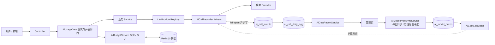

# AI 调用成本观测与控制 · 设计稿

> 状态：v1 备份（已被第二版替换）
> 日期：2026-11-03
> 调研依据：`docs/research/ai-cost-control-options.md`
> 核心决策：不采用「用户自配 Key」；继续使用「管理员池」；按「观测 / 控制 / 报表」三层做；P0 自建账本 + 统一埋点 + Redis 配额。
> 价格来源：模型单价由「系统每日自动同步」与「管理员手工管理」双轨提供；手工价优先，自动同步不覆盖手工价。

## 0. 决策摘要

- 用户继续使用平台统一配置的「管理员池」，不需要自己填 API Key；「用户自有配置」降级为未来可选能力。
- 观测层：新建 `ai_call_events` 明细账本，统一记录每次模型调用的用户、功能、模型、Token、耗时、状态与估算费用。
- 控制层：用 Redis 做调用前闸门（RPM / TPM / 并发）+ 按成本加权的用户预算（软上限 / 硬上限）；贵功能做预占与对账。
- 报表层：在现有后台加「AI 调用与成本」页，供管理员看总览、趋势、排行、用户用量、失败原因与明细。
- 费用：Token 用量按 `ai_model_prices` 价格表估算；与 Provider 真实账单的日/月对账放 P2。
- 埋点：统一挂在 `LlmProviderRegistry` 创建 ChatClient / EmbeddingModel 的位置，不在每个业务 Service 手写。
- 价格管理：内置一份 `classpath:prices/ai-model-prices.yml` 作为自动同步源，每日定时刷新 `AUTO` 价；管理员可新增 / 改价 / 手动立即同步，手工价 `MANUAL` 永远优先。

## 1. 使用示例（Quick Start）

管理员视角：

1. 登录后台，打开「AI 调用与成本」页。
2. 顶部看总调用次数、估算成本、失败率、P95 耗时。
3. 选「近 7 天」，看调用趋势和「哪个功能最贵」「哪个用户用得最多」。
4. 点开明细，按功能 / 模型 / 状态 / 用户筛选，定位某次失败的调用。
5. 切到「模型价格」页签，查看当前各模型的输入 / 输出单价、来源（自动 / 手工）与生效时间，手工改价或点「立即同步」。

用户视角：

1. 普通用户正常出题、导入试卷、问答。
2. 用户当天某功能的次数到达硬上限时，请求被拦，页面提示「今日额度已用尽，请明天再试」。
3. 到达软上限时，请求放行，但后台记一条告警，管理员可看到该用户接近上限。

## 2. 正文（业务逻辑）

### 2.1 观测：一次 AI 调用记一条账

- 目的：回答「谁、在哪个功能、用了哪个模型、多少 Token、多少钱、成功还是失败、快还是慢」。
- 触发：任何一次对模型 Provider 的实际调用（文字 / 识图 / Embedding）。
- 规则与步骤：
  1. 调用开始时生成一个 `request_id`，并带上发起用户、功能、操作、Provider、模型、模态。
  2. 调用结束拿到实际 Token 用量（输入 / 输出 / 缓存）与耗时。
  3. 按价格表算出估算费用，连同状态（成功 / Provider 错 / 超时 / 被限流 / 超预算）一起落一条账。
  4. 同一业务操作可能触发多次底层调用（重试、fallback、多次工具调用），每条都落账，并共用同一个 `operation_id` 便于对账。
- 结果：`ai_call_events` 有完整明细；任何报表都从这张表和它的日聚合表出。
- 边界与异常：账本写入失败不影响主业务（fail-open），只告警；失败请求也记一条账，因为失败也可能产生费用。
- 可改点：想改明细保留天数，改 `app.ai.cost.ledger.retention-days`。
- 实现简述：在 `LlmProviderRegistry` 创建的 ChatClient 上挂一个统一 Advisor，从 `ChatResponse` 的 metadata 读 usage，异步写 `ai_call_events`；EmbeddingModel 用包装器同理记录。业务侧通过上下文把 `feature / operation / user_id` 传给记录器。

### 2.2 观测：统一埋点入口

- 目的：避免在每个 Service 手写埋点、避免漏掉直接调用 ChatClient 的路径。
- 触发：所有经 `LlmProviderRegistry` 取得的模型客户端发起的调用。
- 规则与步骤：只在这一处统一挂记录器；业务代码不改调用方式，只声明「这是哪个功能、哪个操作」。
- 结果：新接入一个功能时，只要标了功能名，自动进账本。
- 边界与异常：Spring AI 的 Advisor 若拿不到 usage，则退化为统一调用器包装；`feature / operation` 必须是受控枚举，禁止用动态字符串。
- 可改点：想加新功能，只在 `AiFeature` 枚举加值。
- 实现简述：`AiCallRecorder` 实现 Spring AI 的 `CallAdvisor`（非流式），`aroundCall` 里先记开始时间，调用后从 `ChatResponse.getMetadata().getUsage()` 取 Token，再异步落账。P0 只覆盖非流式 Chat 与 Embedding。

### 2.3 控制：调用前闸门

- 目的：防止单个用户瞬间打爆 Provider（防突发）。
- 触发：每次模型调用前。
- 规则与步骤：
  1. 检查该用户在该功能上的每分钟请求数（RPM）、每分钟 Token 数（TPM）与并发数。
  2. 三项都通过才放行；任一项超限则拒绝，并记一条 `RATE_LIMITED` 账。
- 结果：请求要么放行、要么立即被拒，不会排队堆积。
- 边界与异常：Redis 不可用时按失败关闭（拒绝并告警），不放行；多实例共享同一 Redis 计数。
- 可改点：想改默认 RPM / TPM / 并发，改 `app.ai.budget.default` 与 `app.ai.budget.features.*`。
- 实现简述：`AiUsageGate.tryAcquire(...)` 用 Redis Lua 原子检查并扣减三个计数器（复用 `RateLimitAspect` 的 Lua 模式）；超限抛 `AiRateLimitExceededException`。

### 2.4 控制：用户预算（软上限 / 硬上限）

- 目的：限制单个用户在某时间窗（日 / 月）内的**花费**，而不是简单限制次数。导入 1 页和导入 50 页消耗不同，按成本算才公平。
- 触发：开始一个业务操作前（不是每次底层模型调用）。
- 规则与步骤：
  1. 先估算这次操作要花多少钱：导入按页数、出题按题数、问答按上下文长度。估算不到时用最近 7 天该用户该功能的平均成本，再兜底用配置的默认单次成本。
  2. 读该用户在该功能上的日 / 月已用金额与配额（默认值 + 单用户覆盖）。
  3. 预计会超过软上限：照常放行，但后台记一条「接近上限」告警。
  4. 预计会超过硬上限：拒绝这次操作，返回「今日额度不足」并给出剩余额度。
  5. 操作结束后用真实 Token 结算金额，多退少补。
- 结果：用户看到的是「还能导入几次」，这个次数按成本折算，不是固定次数。
- 边界与异常：估算只是预判，真实花费以结算为准；一次操作内部的多页 / 多次调用共享同一笔预算，不重复扣。管理员可对单用户放宽或加严。
- 可改点：想改默认日 / 月金额，改 `app.ai.cost.budget.*`；想给某用户单独调，改 `ai_user_budget_override`；想改估算参数，改 `app.ai.cost.estimator.*`。
- 实现简述：`AiCostEstimator` 先给 `estimatedUsd`；`AiBudgetService.reserve(...)` 用 Redis Lua 原子检查「已用 + 已预占 + 本次估算 ≤ 硬上限」，通过后写预占；操作结束 `settle(operationId, actualUsd)` 用真实金额替换预占，失败 `release(...)` 退回。日 / 月窗口都按金额计。

### 2.5 控制：贵功能预占与对账

- 目的：一次操作可能包含很多次模型调用（如整卷识图），开始前先占住一笔额度，避免执行到一半才发现超额。
- 触发：`reserve=true` 的功能（P0：试卷导入 / 识图、整卷出题、作答批改）。
- 规则与步骤：
  1. 按估算金额预占。
  2. 操作内每次模型调用照常记账，但不重复扣预算。
  3. 操作结束按真实金额结算；成功、失败、超时都结算或释放。
- 结果：并发下也不会明显超过硬上限。
- 边界与异常：预占失败直接拒绝整次操作；只完成一部分时按已发生的真实成本结算，不把剩余预占算进花费。
- 可改点：想扩大预占范围，在功能配置里给该功能开 `reserve=true`。
- 实现简述：`ai_usage_operations` 记录 `operation_id / estimated_cost / actual_cost / status`；`reserve → settle / release` 三态；Redis 里同时维护 `used` 与 `reserved` 两个计数，预占和结算都在 Lua 里原子完成。

### 2.6 费用：估算价与真实账单

- 目的：给每次调用一个「大概多少钱」，并保证价格可追溯、可改价。
- 触发：每次调用结算费用时。
- 规则与步骤：
  1. 按 provider + model + 模态，从 `ai_model_prices` 取输入 / 输出 / 缓存单价（每百万 Token）。
  2. 费用 = 输入单价 × 输入 Token + 输出单价 × 输出 Token + 缓存单价 × 缓存 Token。
  3. 记录价格版本，改价只影响新调用。
- 结果：报表能给出估算成本；价格有版本可查。
- 边界与异常：查不到价格时 `estimated_cost` 记空并标 `estimated=true`；这是内部估算，不等于 Provider 账单。
- 可改点：想改单价，更新 `ai_model_prices` 新增一条带生效时间的记录。
- 实现简述：`AiCostCalculator.estimate(provider, model, modality, usage)` 查当前生效价格，返回金额与 `price_version`。

### 2.10 价格：自动同步与手工管理

- 目的：让「每次调用估算多少钱」的单价有来源、可追溯、可修改，避免价格表长期失准。
- 触发：每日定时任务，或管理员在后台点「立即同步」/ 手工改价。
- 规则与步骤：
  1. 系统内置 `classpath:prices/ai-model-prices.yml` 维护常见模型的默认单价；若配置了 `app.ai.cost.prices.sync-url`，优先从该地址拉取 JSON。
  2. 同步时只处理 `source=AUTO` 的行：先看是否存在「同 provider + model + modality 且来源为 MANUAL」的生效行，有则跳过；否则结束旧 `AUTO` 行（写 `effective_to`），插入新 `AUTO` 行。
  3. 管理员手工改价 = 插入一条 `MANUAL` 生效行（旧的同 key 行 `effective_to` 置为当前时间）；删除手工价 = 恢复该 key 的 `AUTO` 价。
  4. 费用计算始终取「当前时间落在 effective_from / effective_to 之间」的最新一条；同 key 多条时 `MANUAL` 优先于 `AUTO`。
- 结果：单价可追踪到「谁 / 何时 / 自动还是手工」；改价只影响新调用，历史账单金额不重算。
- 边界与异常：拉取外部价格失败时保持上次生效价并告警，不因同步失败而中断系统；内置清单缺失的模型查不到价时按 2.6 的 `estimated=true` 处理。
- 可改点：想改默认单价来源，改 `app.ai.cost.prices.sync-url` 或内置 YAML；想调整同步时间，改 `app.ai.cost.prices.sync-cron`。
- 实现简述：`AiModelPriceSyncService.syncNow()` 拉取/读取源 → 与库内 `MANUAL` 行求差 → 批量结束旧 `AUTO` 行、插入新 `AUTO` 行；`AiModelPriceAdminService` 提供手工 CRUD，复用同一套「生效区间」语义。

### 2.7 报表：管理页

- 目的：让管理员一眼看到钱花在哪、谁在花、有没有异常。
- 触发：管理员打开「AI 调用与成本」页。
- 规则与步骤：页面分四块——总览卡片、趋势、排行（功能 / Provider / 模型 / 用户）、明细表；支持时间、功能、模型、状态、用户筛选。
- 结果：管理员能回答「这个月哪个功能最贵」「哪个用户超了」「失败集中在哪」。
- 边界与异常：默认只显示最近 N 天的聚合数据；明细查询走日聚合表优先，避免每次全表扫。
- 可改点：想加新排行维度，扩展报表接口的 `dimension` 枚举。
- 实现简述：`AiCostReportService` 提供 summary / trend / ranking / users / errors / events 六个查询，优先读 `ai_call_daily_agg`，近实时窗口回退 `ai_call_events`。

### 2.8 异步任务归因

- 目的：把「谁发起的」带到异步 worker，账本才能归到正确用户。
- 触发：任务入队时。
- 规则与步骤：入队时把发起用户 ID 写进任务实体 / Stream payload；worker 消费时直接读该字段，不依赖请求线程上下文。系统定时任务用 `SYSTEM` 身份。
- 结果：异步产生的调用也能归到用户。
- 边界与异常：历史任务没有该字段时按 `SYSTEM` 处理；不猜用户。
- 可改点：新增异步任务类型时，强制要求 payload 带 `owner_id`。
- 实现简述：在现有 `AbstractStreamProducer` / `AbstractStreamConsumer` 的 payload DTO 增加 `owner_id` 字段并透传。

### 2.9 用户侧：还能导入几次

- 目的：让用户在操作前就知道「今天还能不能做」，而不是做到一半被拦。
- 触发：用户选中文件 / 打开出题弹窗 / 打开问答页时。
- 规则与步骤：
  1. 前端把页数、题数或上下文规模传给后端。
  2. 后端返回：本次预估金额、剩余金额、按本次预估还能做几次。
  3. 前端默认只显示「按当前文件，今天还能导入约 N 次」；剩余不足时禁用提交并说明原因。金额仅管理员报表展示。
- 结果：用户提前知道额度，不会白等。
- 边界与异常：没选文件时用最近 7 天平均成本估算，文案写「约」；次数只是预估，实际以结算为准。
- 可改点：想改「约几次」的取整方式，改 `AiUsageEstimateService` 的向下取整规则。
- 实现简述：`AiUsageEstimateService.estimate(feature, userId, request)` 复用 `AiCostEstimator` 与 Redis 剩余额度；Controller 暴露 `GET /api/ai-usage/estimate`。

## 3. 概念设计图

### 3.1 系统结构



### 3.2 管理页线框

```text
┌────────────────────────────────────────────────────────────────────┐
│ AI 调用与成本                        时间范围 [近 7 天 ▾] [刷新]    │
├──────────────────┬──────────────────┬──────────────────┬──────────┤
│ 总调用 12,340    │ 估算成本 $4.21   │ 失败率 2.3%      │ P95 3.8s │
│ 输入 8.2M Token  │ 输出 1.1M Token  │ 超预算 17 次     │          │
├──────────────────┴──────────────────┴──────────────────┴──────────┤
│ 调用趋势（折线图：调用数 / 成本 / 失败率）                          │
├───────────────────────────────┬────────────────────────────────────┤
│ 功能成本排行                  │ Provider / Model 排行              │
│  出题        $1.80            │  dashscope/qwen  $2.60             │
│  试卷识图    $1.40            │  openai/gpt      $1.61             │
│  知识库问答  $0.90            │                                    │
├───────────────────────────────┴────────────────────────────────────┤
│ 用户用量 Top                                                       │
│  user_id | 调用数 | Token | 估算成本 | 预算使用率 | 成功率 | 趋势      │
├────────────────────────────────────────────────────────────────────┤
│ 失败原因分布：[Provider 超时 40%] [无效输出 25%] [被限流 15%] ...   │
├────────────────────────────────────────────────────────────────────┤
│ 调用明细  筛选：[功能 ▾][模型 ▾][状态 ▾][用户 ▾]                   │
│  时间 | 用户 | 功能 | 模型 | Token | 成本 | 状态 | 耗时             │
└────────────────────────────────────────────────────────────────────┘
```

### 3.3 用户被拦提示

```text
┌───────────────────────────────────────┐
│ 今日 AI 额度已用尽                     │
│ 你今天的「出题」次数已达上限。          │
│ 请明天再试，或联系管理员提升额度。       │
└───────────────────────────────────────┘
```

### 3.4 用户侧「还能导入几次」

```text
┌──────────────────────────────────────────────┐
│ 上传试卷                                      │
│ 已选：高三数学.pdf（12 页）                    │
│ 按当前文件，今天还能导入约 4 次                 │
│ [开始导入]                                     │
└──────────────────────────────────────────────┘
```

## 4. 附录（实现，P0）

### 4.1 数据模型（DDL）

迁移文件建议：`app/src/main/resources/db/migration/V20261103__ai_cost_observability.sql`

```sql
CREATE TABLE ai_call_events (
  id                BIGSERIAL PRIMARY KEY,
  request_id        VARCHAR(64)  NOT NULL,
  trace_id          VARCHAR(64),
  operation_id      VARCHAR(64)  NOT NULL,
  tenant_id         VARCHAR(64)  NOT NULL DEFAULT 'default',
  user_id           BIGINT,
  feature           VARCHAR(32)  NOT NULL,
  operation         VARCHAR(32)  NOT NULL,
  source            VARCHAR(16)  NOT NULL DEFAULT 'SYNC',
  provider          VARCHAR(64)  NOT NULL,
  model             VARCHAR(128) NOT NULL,
  modality          VARCHAR(16)  NOT NULL,
  status            VARCHAR(24)  NOT NULL,
  error_class       VARCHAR(64),
  retry_index       INT          NOT NULL DEFAULT 0,
  latency_ms        BIGINT,
  queue_wait_ms     BIGINT,
  input_tokens      BIGINT,
  output_tokens     BIGINT,
  cached_tokens     BIGINT,
  image_count       INT,
  char_count        BIGINT,
  audio_seconds     NUMERIC(12,3),
  estimated_cost    NUMERIC(18,6),
  currency          VARCHAR(3)   NOT NULL DEFAULT 'USD',
  price_version     VARCHAR(32),
  estimated         BOOLEAN      NOT NULL DEFAULT TRUE,
  occurred_at       TIMESTAMPTZ  NOT NULL,
  created_at        TIMESTAMPTZ  NOT NULL DEFAULT now()
);

CREATE INDEX idx_ai_call_occurred ON ai_call_events (occurred_at);
CREATE INDEX idx_ai_call_user      ON ai_call_events (user_id, occurred_at);
CREATE INDEX idx_ai_call_feature   ON ai_call_events (feature, occurred_at);
CREATE INDEX idx_ai_call_provider  ON ai_call_events (provider, occurred_at);
CREATE INDEX idx_ai_call_op        ON ai_call_events (operation_id);

CREATE TABLE ai_model_prices (
  id                    BIGSERIAL PRIMARY KEY,
  provider              VARCHAR(64)  NOT NULL,
  model                 VARCHAR(128) NOT NULL,
  modality              VARCHAR(16)  NOT NULL,
  input_price_per_1m    NUMERIC(18,6),
  output_price_per_1m   NUMERIC(18,6),
  cached_price_per_1m   NUMERIC(18,6),
  unit                  VARCHAR(8)   NOT NULL DEFAULT 'TOKEN',
  currency              VARCHAR(3)   NOT NULL DEFAULT 'USD',
  source                VARCHAR(8)   NOT NULL DEFAULT 'AUTO',
  effective_from        TIMESTAMPTZ  NOT NULL,
  effective_to          TIMESTAMPTZ,
  created_at            TIMESTAMPTZ  NOT NULL DEFAULT now(),
  updated_at            TIMESTAMPTZ  NOT NULL DEFAULT now()
);

CREATE INDEX idx_ai_model_prices_lookup
  ON ai_model_prices (provider, model, modality, effective_from);

CREATE TABLE ai_usage_operations (
  operation_id    VARCHAR(64) PRIMARY KEY,
  request_id      VARCHAR(64),
  trace_id        VARCHAR(64),
  tenant_id       VARCHAR(64) NOT NULL DEFAULT 'default',
  user_id         BIGINT,
  feature         VARCHAR(32) NOT NULL,
  source          VARCHAR(16) NOT NULL DEFAULT 'SYNC',
  status          VARCHAR(16) NOT NULL,
  estimated_cost  NUMERIC(18,6) NOT NULL,
  actual_cost     NUMERIC(18,6),
  currency        VARCHAR(3) NOT NULL DEFAULT 'USD',
  started_at      TIMESTAMPTZ NOT NULL,
  settled_at      TIMESTAMPTZ
);

CREATE INDEX idx_ai_usage_op_user ON ai_usage_operations (user_id, started_at);
CREATE INDEX idx_ai_usage_op_feature ON ai_usage_operations (feature, started_at);

CREATE TABLE ai_user_budget_override (
  id          BIGSERIAL PRIMARY KEY,
  user_id     BIGINT      NOT NULL,
  feature     VARCHAR(32),
  period      VARCHAR(8)  NOT NULL,
  limit_type  VARCHAR(8)  NOT NULL DEFAULT 'COST',
  soft_limit  NUMERIC(18,6),
  hard_limit  NUMERIC(18,6) NOT NULL,
  effective_from TIMESTAMPTZ NOT NULL,
  effective_to   TIMESTAMPTZ
);

CREATE TABLE ai_call_daily_agg (
  agg_date      DATE         NOT NULL,
  tenant_id     VARCHAR(64)  NOT NULL,
  user_id       BIGINT       NOT NULL,
  feature       VARCHAR(32)  NOT NULL,
  provider      VARCHAR(64)  NOT NULL,
  model         VARCHAR(128) NOT NULL,
  call_count    BIGINT       NOT NULL,
  success_count BIGINT       NOT NULL,
  input_tokens  BIGINT       NOT NULL,
  output_tokens BIGINT       NOT NULL,
  operation_count BIGINT     NOT NULL,
  estimated_cost NUMERIC(18,6) NOT NULL,
  PRIMARY KEY (agg_date, tenant_id, user_id, feature, provider, model)
);
```

### 4.2 配置键

`app.ai.cost`（`@ConfigurationProperties`，默认值待确认）：

```yaml
app:
  ai:
    cost:
      enabled: true
      ledger:
        async: true
        retention-days: 90
      budget:
        default:
          rpm: 10
          tpm: 200000
          concurrency: 4
          day-soft-usd: 0.20
          day-hard-usd: 0.50
          month-hard-usd: 8.00
        features:
          PAPER_RECOGNIZE:
            concurrency: 2
            reserve: true
            day-soft-usd: 0.10
            day-hard-usd: 0.30
            month-hard-usd: 5.00
          QUIZ_GENERATE:
            rpm: 5
            reserve: true
            day-soft-usd: 0.10
            day-hard-usd: 0.30
          KB_QA:
            day-soft-usd: 0.10
            day-hard-usd: 0.30
      estimator:
        default-operation-usd: 0.01
        paper-tokens-per-page: 2000
        quiz-tokens-per-question: 1200
        qa-context-tokens: 4000
      prices:
        sync-url: ${APP_AI_COST_PRICE_SYNC_URL:}
        sync-cron: ${APP_AI_COST_PRICE_SYNC_CRON:0 20 4 * * ?}
```

### 4.3 埋点入口

- 枚举：`AiFeature`（`QUIZ_GENERATE / PAPER_IMPORT / PAPER_RECOGNIZE / KB_QA / KB_VECTORIZE / ANSWER_EVALUATE`，新增功能在此加值）。
- 注解：`@AiCost(feature = AiFeature.X, operation = "generate")`，挂在 Controller 或 Service 方法上，由切面把 `feature / operation` 写入调用上下文。
- 上下文：`AiCallContextHolder`（ThreadLocal + 支持异步传播），携带 `user_id / feature / operation / request_id / operation_id`。
- 记录器：`AiCallRecorder implements CallAdvisor`；`aroundCall` 读 `AiCallContextHolder`，调用后取 `ChatResponse.getMetadata().getUsage()`，组装 `AiCallEvent` 异步写入 `ai_call_events`（fail-open）。Embedding 用 `EmbeddingModel` 包装器同等处理。
- 挂载点：`LlmProviderRegistry` 在创建 ChatClient / EmbeddingModel 处统一追加该 Advisor / 包装器；业务代码不改调用方式。

### 4.4 闸门与预算

- `AiUsageGate.tryAcquire(feature, userId, estimateTokens)` → `boolean`。Redis Lua 原子检查 RPM / TPM / 并发三个计数器；超限抛 `AI_RATE_LIMIT_EXCEEDED(7005)`。
- `AiCostEstimator.estimate(AiCostEstimateRequest)` → `BigDecimal estimatedUsd`；按功能实现：
  - `PAPER_RECOGNIZE`：`pageCount × paper-tokens-per-page` 的视觉 Token 成本。
  - `QUIZ_GENERATE`：`questionCount × quiz-tokens-per-question` 的输入输出成本。
  - `KB_QA`：`qa-context-tokens + expectedOutputTokens` 的成本。
  - 其它功能：`default-operation-usd`，或最近 7 天该用户该功能平均值。
- `AiBudgetService.reserve(operationId, userId, feature, estimatedUsd)` → `BudgetDecision{PASS, SOFT_LIMIT, HARD_LIMIT}`。Redis Lua 原子检查「已用 + 已预占 + 本次估算 ≤ 硬上限」；通过后写 `used`/`reserved` 并落 `ai_usage_operations(RESERVED)`。
- `AiBudgetService.settle(operationId, actualUsd)`：把预占换成真实金额，多退少补，状态置 `SUCCEEDED`。
- `AiBudgetService.release(operationId)`：没有发生调用时全额退回，状态置 `RELEASED`。
- `AiUsageEstimateService.estimate(feature, userId, request)` → `EstimateResult{estimatedUsd, remainingUsd, estimatedRemainingOps}`；`estimatedRemainingOps = floor(remainingUsd / estimatedUsd)`。
- 新增错误码：`AI_BUDGET_EXCEEDED(7006, "今日 AI 额度已用尽")`。

### 4.5 报表接口

控制器 `AiCostAdminController`，前缀 `/api/admin/ai-cost`，权限 `ai:cost:view`：

- `GET /summary?from&to` → 总调用、成本、失败率、P95、超预算次数。
- `GET /trend?from&to&granularity=DAY` → 按天序列。
- `GET /ranking?from&to&dimension=FEATURE|PROVIDER|MODEL|USER` → 排行。
- `GET /users?from&to&page&size` → 用户用量表。
- `GET /errors?from&to` → 失败原因分布。
- `GET /events?from&to&feature&model&status&userId&page&size` → 明细。
- `GET /prices` → 当前各模型单价（含来源 / 生效时间）。
- `POST /prices` / `PUT /prices/{id}` / `DELETE /prices/{id}` → 手工新增 / 改价 / 删除手工价。
- `POST /prices/sync` → 立即执行一次价格同步。

服务 `AiCostReportService`：优先查 `ai_call_daily_agg`，近实时窗口回退 `ai_call_events`。日聚合由定时任务按 `occurred_at` 前一天增量回填。

用户侧 `UserAiUsageController`，前缀 `/api/ai-usage`，登录即可访问（只返回本人数据）：

- `GET /summary` → 各功能日 / 月已用、剩余、软硬上限、按平均成本估算的剩余次数。
- `GET /estimate?feature&pageCount&charCount&questionCount&contextTokens` → `estimatedUsd / remainingUsd / estimatedRemainingOps`。前端只展示 `estimatedRemainingOps`。

### 4.6 费用计算

- `AiCostCalculator.estimate(provider, model, modality, usage)` → `CostResult{amount, currency, priceVersion, estimated}`。
- 金额 = `input_tokens/1e6 * input_price_per_1m + output_tokens/1e6 * output_price_per_1m + cached_tokens/1e6 * cached_price_per_1m`。
- 查不到生效价格时 `amount=null, estimated=true`。
- 预算统一用金额（默认 USD）计；用户端只显示「约 N 次」，不直接暴露单价。

### 4.7 权限

- `PermissionCode` 新增 `AI_COST_VIEW("ai:cost:view", "AI 调用与成本")`，加入 `ADMIN` 角色的权限集合。
- 后台路由常量新增 `/admin/ai-cost`；前端页面放 `frontend/src/pages/admin/`。

### 4.8 分期验收

- P0：账本 + 埋点 + 频次闸门 + **成本加权预算与预占** + 报表页 + 用户侧「约 N 次」。验收：任意「用户 × 功能 × 模型 × 日期」可答出调用量、Token、估算费用、成功率、P95；用户超预算时按成本折算拦截。
- P0 价格：内置价目表 + 每日自动同步 + 管理员手工改价 + 手工价优先；验收：改价后新调用按新价估算、旧账单不重算、同步失败不影响主链路。
- P1：provider prompt caching、cheap-first 路由、失败与 fallback 成本分析。
- P2：价格历史与日/月对账、provider 变多后评估 LiteLLM。
- P3：Langfuse 做 trace / 评估；未来账单模块。

## 5. 待确认默认值

- 价格以「每百万 Token 的 USD」计，内置 `AUTO` 初始价（示意，上线前按厂商官网校准）：`dashscope/qwen3.5-122b-a10b` 输入 0.40 / 输出 1.20；`dashscope-vl/qwen3.8-flash` 输入 1.50 / 输出 5.00；`dashscope/text-embedding-v3` 输入 0.05；`deepseek/deepseek-v4-flash` 输入 0.14 / 输出 0.28；`glm/glm-5` 输入 0.28 / 输出 0.84。
- 预算默认（示意，按真实单价校准）：`default.rpm=10 / tpm=200000 / concurrency=4`，`day-soft-usd=0.20 / day-hard-usd=0.50 / month-hard-usd=8.00`；`PAPER_RECOGNIZE.concurrency=2 / reserve=true / day-hard-usd=0.30`；`QUIZ_GENERATE.rpm=5 / reserve=true / day-hard-usd=0.30`；`KB_QA.day-hard-usd=0.30`。
- 估算参数：`paper-tokens-per-page=2000`、`quiz-tokens-per-question=1200`、`qa-context-tokens=4000`、`default-operation-usd=0.01`。
- 首批纳入预算的功能清单（`AiFeature`）：`QUIZ_GENERATE / PAPER_RECOGNIZE / KB_QA / KB_VECTORIZE / ANSWER_EVALUATE / PAPER_IMPORT`。
- `ai_call_events` 明细保留 90 天（已确认）；日聚合表是否只保留最近一年待定。
