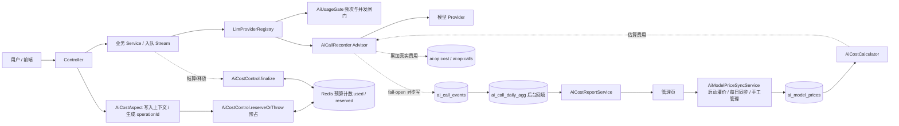
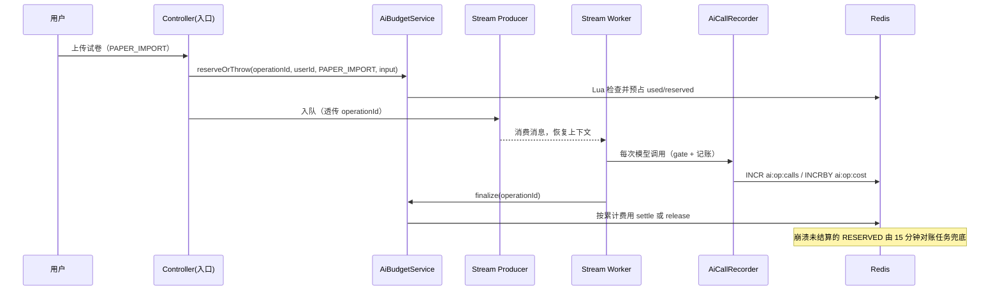

# AI 调用成本观测与控制 · 设计稿（第二版）

> 状态：设计修订中（第二版），待审核；审核通过后重新实现
> 日期：2026-11-03
> 调研依据：`docs/research/ai-cost-control-options.md`
> 版本说明：本版修正章节编号、补齐附录（零猜测）、明确异步归因与预占结算链路、启动灌价、预占对账、账本保留清理，并列出与当前已存在代码的偏差清单。
> 核心决策：不采用「用户自配 Key」；继续使用「管理员池」；按「观测 / 控制 / 报表」三层做；P0 自建账本 + 统一埋点 + Redis 配额。
> 价格来源：模型单价由「系统每日自动同步」与「管理员手工管理」双轨提供；手工价优先，自动同步不覆盖手工价。

## 0. 决策摘要

- 用户继续使用平台统一配置的「管理员池」，不需要自己填 API Key；「用户自有配置」降级为未来可选能力。
- 观测层：新建 `ai_call_events` 明细账本，统一记录每次模型调用的用户、功能、模型、Token、耗时、状态与估算费用。
- 控制层：用 Redis 做调用前闸门（RPM / TPM / 并发）+ 按成本加权的用户预算（软上限 / 硬上限）；贵功能做预占与对账。
- 报表层：在现有后台加「AI 调用与成本」页，供管理员看总览、趋势、排行、用户用量、失败原因与明细。
- 费用：Token 用量按 `ai_model_prices` 价格表估算；与 Provider 真实账单的日/月对账放 P2。
- 埋点：统一挂在 `LlmProviderRegistry` 创建 ChatClient / EmbeddingModel 的位置，不在每个业务 Service 手写。
- 价格管理：内置 `classpath:prices/ai-model-prices.yml` 作为兜底同步源，每日定时刷新 `AUTO` 价；管理员可新增 / 改价 / 立即同步，手工价 `MANUAL` 永远优先。

本版需要用户拍板的十项决策（D1–D10）详见 4.20：

- D1：P0 报表直接查 `ai_call_events`；`ai_call_daily_agg` 只后台回填，P1 再切换。
- D2：`AiFeature` 放 `common/ai`，`@AiCost.feature` 用枚举而非字符串。
- D3：异步归因走 `AbstractStreamProducer/Consumer` 的通用字段透传，不改每个 payload DTO。
- D4：启动时自动灌价（`seed-on-startup=true`）。
- D5：预占范围 = 试卷导入 / 识图 / 切题、出题、批改（详见 4.16 的四个入口）。
- D6：价格源 = 内置 YAML 兜底 + 可选远端 JSON。
- D7：只做 USD，不做汇率换算。
- D8：流式计量 P1；P0 只覆盖非流式 Chat + Embedding。
- D9：用户侧「约 N 次」P0 只接试卷上传。
- D10：默认价格 / 预算先用示意值，上线前校准。

## 1. 使用示例（Quick Start）

管理员视角：

1. 登录后台，打开「AI 调用与成本」页。
2. 顶部看总调用次数、估算成本、失败率、P95 耗时、超预算次数。
3. 选「近 7 / 30 / 90 天」，看成本趋势和「哪个功能最贵」「哪个用户用得最多」。
4. 点开明细，按功能 / 模型 / 状态 / 用户筛选，定位某次失败的调用。
5. 切到「模型价格」页签，查看当前各模型的输入 / 输出单价、来源（自动 / 手工）与生效时间，手工改价或点「立即同步」。

用户视角：

1. 普通用户正常出题、导入试卷、问答。
2. 用户当天某功能的成本到达硬上限时，请求被拦，页面提示「今日 AI 额度已用尽」。
3. 到达软上限时，请求放行，但后台记一条告警，管理员可看到该用户接近上限。
4. 上传试卷前，页面按当前文件提示「按当前文件，今天还能导入约 N 次」。

## 2. 正文（业务逻辑）

### 2.1 观测：一次 AI 调用记一条账

- 目的：回答「谁、在哪个功能、用了哪个模型、多少 Token、多少钱、成功还是失败、快还是慢」。
- 触发：任何一次对模型 Provider 的实际调用（文字 / 识图 / Embedding）。
- 规则与步骤：
  1. 调用开始前，由入口切面生成一个 `request_id` 和一个 `operation_id`，并带上发起用户、功能、操作、来源（同步 / 异步 / 系统）。
  2. 调用结束拿到实际 Token 用量（输入 / 输出 / 缓存）与耗时。
  3. 按价格表算出估算费用，连同状态（成功 / Provider 错 / 超时 / 被限流 / 超预算）一起落一条账。
  4. 同一业务操作可能触发多次底层调用（重试、fallback、多次工具调用），每条都落账，并共用同一个 `operation_id` 便于对账。
- 结果：`ai_call_events` 有完整明细；任何报表都从这张表出。
- 边界与异常：账本写入失败不影响主业务（fail-open），只告警；失败请求也记一条账，因为失败也可能产生费用。
- 可改点：想改明细保留天数，改 `app.ai.cost.ledger.retention-days`。
- 实现简述：在 `LlmProviderRegistry` 创建的 ChatClient 上统一追加 `AiCallRecorder` 这个 Advisor，`adviseCall` 里记开始时间，调用后从 `ChatResponse.getMetadata().getUsage()` 取 Token，异步写 `ai_call_events`；EmbeddingModel 用包装器同理记录。业务侧通过上下文把 `feature / operation / user_id / operation_id` 传给记录器。

### 2.2 观测：统一埋点入口

- 目的：避免在每个 Service 手写埋点、避免漏掉直接调用 ChatClient 的路径。
- 触发：所有经 `LlmProviderRegistry` 取得的模型客户端发起的调用。
- 规则与步骤：只在这一处统一挂记录器；业务代码不改调用方式，只声明「这是哪个功能、哪个操作」。
- 结果：新接入一个功能时，只要标了功能名，自动进账本。
- 边界与异常：Spring AI 的 Advisor 若拿不到 usage，则按「无 Token 数据」记一条 `estimated=true` 的账；`feature / operation` 必须用受控枚举，禁止用动态字符串。
- 可改点：想加新功能，只在 `AiFeature` 枚举加值。
- 实现简述：`AiCallRecorder` 实现 Spring AI 的 `CallAdvisor`（非流式），`adviseCall` 先记开始时间，调用后从 `ChatResponse.getMetadata().getUsage()` 取 Token，再异步落账。P0 只覆盖非流式 Chat 与 Embedding。

### 2.3 控制：调用前闸门

- 目的：防止单个用户瞬间打爆 Provider（防突发）。
- 触发：每次模型调用前。
- 规则与步骤：
  1. 检查该用户在该功能上的每分钟请求数（RPM）、每分钟 Token 数（TPM）与并发数。
  2. 管理员（`ROLE_ADMIN`）直接放行，不占用 RPM / TPM / 并发计数。
  3. 普通用户三项都通过才放行；任一项超限则拒绝，并记一条 `RATE_LIMITED` 账。
- 结果：普通用户的请求要么放行、要么立即被拒，不会排队堆积；管理员不受模型调用闸门限制。
- 边界与异常：Redis 不可用时按失败关闭（拒绝并告警），不放行；多实例共享同一 Redis 计数。
- 可改点：想改默认 RPM / TPM / 并发，改 `app.ai.cost.budget.default` 与 `app.ai.cost.budget.features.*`。
- 实现简述：`AiUsageGate.tryAcquire(...)` 用 Redis Lua 原子检查并扣减三个计数器；超限抛 `BusinessException(ErrorCode.AI_RATE_LIMIT_EXCEEDED, ...)`。

### 2.4 控制：用户预算（软上限 / 硬上限）

- 目的：限制单个用户在某时间窗（日 / 月）内的**花费**，而不是简单限制次数。导入 1 页和导入 50 页消耗不同，按成本算才公平。
- 触发：开始一个业务操作前（不是每次底层模型调用）。
- 规则与步骤：
  1. 先估算这次操作要花多少钱：导入按页数、出题按题数、问答按上下文长度。估算不到时用配置的默认单次成本。
  2. 读该用户在该功能上的日 / 月已用金额与配额（默认值 + 单用户覆盖）。
  3. 预计会超过软上限：照常放行，但后台记一条「接近上限」告警。
  4. 管理员直接放行，不做日 / 月硬上限检查；普通用户预计会超过硬上限时拒绝，返回「今日额度不足」并给出剩余额度。
  5. 操作结束后用真实 Token 结算金额，多退少补。
- 结果：用户看到的是「还能导入几次」，这个次数按成本折算，不是固定次数。
- 边界与异常：估算只是预判，真实花费以结算为准；一次操作内部的多页 / 多次调用共享同一笔预算，不重复扣。管理员可对单用户放宽或加严。
- 管理员边界：豁免只针对模型调用的 RPM / TPM / 并发与日 / 月成本硬上限；管理员调用仍写调用账本、创建操作记录并结算真实成本，接口级 `@RateLimit` 也不受影响。
- 可改点：想改默认日 / 月金额，改 `app.ai.cost.budget.*`；想给某用户单独调，改 `ai_user_budget_override`；想改估算参数，改 `app.ai.cost.estimator.*`。
- 实现简述：`AiCostEstimator` 先给 `estimatedUsd`；`AiBudgetService.reserve(...)` 用 Redis Lua 原子检查「已用 + 已预占 + 本次估算 ≤ 硬上限」，通过后写预占；操作结束 `finalize(operationId)` 按实际发生的调用结算或释放。日 / 月窗口都按金额计。

### 2.5 控制：贵功能预占与对账

- 目的：一次操作可能包含很多次模型调用（如整卷识图），开始前先占住一笔额度，避免执行到一半才发现超额。
- 触发：`reserve=true` 的功能（P0：试卷导入 / 识图、切题、出题、作答批改）。
- 规则与步骤：
  1. 按估算金额预占。
  2. 操作内每次模型调用照常记账，并把真实费用累加到该操作上，不重复扣预算。
  3. 操作结束按真实金额结算；成功、失败、超时都结算或释放。
  4. 操作异常挂起超过 2 小时，由后台对账任务按已发生的真实成本结算或释放。
- 结果：并发下也不会明显超过硬上限。
- 边界与异常：预占失败直接拒绝整次操作；只完成一部分时按已发生的真实成本结算，不把剩余预占算进花费。
- 可改点：想扩大预占范围，在功能配置里给该功能开 `reserve=true`。
- 实现简述：`ai_usage_operations` 记录 `operation_id / estimated_cost / actual_cost / status`；`reserve → settle / release` 三态；Redis 里同时维护 `used` 与 `reserved` 两个计数，预占和结算都在 Lua 里原子完成。真实费用在每次模型调用后累加到 `ai:op:cost:{operationId}`。

### 2.6 费用：估算价与真实账单

- 目的：给每次调用一个「大概多少钱」，并保证价格可追溯、可改价。
- 触发：每次调用结算费用时。
- 规则与步骤：
  1. 按 provider + model + 模态，从 `ai_model_prices` 取输入 / 输出 / 缓存单价（每百万 Token）。
  2. 费用 = 输入单价 × 输入 Token + 输出单价 × 输出 Token + 缓存单价 × 缓存 Token。
  3. 记录价格版本，改价只影响新调用。
- 结果：报表能给出估算成本；价格有版本可查。
- 边界与异常：查不到价格时 `estimated_cost` 记空并标 `estimated=true`；这是内部估算，不等于 Provider 账单。
- 可改点：想改单价，更新 `ai_model_prices` 新增一条带生效时间的记录。
- 实现简述：`AiCostCalculator.estimate(provider, model, modality, usage)` 查当前生效价格，返回金额与 `price_version`。

### 2.7 价格：自动同步与手工管理

- 目的：让「每次调用估算多少钱」的单价有来源、可追溯、可修改，避免价格表长期失准。
- 触发：启动时灌价、每日定时任务，或管理员在后台点「立即同步」/ 手工改价。
- 规则与步骤：
  1. 系统内置 `classpath:prices/ai-model-prices.yml` 维护常见模型的默认单价；若配置了 `app.ai.cost.prices.sync-url`，优先从该地址拉取 JSON，失败回退内置清单。
  2. 同步时只处理 `source=AUTO` 的行：先看是否存在「同 provider + model + modality 且来源为 MANUAL」的生效行，有则跳过；否则结束旧 `AUTO` 行（写 `effective_to`），插入新 `AUTO` 行。
  3. 管理员手工改价 = 插入一条 `MANUAL` 生效行（旧的同 key 行 `effective_to` 置为当前时间）；删除手工价 = 恢复该 key 的 `AUTO` 价。
  4. 费用计算始终取「当前时间落在 effective_from / effective_to 之间」的最新一条；同 key 多条时 `MANUAL` 优先于 `AUTO`。
- 结果：单价可追踪到「谁 / 何时 / 自动还是手工」；改价只影响新调用，历史账单金额不重算。
- 边界与异常：拉取外部价格失败时保持上次生效价并告警，不因同步失败而中断系统；内置清单缺失的模型查不到价时按 2.6 的 `estimated=true` 处理。
- 可改点：想改默认单价来源，改 `app.ai.cost.prices.sync-url` 或内置 YAML；想调整同步时间，改 `app.ai.cost.prices.sync-cron` 与 `sync-zone`。
- 实现简述：`AiModelPriceSyncService.syncNow()` 拉取/读取源 → 与库内 `MANUAL` 行求差 → 批量结束旧 `AUTO` 行、插入新 `AUTO` 行；`AiModelPriceAdminService` 提供手工 CRUD，复用同一套「生效区间」语义。

### 2.8 报表：管理页

- 目的：让管理员一眼看到钱花在哪、谁在花、有没有异常。
- 触发：管理员打开「AI 调用与成本」页。
- 规则与步骤：页面分四块——总览卡片、趋势、排行（功能 / Provider / 模型 / 用户）、明细表；支持时间、功能、模型、状态、用户筛选。
- 结果：管理员能回答「这个月哪个功能最贵」「哪个用户超了」「失败集中在哪」。
- 边界与异常：默认显示最近 7 天；明细查询 P0 直接走 `ai_call_events`，按 `occurred_at` 走索引；P1 再切换到日聚合表。
- 可改点：想加新排行维度，扩展报表接口的 `dimension` 枚举。
- 实现简述：`AiCostReportService` 提供 summary / trend / ranking / users / errors / events 六个查询，P0 全部直查 `ai_call_events`；`ai_call_daily_agg` 由定时任务回填，P1 再切换。

### 2.9 异步任务归因

- 目的：把「谁发起的」带到异步 worker，账本才能归到正确用户。
- 触发：任务入队时。
- 规则与步骤：入队时把发起用户 ID、功能、操作、`operation_id`、`request_id` 写进 Stream 通用字段；worker 消费时直接读这些字段并回填上下文，不依赖请求线程上下文。系统定时任务用 `SYSTEM` 身份。
- 结果：异步产生的调用也能归到用户，并且能按 `operation_id` 与入口预占对账。
- 边界与异常：历史任务没有这些字段时按 `SYSTEM` 处理；不猜用户。
- 可改点：新增异步任务类型时，强制要求 payload 走通用字段，不需要新增专用字段。
- 实现简述：在现有 `AbstractStreamProducer.attachCallContext` 与 `AbstractStreamConsumer.parseCallContext` 中透传 / 恢复 `ownerId / aiFeature / aiOperation / aiOperationId / aiRequestId` 五个字段。

### 2.10 用户侧：还能导入几次

- 目的：让用户在操作前就知道「今天还能不能做」，而不是做到一半被拦。
- 触发：用户选中文件时（P0 只接试卷上传）。
- 规则与步骤：
  1. 前端把页数（P0 用文件数近似）传给后端。
  2. 后端返回：本次预估金额、剩余金额、按本次预估还能做几次。
  3. 前端默认只显示「按当前文件，今天还能导入约 N 次」；剩余不足时提示联系管理员。金额仅管理员报表展示。
- 结果：用户提前知道额度，不会白等。
- 边界与异常：没选文件时不显示；次数只是预估，实际以结算为准。
- 可改点：想改「约几次」的取整方式，改 `AiUsageEstimateService` 的向下取整规则。
- 实现简述：`AiUsageEstimateService.estimate(feature, userId, request)` 复用 `AiCostEstimator` 与 Redis 剩余额度；Controller 暴露 `GET /api/ai-usage/estimate`。

## 3. 概念设计图

### 3.1 系统结构



### 3.2 预占与异步结算时序



### 3.3 管理页线框

```text
┌────────────────────────────────────────────────────────────────────┐
│ AI 调用与成本                        时间范围 [近 7 天 ▾] [刷新]    │
├──────────────────┬──────────────────┬──────────────────┬──────────┤
│ 总调用 12,340    │ 估算成本 $4.21   │ 失败率 2.3%      │ P95 3.8s │
│ 输入 8.2M Token  │ 输出 1.1M Token  │ 超预算 17 次     │          │
├──────────────────┴──────────────────┴──────────────────┴──────────┤
│ 调用趋势（折线图：调用数 / 成本 / 失败率）                          │
├───────────────────────────────┬────────────────────────────────────┤
│ 功能成本排行                  │ Provider / Model 排行              │
│  出题        $1.80            │  dashscope/qwen  $2.60             │
│  试卷识图    $1.40            │  openai/gpt      $1.61             │
│  知识库问答  $0.90            │                                    │
├───────────────────────────────┴────────────────────────────────────┤
│ 用户用量 Top                                                       │
│  user_id | 调用数 | Token | 估算成本 | 成功率                        │
├────────────────────────────────────────────────────────────────────┤
│ 失败原因分布：[Provider 超时 40%] [无效输出 25%] [被限流 15%] ...   │
├────────────────────────────────────────────────────────────────────┤
│ 调用明细  筛选：[功能 ▾][模型 ▾][状态 ▾][用户 ▾]                   │
│  时间 | 用户 | 功能 | 模型 | Token | 成本 | 状态 | 耗时             │
└────────────────────────────────────────────────────────────────────┘
```

### 3.4 用户被拦提示与「还能导入几次」

```text
┌───────────────────────────────────────┐
│ 今日 AI 额度已用尽                     │
│ 你今天的「出题」额度已达上限。          │
│ 请明天再试，或联系管理员提升额度。       │
└───────────────────────────────────────┘

┌──────────────────────────────────────────────┐
│ 上传试卷                                      │
│ 已选：高三数学.pdf（12 页）                    │
│ 按当前文件，今天还能导入约 4 次                 │
│ [开始导入]                                     │
└──────────────────────────────────────────────┘
```

## 4. 附录（实现，零猜测）

> 本附录自足：另一个模型只读本附录即可完整实现，无需追问、无需补决策。

### 4.1 模块与文件清单

| 包/路径 | 文件 | 职责 |
| --- | --- | --- |
| `common/ai` | `AiFeature` | 功能归属枚举（从 `modules/aicost` 迁移至此） |
| `common/ai` | `AiCost` | 业务入口注解，`feature` 用 `AiFeature` 枚举 |
| `common/ai` | `AiCostEstimateInput` | 估算入参 record（页数/题数/上下文/chunk/输出 Token） |
| `common/ai` | `AiCallContextHolder` | ThreadLocal 上下文（含 `AiCallContext` record） |
| `common/ai` | `AiCallMeter` | 计量插口（Chat Advisor + Embedding 包装），实现放 `modules/aicost` |
| `common/ai` | `AiCostControl` | 预占 / 结算控制插口，实现放 `modules/aicost` |
| `common/aspect` | `AiCostAspect` | 把 `@AiCost` 映射为上下文，生成 requestId/operationId |
| `common/async` | `AbstractStreamProducer` | 入队时透传归因字段 |
| `common/async` | `AbstractStreamConsumer` | 消费时恢复上下文、结束时 finalize |
| `common/constant` | `AsyncTaskStreamConstants` | 增加 `aiOperationId` / `aiRequestId` 常量 |
| `modules/aicost` | `AiCallSource` / `AiCallStatus` / `AiModality` / `PriceSource` / `AiOperationStatus` | 领域枚举 |
| `modules/aicost` | `AiCostProperties` | `@ConfigurationProperties` |
| `modules/aicost/model` | 四个 Entity | `ai_call_events` / `ai_model_prices` / `ai_usage_operations` / `ai_user_budget_override` |
| `modules/aicost/repository` | 四个 Repository | JPA 查询 |
| `modules/aicost/service` | 见 4.2 之后的各服务 | 业务与调度 |
| `modules/aicost/controller` | `AiCostAdminController` / `UserAiUsageController` | REST 入口 |
| `modules/aicost/dto` | `AiUsageDtos` | 所有请求/响应 record |
| `resources/scripts` | 5 个 Lua | 闸门 / 预占 / 结算 / 释放 |
| `resources/prices` | `ai-model-prices.yml` | 内置价目表 |
| `resources/db/migration` | `V20261103__ai_cost_observability.sql` | DDL |
| `frontend` | `src/api/aiCost.ts` / `src/pages/admin/AiCostPage.tsx` / `src/components/paper-recognition/PaperUploadGroup.tsx` | 前端 |

### 4.2 枚举、常量与状态

`common/ai/AiFeature`（新增功能在此加值）：

```java
public enum AiFeature {
  QUIZ_GENERATE, PAPER_IMPORT, PAPER_RECOGNIZE, PAPER_EXTRACTION,
  KB_QA, KB_VECTORIZE, KB_QUESTION_GEN, ANSWER_EVALUATE, VOICE_EVALUATE, UNKNOWN
}
```

`modules/aicost` 领域枚举：

- `AiCallSource { SYNC, ASYNC, SYSTEM }`
- `AiCallStatus { SUCCESS, PROVIDER_ERROR, TIMEOUT, RATE_LIMITED, BUDGET_EXCEEDED, PARSE_ERROR }`
- `AiModality { TEXT, VISION, EMBEDDING, AUDIO }`
- `PriceSource { AUTO, MANUAL }`
- `AiOperationStatus { RESERVED, SUCCEEDED, RELEASED }`（落库用 `name()`）

`AsyncTaskStreamConstants` 新增：

```java
public static final String FIELD_OWNER_ID = "ownerId";
public static final String FIELD_AI_FEATURE = "aiFeature";
public static final String FIELD_AI_OPERATION = "aiOperation";
public static final String FIELD_AI_OPERATION_ID = "aiOperationId";
public static final String FIELD_AI_REQUEST_ID = "aiRequestId";
```

错误码（`ErrorCode`，已存在，保持不动）：

- `AI_RATE_LIMIT_EXCEEDED(7005, "AI服务调用频率超限")`
- `AI_BUDGET_EXCEEDED(7006, "今日 AI 额度已用尽")`
- `AI_PRICE_CONFIG_INVALID(7007, "模型价格配置无效")`

### 4.3 最终 DDL

迁移文件：`app/src/main/resources/db/migration/V20261103__ai_cost_observability.sql`。内容与当前文件一致，仅补一条 `idx_ai_usage_op_status` 索引：

```sql
CREATE TABLE IF NOT EXISTS ai_call_events (
  id                BIGSERIAL PRIMARY KEY,
  request_id        VARCHAR(64)  NOT NULL,
  trace_id          VARCHAR(64),
  operation_id      VARCHAR(64)  NOT NULL,
  tenant_id         VARCHAR(64)  NOT NULL DEFAULT 'default',
  user_id           BIGINT,
  feature           VARCHAR(32)  NOT NULL,
  operation         VARCHAR(32)  NOT NULL,
  source            VARCHAR(16)  NOT NULL DEFAULT 'SYNC',
  provider          VARCHAR(64)  NOT NULL,
  model             VARCHAR(128) NOT NULL,
  modality          VARCHAR(16)  NOT NULL,
  status            VARCHAR(24)  NOT NULL,
  error_class       VARCHAR(64),
  retry_index       INT          NOT NULL DEFAULT 0,
  latency_ms        BIGINT,
  queue_wait_ms     BIGINT,
  input_tokens      BIGINT,
  output_tokens     BIGINT,
  cached_tokens     BIGINT,
  image_count       INT,
  char_count        BIGINT,
  audio_seconds     NUMERIC(12,3),
  estimated_cost    NUMERIC(18,6),
  currency          VARCHAR(3)   NOT NULL DEFAULT 'USD',
  price_version     VARCHAR(32),
  estimated         BOOLEAN      NOT NULL DEFAULT TRUE,
  occurred_at       TIMESTAMPTZ  NOT NULL,
  created_at        TIMESTAMPTZ  NOT NULL DEFAULT now()
);

CREATE INDEX IF NOT EXISTS idx_ai_call_occurred ON ai_call_events (occurred_at);
CREATE INDEX IF NOT EXISTS idx_ai_call_user      ON ai_call_events (user_id, occurred_at);
CREATE INDEX IF NOT EXISTS idx_ai_call_feature   ON ai_call_events (feature, occurred_at);
CREATE INDEX IF NOT EXISTS idx_ai_call_provider  ON ai_call_events (provider, occurred_at);
CREATE INDEX IF NOT EXISTS idx_ai_call_op        ON ai_call_events (operation_id);

CREATE TABLE IF NOT EXISTS ai_model_prices (
  id                    BIGSERIAL PRIMARY KEY,
  provider              VARCHAR(64)  NOT NULL,
  model                 VARCHAR(128) NOT NULL,
  modality              VARCHAR(16)  NOT NULL,
  input_price_per_1m    NUMERIC(18,6),
  output_price_per_1m   NUMERIC(18,6),
  cached_price_per_1m   NUMERIC(18,6),
  unit                  VARCHAR(8)   NOT NULL DEFAULT 'TOKEN',
  currency              VARCHAR(3)   NOT NULL DEFAULT 'USD',
  source                VARCHAR(8)   NOT NULL DEFAULT 'AUTO',
  effective_from        TIMESTAMPTZ  NOT NULL,
  effective_to          TIMESTAMPTZ,
  created_at            TIMESTAMPTZ  NOT NULL DEFAULT now(),
  updated_at            TIMESTAMPTZ  NOT NULL DEFAULT now()
);

CREATE INDEX IF NOT EXISTS idx_ai_model_prices_lookup
  ON ai_model_prices (provider, model, modality, effective_from);

CREATE TABLE IF NOT EXISTS ai_usage_operations (
  operation_id    VARCHAR(64) PRIMARY KEY,
  request_id      VARCHAR(64),
  trace_id        VARCHAR(64),
  tenant_id       VARCHAR(64) NOT NULL DEFAULT 'default',
  user_id         BIGINT,
  feature         VARCHAR(32) NOT NULL,
  source          VARCHAR(16) NOT NULL DEFAULT 'SYNC',
  status          VARCHAR(16) NOT NULL,
  estimated_cost  NUMERIC(18,6) NOT NULL,
  actual_cost     NUMERIC(18,6),
  currency        VARCHAR(3) NOT NULL DEFAULT 'USD',
  started_at      TIMESTAMPTZ NOT NULL,
  settled_at      TIMESTAMPTZ
);

CREATE INDEX IF NOT EXISTS idx_ai_usage_op_user ON ai_usage_operations (user_id, started_at);
CREATE INDEX IF NOT EXISTS idx_ai_usage_op_feature ON ai_usage_operations (feature, started_at);
CREATE INDEX IF NOT EXISTS idx_ai_usage_op_status ON ai_usage_operations (status, started_at);

CREATE TABLE IF NOT EXISTS ai_user_budget_override (
  id          BIGSERIAL PRIMARY KEY,
  user_id     BIGINT      NOT NULL,
  feature     VARCHAR(32),
  period      VARCHAR(8)  NOT NULL,
  limit_type  VARCHAR(8)  NOT NULL DEFAULT 'COST',
  soft_limit  NUMERIC(18,6),
  hard_limit  NUMERIC(18,6) NOT NULL,
  effective_from TIMESTAMPTZ NOT NULL,
  effective_to   TIMESTAMPTZ
);

CREATE INDEX IF NOT EXISTS idx_ai_budget_override_user
  ON ai_user_budget_override (user_id, effective_from);

CREATE TABLE IF NOT EXISTS ai_call_daily_agg (
  agg_date      DATE         NOT NULL,
  tenant_id     VARCHAR(64)  NOT NULL,
  user_id       BIGINT       NOT NULL,
  feature       VARCHAR(32)  NOT NULL,
  provider      VARCHAR(64)  NOT NULL,
  model         VARCHAR(128) NOT NULL,
  call_count    BIGINT       NOT NULL,
  success_count BIGINT       NOT NULL,
  input_tokens  BIGINT       NOT NULL,
  output_tokens BIGINT       NOT NULL,
  operation_count BIGINT     NOT NULL,
  estimated_cost NUMERIC(18,6) NOT NULL,
  PRIMARY KEY (agg_date, tenant_id, user_id, feature, provider, model)
);
```

### 4.4 配置键与默认值

`app.ai.cost`（`@ConfigurationProperties(prefix="app.ai.cost")`）：

```yaml
app:
  ai:
    cost:
      enabled: true
      ledger:
        async: true
        retention-days: 90
        queue-capacity: 10000
        flush-batch-size: 200
        cleanup-cron: "0 10 3 * * ?"
      budget:
        default:
          rpm: 10
          tpm: 200000
          concurrency: 4
          day-soft-usd: 0.20
          day-hard-usd: 0.50
          month-hard-usd: 8.00
        features:
          PAPER_IMPORT:
            reserve: true
            concurrency: 2
            day-soft-usd: 0.10
            day-hard-usd: 0.30
            month-hard-usd: 5.00
          PAPER_RECOGNIZE:
            concurrency: 2
            day-hard-usd: 0.30
          PAPER_EXTRACTION:
            reserve: true
            day-hard-usd: 0.30
          QUIZ_GENERATE:
            reserve: true
            rpm: 5
            day-soft-usd: 0.10
            day-hard-usd: 0.30
          ANSWER_EVALUATE:
            reserve: true
            day-hard-usd: 0.30
          KB_QA:
            day-soft-usd: 0.10
            day-hard-usd: 0.30
        reconciliation-cron: "0 */15 * * * ?"
        stale-reserved-hours: 2
      estimator:
        default-operation-usd: 0.01
        paper-tokens-per-page: 2000
        quiz-tokens-per-question: 1200
        qa-context-tokens: 4000
        qa-output-tokens: 800
        vectorize-tokens-per-chunk: 800
      prices:
        seed-on-startup: true
        sync-url: ${APP_AI_COST_PRICE_SYNC_URL:}
        sync-cron: "0 20 4 * * ?"
        sync-zone: Asia/Shanghai
```

对应 `AiCostProperties` 内嵌类与字段：

- `Ledger { async, retentionDays, queueCapacity, flushBatchSize, cleanupCron }`
- `Budget { Default defaultRules; Map<String, FeatureBudget> features; String reconciliationCron; int staleReservedHours }`
- `Default { int rpm; long tpm; int concurrency; BigDecimal daySoftUsd; dayHardUsd; monthHardUsd }`
- `FeatureBudget { Integer rpm; Long tpm; Integer concurrency; boolean reserve; BigDecimal daySoftUsd; dayHardUsd; monthHardUsd }`
- `Estimator { defaultOperationUsd, paperTokensPerPage, quizTokensPerQuestion, qaContextTokens, qaOutputTokens, vectorizeTokensPerChunk }`
- `Prices { seedOnStartup, syncUrl, syncCron, syncZone }`

注意：`@Scheduled(cron=...)` 的价格同步与对账任务必须写 `zone`：

```java
@Scheduled(cron = "${app.ai.cost.prices.sync-cron:0 20 4 * * ?}",
    zone = "${app.ai.cost.prices.sync-zone:Asia/Shanghai}")
```

### 4.5 上下文与注解

`common/ai/AiCost`：

```java
@Target(ElementType.METHOD)
@Retention(RetentionPolicy.RUNTIME)
public @interface AiCost {
  AiFeature feature();
  String operation() default "";
}
```

`common/ai/AiCostEstimateInput`：

```java
public record AiCostEstimateInput(
    Long pageCount, Long questionCount, Long contextTokens, Long chunkCount, Long outputTokens) {}
```

`common/ai/AiCallContextHolder`：

```java
public final class AiCallContextHolder {
  private static final ThreadLocal<AiCallContext> HOLDER = new ThreadLocal<>();
  public static void set(AiCallContext c) { HOLDER.set(c); }
  public static AiCallContext get() { return HOLDER.get(); }
  public static void clear() { HOLDER.remove(); }
  public static <T> T callWith(AiCallContext c, ThrowingSupplier<T> action) throws Throwable {
    AiCallContext prev = HOLDER.get();
    HOLDER.set(c);
    try { return action.get(); }
    finally {
      if (prev == null) { HOLDER.remove(); } else { HOLDER.set(prev); }
    }
  }
  @FunctionalInterface
  public interface ThrowingSupplier<T> { T get() throws Throwable; }

  public record AiCallContext(
      Long userId, AiFeature feature, String operation,
      String requestId, String operationId, String source) {}
}
```

`common/ai/AiCostControl`：

```java
public interface AiCostControl {
  void reserveOrThrow(String operationId, Long userId, AiFeature feature, AiCostEstimateInput input);
  void finalize(String operationId);
}
```

`common/aspect/AiCostAspect`：

- `@Around("@annotation(interview.guide.common.ai.AiCost)")`。
- 从注解取 `AiFeature feature` 与 `String operation`。
- `requestId = UUID.randomUUID().toString()`，`operationId = "op-" + UUID.randomUUID()`。
- `userId` 从 `RequestContextHolder` 的 `HttpServletRequest` 读属性 `userId`（由 `JwtAuthenticationFilter` 写入），取不到为 `null`（系统/匿名调用）。
- `source = "SYNC"`。
- 用 `AiCallContextHolder.callWith(context, () -> joinPoint.proceed())` 包裹，**原样抛出**异常（不包装 checked exception）。

### 4.6 计量记录器

`modules/aicost/service/AiCallRecorder implements AiCallMeter`：

- `chatAdvisor(String providerId, String model, String modality)`：返回 `CallAdvisor`，`getName()="ai-cost-recorder"`，`getOrder()=Ordered.LOWEST_PRECEDENCE - 10`。
  - 进入时 `AiCallContext context = AiCallContextHolder.get()`；`acquire(context)` 调 `AiUsageGate.tryAcquire(feature, userId, 1000)`；记 `start = System.nanoTime()`。
  - 成功：读 `chatResponse.getMetadata().getUsage()` 与 `getModel()`；`record(..., SUCCESS, null, start, usage, 0, 0)`。
  - 失败：`status = classify(e)`；`record(..., status, e.getClass().getSimpleName(), start, null, 0, 0)`；重新抛出原异常。
  - `finally`：`acquired` 时 `usageGate.release(feature, userId)`。
- `wrapEmbedding(EmbeddingModel delegate, providerId, model)`：包装 `call(EmbeddingRequest)`，字符数 = 所有 instructions 的 `String.length()` 之和；`Usage` 从 `response.getMetadata().getUsage()` 取；`modality = EMBEDDING`。
- `acquire(context)`：仅当 `properties.enabled` 且 `context != null` 且 `context.feature() != null` 且 `context.userId() != null` 时闸门；否则 `false`（系统/匿名只记账不限流）。返回值直接使用 `AiUsageGate.tryAcquire(...)`：普通用户放行返回 `true`（结束需释放并发槽），管理员豁免返回 `false`（不释放）。
- `classify(e)`：`BusinessException` 且 code == `AI_RATE_LIMIT_EXCEEDED` → `RATE_LIMITED`；`StructuredOutputInvoker.isTransportFailure(e)` → `TIMEOUT`；否则 `PROVIDER_ERROR`。
- `record(...)` 组装 `AiCallEventEntity`（字段见 DDL），`estimatedCost = cost.amount()`，`estimated = cost.estimated()`，`occurredAt = Instant.now()`，`tenantId="default"`，`retryIndex=0`；`charCount <= 0` 时置 `null`。
- **真实费用累计**：`record` 最后若 `context.operationId() != null`，调 `aiBudgetService.recordModelCall(operationId, costMicro(cost.amount()))`（见 4.9）。
- Token 兜底：`usage == null` 时 `inputTokens = estimateTokens(charCount)`（`charCount<=0` 用 1000，否则 `charCount/4`），`outputTokens=0`。

`modules/aicost/service/AiLedgerWriter`：

- 构造：`LinkedBlockingQueue<AiCallEventEntity>` 容量 = `max(100, ledger.queueCapacity)`。
- `record(event)`：`queue.offer` 失败则 `dropped` 计数 + 告警（fail-open，丢弃不阻塞）。
- 单写线程 `ai-ledger-writer`（daemon），每 500ms 轮询，凑到 `flushBatchSize` 或空闲时 `eventRepository.saveAll(batch)`；`@PreDestroy` 停线程并 flush 剩余批次。

### 4.7 账本写入与保留清理

- 写入：见 4.6 的 `AiLedgerWriter`，异步批量 `saveAll`，异常只告警。
- 保留清理：新增 `AiLedgerRetentionJob`：

```java
@Scheduled(cron = "${app.ai.cost.ledger.cleanup-cron:0 10 3 * * ?}",
    zone = "${app.ai.cost.prices.sync-zone:Asia/Shanghai}")
public void cleanup() {
  Instant cutoff = Instant.now().minus(Duration.ofDays(properties.getLedger().getRetentionDays()));
  jdbcTemplate.update("DELETE FROM ai_call_events WHERE occurred_at < ?", cutoff);
}
```

- 明细保留 90 天（已确认）；`ai_call_daily_agg` 保留策略上线后另定，当前不清理。
- 日聚合：`AiCallDailyAggregator` 每天 01:30 回填前一天（UTC），`INSERT ... ON CONFLICT ... DO UPDATE`（SQL 与当前文件一致）。

### 4.8 闸门 Lua 与 Java

`resources/scripts/ai_usage_gate.lua`（与当前一致）：

```lua
-- KEYS[1]=rpm, KEYS[2]=tpm, KEYS[3]=conc
-- ARGV[1]=rpmLimit, ARGV[2]=tpmLimit, ARGV[3]=concLimit, ARGV[4]=windowMs, ARGV[5]=estimateTokens
local rpm = tonumber(ARGV[1]); local tpm = tonumber(ARGV[2]); local conc = tonumber(ARGV[3])
local window = tonumber(ARGV[4]); local tokens = tonumber(ARGV[5])
local c = redis.call('INCR', KEYS[3])
if c == 1 then redis.call('PEXPIRE', KEYS[3], 3600000) end
if c > conc then redis.call('DECR', KEYS[3]); return -3 end
local r = redis.call('INCR', KEYS[1])
if r == 1 then redis.call('PEXPIRE', KEYS[1], window) end
if r > rpm then redis.call('DECR', KEYS[1]); redis.call('DECR', KEYS[3]); return -1 end
local t = redis.call('INCRBY', KEYS[2], tokens)
if t == tokens then redis.call('PEXPIRE', KEYS[2], window) end
if t > tpm then redis.call('DECRBY', KEYS[2], tokens); redis.call('DECR', KEYS[1]); redis.call('DECR', KEYS[3]); return -2 end
return 0
```

`resources/scripts/ai_usage_release.lua`：

```lua
-- KEYS[1]=conc
local c = redis.call('DECR', KEYS[1])
if c < 0 then redis.call('SET', KEYS[1], 0); return 0 end
return c
```

`AiUsageGate`：

- `tryAcquire(AiFeature feature, Long userId, long estimateTokens) -> boolean`：
  - 先通过 `AiAdminPolicy.isAdmin(userId)` 判断管理员；命中直接返回 `false`，不读写 Redis。
  - 从 `FeatureBudget` + `Default` 解析 rpm/tpm/concurrency（feature 键为枚举 `name()`）。
  - bucket = `userId == null ? "system" : userId.toString()`。
  - keys：`ai:gate:rpm:{bucket:feature}`、`ai:gate:tpm:{bucket:feature}`、`ai:gate:conc:{bucket:feature}`。
  - 普通用户 `evalSha` 返回 0 → 放行并返回 `true`；否则先 `releaseConcurrency` 再抛 `BusinessException(ErrorCode.AI_RATE_LIMIT_EXCEEDED, "AI 请求过于频繁，请稍后重试")`。
- `release(AiFeature feature, Long userId)`：`ai_usage_release.lua` 释放并发槽。
- `remainingRpmWindowMillisIfExhausted(...)`：管理员直接返回 0，不进入等待；普通用户仍按 Redis RPM 窗口返回剩余等待时间。
- `evalSha` 带 NOSCRIPT 重载逻辑（与当前一致）。

`AiAdminPolicy`：

- `isAdmin(Long userId)`：`userId == null` 返回 `false`（系统任务）；否则查 `users -> user_roles -> roles` 是否含 `ROLE_ADMIN`。
- 结果本地缓存 60 秒，避免异步切题 / 批改的每次模型调用都查库；角色调整后最多 60 秒生效。
- 查询异常按普通用户处理，原有保护不回退。

### 4.9 预算、预占、结算、释放

金额单位：Redis 内用 **micro-USD**（金额 × 1_000_000，`HALF_UP` 取整为 long）。DB 内用 `NUMERIC(18,6)` USD。

Redis key：

- 预算：`ai:budget:{period}:{bucket:feature}:{used|reserved}`，period ∈ `{day, month}`，bucket = `userId==null ? "system" : userId`。
- 操作真实费用：`ai:op:cost:{operationId}`（micro-USD 累计）、`ai:op:calls:{operationId}`（调用次数）。两者 TTL = `DAY_TTL_SECONDS`（2 天）。

`AiBudgetService implements AiCostControl`：

- `@PostConstruct init()`：加载 3 个 Lua 脚本（reserve/settle/release）到 `sha`。
- `BudgetDecision reserve(String operationId, Long userId, AiFeature feature, BigDecimal estimatedUsd)`：
  - 管理员：跳过 `resolveLimits` 与 Redis 预占，仍落 `ai_usage_operations(status=RESERVED)`，返回 `PASS`。
  - `resolveLimits` 取 day/month 配额。
  - 先 day 后 month 执行 `reservePeriod`；任一返回 -1（超硬上限）则回滚已成功的周期并返回 `HARD_LIMIT`。
  - 通过后落 `ai_usage_operations(status=RESERVED)`，返回 `SOFT_LIMIT`（任一周期超软上限）或 `PASS`。
- `void reserveOrThrow(String operationId, Long userId, AiFeature feature, AiCostEstimateInput input)`（接口实现）：
  - `estimatedUsd = estimator.estimate(feature, input)`。
  - `reserve(...) == HARD_LIMIT` 时抛 `AiBudgetExceededException("今日 AI 额度已用尽，剩余约 $" + remaining + "，请明天再试")`。
- `void finalize(String operationId)`（接口实现）：
  - 读 `ai_usage_operations` 行；不存在或 status != `RESERVED` → 直接返回（幂等）。
  - `calls = GET ai:op:calls:{op}`（缺省 0）、`costMicro = GET ai:op:cost:{op}`（缺省 0）。
  - `calls > 0` → 按 `costMicro` 结算：`settlePeriod` 日/月 + 行置 `SUCCEEDED/actualCost/settledAt`。
  - `calls == 0` → `releasePeriod` 日/月 + 行置 `RELEASED/settledAt`。
  - 最后 `DEL ai:op:calls:{op}`、`DEL ai:op:cost:{op}`。
- `void recordModelCall(String operationId, long costMicro)`：`INCR ai:op:calls:{op}`、`INCRBY ai:op:cost:{op} costMicro`，均 `EXPIRE 2 天`。
- `BigDecimal used(Long userId, AiFeature feature, String period)`：读 `used` key，micro → USD。
- `BudgetLimits resolveLimits(Long userId, AiFeature feature)`：默认值 ← `FeatureBudget`（按 `name()`） ← `ai_user_budget_override` 单用户覆盖（day/month，软/硬）。
- Lua 入参/返回：
  - `ai_budget_reserve.lua`：KEYS[1]=used, KEYS[2]=reserved；ARGV=estimateMicro, hardMicro, softMicro, ttl。返回 -1 超硬、1 超软、0 通过。
  - `ai_budget_settle.lua`：KEYS[1]=used, KEYS[2]=reserved；ARGV=estimatedMicro, actualMicro, ttl。撤销预占、按 actual 入账。
  - `ai_budget_release.lua`：KEYS[1]=reserved；ARGV=estimatedMicro, ttl。全额退回。
- `evalSha` NOSCRIPT 重载；Redis 异常向上抛（闸门按 fail-closed 处理，预算路径异常不吞）。

`AiUsageOperationReconciler`（预占对账任务，新增）：

```java
@Scheduled(cron = "${app.ai.cost.budget.reconciliation-cron:0 */15 * * * ?}",
    zone = "${app.ai.cost.prices.sync-zone:Asia/Shanghai}")
public void reconcile() {
  Instant cutoff = Instant.now().minus(Duration.ofHours(properties.getBudget().getStaleReservedHours()));
  for (AiUsageOperationEntity op : operationRepository.findByStatusAndStartedAtBefore(AiOperationStatus.RESERVED.name(), cutoff)) {
    try { budgetService.finalize(op.getOperationId()); }
    catch (Exception e) { log.warn("预占对账失败: operationId={}", op.getOperationId(), e); }
  }
}
```

Repository 新增查询：`AiUsageOperationRepository.findByStatusAndStartedAtBefore(String status, Instant cutoff)`。

### 4.10 估算公式

`AiCostCalculator.estimate(String provider, String model, String modality, long inputTokens, long outputTokens, long cachedTokens) -> CostResult{amount, currency, priceVersion, estimated}`：

- `provider` 或 `model` 为空 → `(null, "USD", null, true)`。
- `findCurrent(provider, model, modality, now, PageRequest.of(0,1))` 为空 → `(null, "USD", null, true)`。
- 否则 `amount = input/1e6*inputPrice + output/1e6*outputPrice + cached/1e6*cachedPrice`；`priceVersion = "v" + row.id`；`estimated=false`。

`AiCostEstimator.estimate(AiFeature feature, AiCostEstimateInput input) -> BigDecimal`：

- 输入 Token（`Math.max(1, ...)`）：
  - `PAPER_IMPORT / PAPER_RECOGNIZE / PAPER_EXTRACTION` → `pageCount * paperTokensPerPage`。
  - `QUIZ_GENERATE / KB_QUESTION_GEN` → `questionCount * quizTokensPerQuestion`。
  - `KB_QA` → `contextTokens>0 ? contextTokens : qaContextTokens`。
  - `KB_VECTORIZE` → `chunkCount * vectorizeTokensPerChunk`。
  - 其它 → 2000。
- 输出 Token：
  - `KB_QA` → `outputTokens>0 ? outputTokens : qaOutputTokens`。
  - `PAPER_*` → 输入 Token / 4。
  - `QUIZ_GENERATE / KB_QUESTION_GEN` → `questionCount * 200`。
  - 其它 → 500。
- 解析当前 provider/model/modality（`PAPER_*` → 识图默认；`KB_VECTORIZE` → embedding 默认；其它 → chat 默认），调 `AiCostCalculator.estimate`；有价且非 estimated → 返回金额；否则返回 `defaultOperationUsd`。

### 4.11 价格同步与手工管理

`AiModelPriceSource.load() -> List<PriceSeed>`：

- `syncUrl` 非空：`RestClient` GET JSON `List<Map>`，字段 `provider/model/modality/input-price-per-1m/output-price-per-1m/cached-price-per-1m`；失败回退内置 YAML。
- 内置：`YamlMapFactoryBean` 读 `classpath:prices/ai-model-prices.yml` 的 `prices` 列表。

`AiModelPriceSyncService.syncNow() -> int`（`@Transactional`）：

1. 对每个 seed：`findActiveManual(...)` 非空 → 跳过。
2. `findActiveAuto(...)` 存在同价 → 跳过。
3. 否则旧 `AUTO` 行 `effectiveTo=now` 保存，插入新 `AUTO` 行。
4. 返回 applied 数。

`AiModelPriceAdminService`：

- `list()`：`findActive(now)`（`effective_to is null or > now`，按 provider/model/modality/effective_from 排序）。
- `upsert(PriceUpsertRequest)`：modality 缺省 `"TEXT"` 大写；若已有同 key 生效 `MANUAL` 且价格完全一致 → 返回该行（幂等）；否则结束同 key 所有生效行，插入 `MANUAL`。
- `delete(Long id)`：只允许 `MANUAL`，否则抛 `AI_PRICE_CONFIG_INVALID`；置 `effectiveTo=now` 后从内置源恢复同 key `AUTO`。

`AiModelPriceSyncScheduler`：cron 每日同步（带 `zone`），异常只告警。

`AiModelPriceSeedRunner`（启动灌价，新增）：`ApplicationRunner`，`if (prices.seedOnStartup) syncService.syncNow()`，异常只告警不阻断启动。

`AiModelPriceRepository` 查询（与当前一致）：`findCurrent`（MANUAL 优先、effective_from 倒序）、`findActive`、`findActiveManual`、`findActiveAuto`。

### 4.12 报表接口与 SQL

控制器 `AiCostAdminController`，前缀 `/api/admin/ai-cost`，权限 `@PreAuthorize("hasAuthority('ai:cost:view')")`：

- `GET /summary?from&to` → `ReportSummary`（totalCalls, estimatedCost, failureRate, p95LatencyMs, inputTokens, outputTokens, budgetExceeded）。`from/to` 缺省 = 近 7 天。
- `GET /trend?from&to` → `List<TrendPoint>`（date, calls, cost, failureRate），按 `date_trunc('day', occurred_at)` 分组。
- `GET /ranking?from&to&dimension=FEATURE|PROVIDER|MODEL|USER` → `List<RankingItem>`（key, calls, cost, inputTokens, outputTokens），按 cost DESC LIMIT 20。
- `GET /users?from&to&page&size` → `PageResult<UserUsageItem>`（userId, calls, inputTokens, outputTokens, cost, successRate）。
- `GET /errors?from&to` → `List<ErrorItem>`（key = `COALESCE(error_class, status)`, count）。
- `GET /events?from&to&feature&model&status&userId&page&size` → `PageResult<EventItem>`（id, occurredAt, userId, feature, provider, model, status, latencyMs, inputTokens, outputTokens, estimatedCost），按 occurred_at DESC。
- `GET /prices` → `List<PriceItem>`；`POST /prices` → `PriceItem`；`DELETE /prices/{id}` → `Result<Void>`；`POST /prices/sync` → `Result<Integer>`。

P0 数据源：`AiCostReportService` 全部用 `JdbcTemplate` 直查 `ai_call_events`（SQL 与当前实现一致）。`ai_call_daily_agg` 由 `AiCallDailyAggregator` 回填，报表 P1 再切换。

### 4.13 用户侧接口

`UserAiUsageController`，前缀 `/api/ai-usage`，登录即可访问，只返回本人数据（`CurrentUserHolder.currentUserId()`）：

- `GET /summary` → `List<FeatureUsage>`（feature, dayUsed, daySoft, dayHard, monthUsed, monthHard, estimatedRemainingOps）。功能清单 = `PAPER_IMPORT / PAPER_RECOGNIZE / QUIZ_GENERATE / KB_QA / KB_VECTORIZE / ANSWER_EVALUATE`。
- `GET /estimate?feature=PAPER_IMPORT&pageCount&questionCount&contextTokens&chunkCount&outputTokens` → `EstimateResult`（estimatedUsd, remainingUsd, estimatedRemainingOps, dayHardUsd, usedUsd）。

`AiUsageEstimateService`：

- `estimate(userId, request)`：`estimated = estimator.estimate(feature, input)`；`remaining = max(0, dayHard - used(day))`；`estimatedRemainingOps = estimated>0 ? floor(remaining/estimated) : 0`。
- `summary(userId)`：遍历 MONITORED 清单，dayUsed/monthUsed 读 Redis，estimatedRemainingOps 同上。

DTO（`AiUsageDtos`，与当前一致）：`EstimateRequest`、`EstimateResult`、`FeatureUsage`、`ReportSummary`、`TrendPoint`、`RankingItem`、`UserUsageItem`、`ErrorItem`、`EventItem`、`PageResult<T>`、`PriceUpsertRequest`、`PriceItem`。

### 4.14 权限与错误码

- `PermissionCode.AI_COST_VIEW("ai:cost:view", "AI 调用与成本")` 已存在，且已从 `defaultUserPermissions()` 排除。
- 管理端控制器用 `@PreAuthorize("hasAuthority('ai:cost:view')")`（当前为 `hasRole('ADMIN')`，重做时改为权限点）。
- 用户侧 `/api/ai-usage/**` 用登录态即可（现有 `CurrentUserHolder`）。
- 错误码：`AI_RATE_LIMIT_EXCEEDED(7005)`、`AI_BUDGET_EXCEEDED(7006)`、`AI_PRICE_CONFIG_INVALID(7007)`（均已存在）。预算超限用 `AiBudgetExceededException extends BusinessException`（已存在）。

### 4.15 前端实现

- `frontend/src/api/aiCost.ts`：导出 `aiCostApi`（summary/trend/ranking/users/errors/events/prices/upsertPrice/deletePrice/syncPrices）与 `aiUsageApi`（summary/estimate）；类型 `ReportSummary/TrendPoint/RankingItem/UserUsageItem/ErrorItem/EventItem/PageResult/PriceItem/PriceUpsertRequest/EstimateResult/FeatureUsage`（与 4.12/4.13 字段一一对应）。
- `frontend/src/pages/admin/AiCostPage.tsx`：两个页签「调用与成本 / 模型价格」；成本页签含总览卡片、成本趋势、功能/Provider 排行、用户 Top、失败原因、最近调用；价格页签含手工改价表单、立即同步、删除手工价。权限由后端接口控制，前端路由已挂在 `admin/ai-cost`。
- `frontend/src/components/paper-recognition/PaperUploadGroup.tsx`：`files.length > 0` 时调 `aiUsageApi.estimate({ feature: 'PAPER_IMPORT', pageCount: max(1, files.length) })`，展示「按当前文件，今天还能导入约 N 次（按成本加权估算，实际以结算为准）」。
- 路由常量 `frontend/src/constants/routes.ts` 已含 `aiCostAdmin: '/admin/ai-cost'`。

### 4.16 功能接入矩阵

| 入口 | feature | reserve | 同步/异步 | 预估输入 | 预占调用点 | finalize 调用点 |
| --- | --- | --- | --- | --- | --- | --- |
| `POST /api/papers/upload` | PAPER_IMPORT | true | 异步 | `pageCount = files.size()`（P0 近似） | Controller 在入队前 `reserveOrThrow`，入队失败 `finalize`（释放） | 试卷输入/识别 worker 结束 |
| `POST /api/papers/{id}/recognition/confirm` | PAPER_EXTRACTION | true | 异步 | `pageCount`（按试卷页数，缺省 1） | Controller 入队前 `reserveOrThrow` | 切题 worker 结束 |
| `POST /api/quiz/sessions`（创建模拟测验） | QUIZ_GENERATE | true | 同步 | `questionCount`（缺省 8） | Controller 调 service 前 `reserveOrThrow` | Controller finally |
| `POST /api/quiz/sessions/{id}/submit` | ANSWER_EVALUATE | true | 异步 | `questionCount = answers.size()` | Controller 入队前 `reserveOrThrow` | 批改 worker 结束 |
| 知识库问答 | KB_QA | false | 同步 | — | 不预占，只闸门 | — |
| 知识库向量化 | KB_VECTORIZE | false | 异步 | — | 不预占，只闸门 | — |
| 知识库出题 | KB_QUESTION_GEN | false | 异步 | — | 不预占，只闸门 | — |

说明：

- `PAPER_RECOGNIZE` 是计量/闸门功能，不独立预占；其模型调用复用 `PAPER_IMPORT` 的 `operationId`，成本并入导入那笔预占结算。
- 同步预占入口（QUIZ_GENERATE）的 finally 逻辑：

```java
String opId = AiCallContextHolder.get().operationId();
aiCostControl.reserveOrThrow(opId, userId, AiFeature.QUIZ_GENERATE,
    new AiCostEstimateInput(null, request.questionCount(), null, null, null));
try { return quizService.createQuiz(request); }
finally { aiCostControl.finalize(opId); }
```

- 异步预占入口：Controller 预占成功后入队；`AbstractStreamProducer.sendTask` 返回 false（入队失败）时 Controller 立即 `finalize(opId)` 释放。
- 异步 worker 的 finalize 由 `AbstractStreamConsumer.executeWorker` 统一处理：成功或失败路径最后都 `if (context.operationId != null) aiCostControl.finalize(context.operationId)`（注入可选 `AiCostControl`）。

`AbstractStreamProducer` 透传（`attachCallContext`）：把 `context.userId / feature.name() / operation / operationId / requestId` 写进 message（`FIELD_OWNER_ID / FIELD_AI_FEATURE / FIELD_AI_OPERATION / FIELD_AI_OPERATION_ID / FIELD_AI_REQUEST_ID`）。

`AbstractStreamConsumer` 恢复（`parseCallContext`）：读五个字段；`feature` 用 `AiFeature.valueOf(...)` 失败回退 `UNKNOWN`；`source="ASYNC"`；`requestId/operationId` 原样恢复。

### 4.17 测试矩阵

| 测试类 | 类型 | 验证点 |
| --- | --- | --- |
| `AiCostCalculatorTest` | 单元 | 有价计算、无价 `estimated=true`、缓存 Token 计入 |
| `AiCostEstimatorTest` | 单元 | 各 feature 的 Token 估算与默认兜底 |
| `AiAdminPolicyTest` | 单元 | 管理员识别、普通用户不豁免、短缓存、系统任务不查库 |
| `AiUsageGateTest` | 单元（Mockito） | 管理员不占闸门、普通用户仍按 RPM 结果放行/拒绝 |
| `AiBudgetServiceTest` | 单元（Mockito） | 管理员跳过预算预占但保留操作记录、普通用户仍执行硬上限 |
| `AiUsageEstimateServiceTest` | 单元 | 剩余次数向下取整、剩余为 0 |
| `AiLedgerWriterTest` | 单元 | 队列满丢弃告警、批量 flush |
| `AiCostReportServiceTest` | 集成（H2/真实 PG） | summary/trend/ranking/users/errors/events SQL |
| `AiModelPriceSyncServiceTest` | 集成 | 手工价跳过、同价跳过、旧 AUTO 结束 |
| `AiCostAspectTest` | 单元 | 上下文写入与清理、checked 异常原样抛出 |
| `AiUsageOperationReconcilerTest` | 集成 | 超时 RESERVED 按累计费用结算或释放 |

测试分级：本次属 T3（common/ai、async、DDL、Redis、AI 调用），最终需全量 `./gradlew :app:test --no-daemon` + `cd frontend && pnpm run build`。限流/预算需真实 Redis；报表 SQL 用集成测试（H2 配置或本地 PG）。

### 4.18 上线、回滚、运维

- 迁移：`V20261103__ai_cost_observability.sql` 当前为未提交新文件；重做时保留其内容（新增 `idx_ai_usage_op_status`）。若生产已在 Flyway 执行过该版本，需**新增一条**迁移而非修改已执行版本。
- 回滚：开关 `app.ai.cost.enabled=false` 可整体关闭计量与闸门（`AiCallRecorder` 不再记数、`AiUsageGate` 不再拦）；价格表与账本保留，不影响主链路。
- 观测：`AiLedgerWriter.dropped` 告警、`AiUsageOperationReconciler` 对账日志、`AiModelPriceSyncService` 同步计数日志。
- 费用口径：`estimated_cost` 是内部估算，不等于 Provider 账单；上线前需校准默认价与预算（见 4.20 D10）。

### 4.19 当前代码偏差与重做清单

当前 `modules/aicost` 与 `common/ai` 里已存在一份未按流程确认的实现（未提交）。重做按以下清单逐项对齐，不要沿用偏差：

1. `AiFeature` 从 `modules/aicost` 移到 `common/ai`；`@AiCost.feature` 由 `String` 改为 `AiFeature`；更新所有 `@AiCost(feature = "...")` 调用点为枚举。
2. `AiCostAspect.proceed` 不再把 checked exception 包装成 `RuntimeException`：新增 `AiCallContextHolder.callWith`（支持 checked 异常），`around` 声明 `throws Throwable`，原样抛出。
3. 新增 `common/ai/AiCostControl` 接口与 `AiCostEstimateInput` record；`AiBudgetService` 实现它，把 `reserveOrThrow / finalize / recordModelCall` 接入业务入口与消费者（当前只有 `reserve/settle/release`，未接入入口）。
4. `AsyncTaskStreamConstants` 增加 `FIELD_AI_OPERATION_ID / FIELD_AI_REQUEST_ID`；`AbstractStreamProducer/Consumer` 透传/恢复完整上下文（当前缺 operationId/requestId）。
5. `AiCallRecorder.record` 增加对 `ai:op:cost / ai:op:calls` 的真实费用累计（当前无）。
6. 新增 `AiModelPriceSeedRunner`（启动灌价）与配置 `prices.seed-on-startup`（当前只有每日 scheduler）。
7. 新增 `AiUsageOperationReconciler`（预占对账）与配置 `budget.reconciliation-cron / stale-reserved-hours`（当前无）。
8. 新增 `AiLedgerRetentionJob`（账本保留清理）与配置 `ledger.cleanup-cron`（当前无清理）。
9. `AiCostAdminController` 权限由 `hasRole('ADMIN')` 改为 `hasAuthority('ai:cost:view')`。
10. `AiModelPriceAdminService.upsert` 补幂等（同 key 同价 MANUAL 直接返回），`AiModelPriceSyncScheduler` / 新调度器 cron 补 `zone`。
11. `AiBudgetService` / `AiUsageGate` / `AiCostEstimator` / `AiUsageEstimateService` 的 feature 参数由 `String` 改为 `AiFeature`（Redis key 用 `name()`）。
12. 补齐 4.17 的测试矩阵；当前仅 `AiCostCalculatorTest` 等少数测试存在。
13. 报表数据源 P0 维持直查 `ai_call_events`（当前实现正确），`ai_call_daily_agg` 保留给 P1。

### 4.20 待用户拍板（D1–D10）

| 编号 | 决策 | 本版默认 |
| --- | --- | --- |
| D1 | 报表数据源 | P0 直查 `ai_call_events`，聚合表后台回填，P1 切换 |
| D2 | 功能枚举位置与注解类型 | `AiFeature` 放 `common/ai`，`@AiCost.feature` 用枚举 |
| D3 | 异步归因透传方式 | 走 Stream 通用字段，不改每个 payload DTO |
| D4 | 启动灌价 | `seed-on-startup=true` |
| D5 | 预占范围 | 试卷导入/识图/切题、出题、批改（4 个入口，见 4.16） |
| D6 | 价格源 | 内置 YAML 兜底 + 可选远端 JSON |
| D7 | 币种 | 只 USD，不做汇率 |
| D8 | 流式计量 | P1；P0 只覆盖非流式 Chat + Embedding |
| D9 | 用户侧「约 N 次」 | P0 只接试卷上传 |
| D10 | 默认价格/预算 | 示意值，上线前校准 |

## 5. 默认值与待校准项

- 内置 `AUTO` 初始价（每百万 Token USD，示意，上线前按厂商官网校准）：`dashscope/qwen3.5-122b-a10b` 输入 0.40 / 输出 1.20；`dashscope/qwen3.8-flash`（TEXT）与 `dashscope-vl/qwen3.8-flash`（VISION）输入 1.50 / 输出 5.00；`dashscope/text-embedding-v3` 输入 0.05；`deepseek/deepseek-v4-flash` 输入 0.14 / 输出 0.28；`glm/glm-5` 输入 0.28 / 输出 0.84；`kimi/kimi-latest` 输入 0.60 / 输出 2.40。
- 预算默认（示意）：`default.rpm=10 / tpm=200000 / concurrency=4`，`day-soft-usd=0.20 / day-hard-usd=0.50 / month-hard-usd=8.00`；`PAPER_IMPORT.concurrency=2 / reserve=true / day-hard-usd=0.30`；`QUIZ_GENERATE.rpm=5 / reserve=true / day-hard-usd=0.30`；`ANSWER_EVALUATE / PAPER_EXTRACTION.reserve=true / day-hard-usd=0.30`。
- 估算参数：`paper-tokens-per-page=2000`、`quiz-tokens-per-question=1200`、`qa-context-tokens=4000`、`qa-output-tokens=800`、`vectorize-tokens-per-chunk=800`、`default-operation-usd=0.01`。
- `ai_call_events` 明细保留 90 天（已确认）；`ai_call_daily_agg` 保留策略上线后另定。
- `AiFeature` 首批清单：`QUIZ_GENERATE / PAPER_IMPORT / PAPER_RECOGNIZE / PAPER_EXTRACTION / KB_QA / KB_VECTORIZE / KB_QUESTION_GEN / ANSWER_EVALUATE / VOICE_EVALUATE / UNKNOWN`（语音模块当前未启用，枚举保留但不上预算）。
