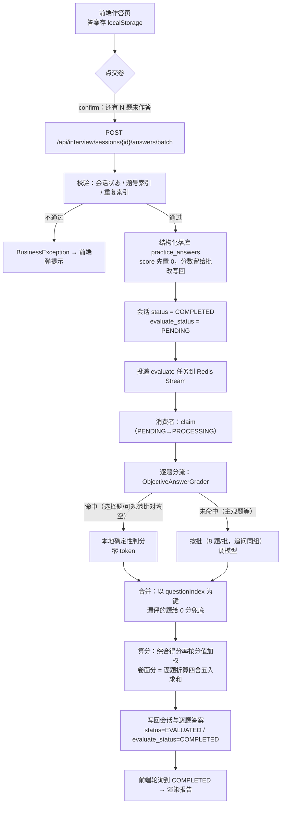
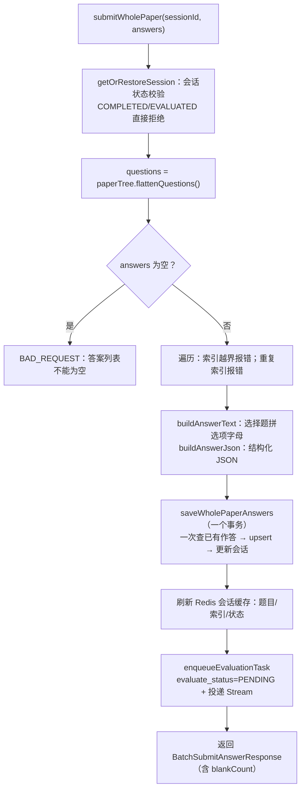
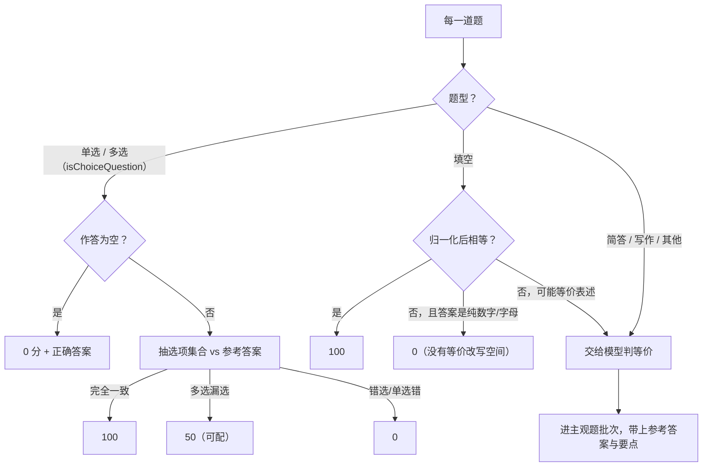
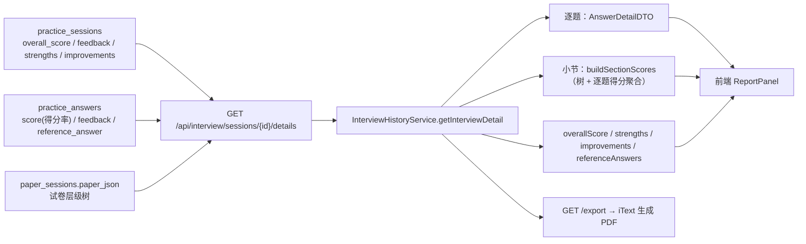
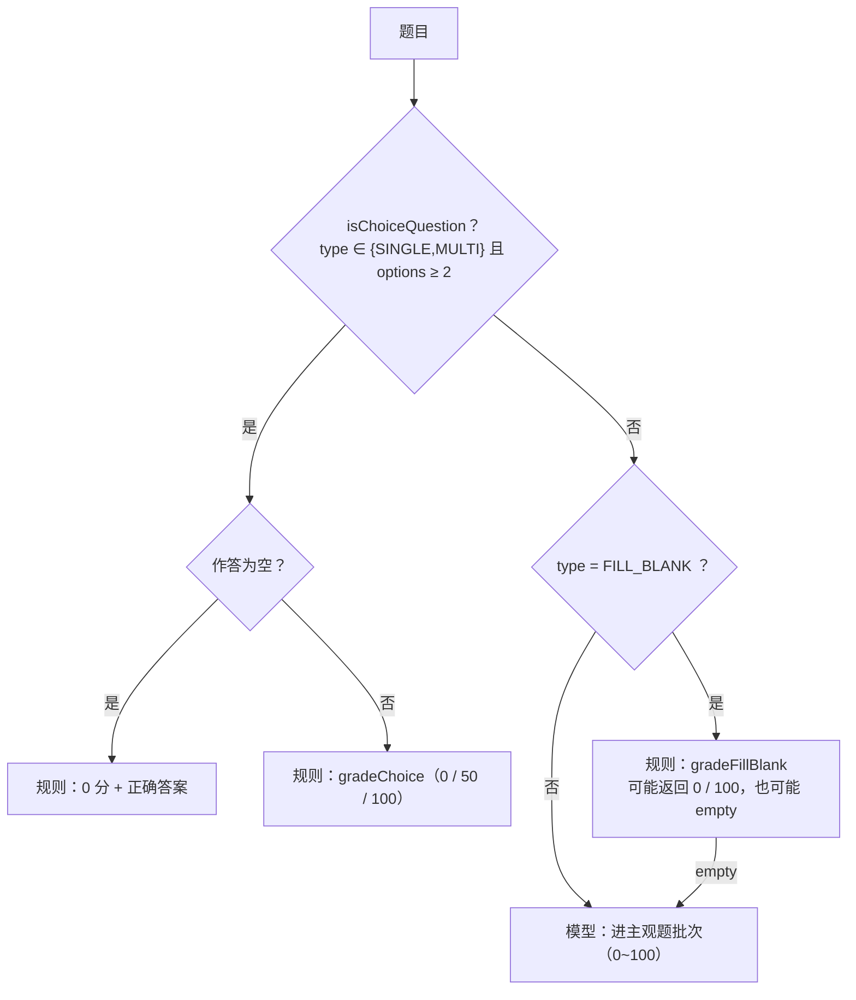
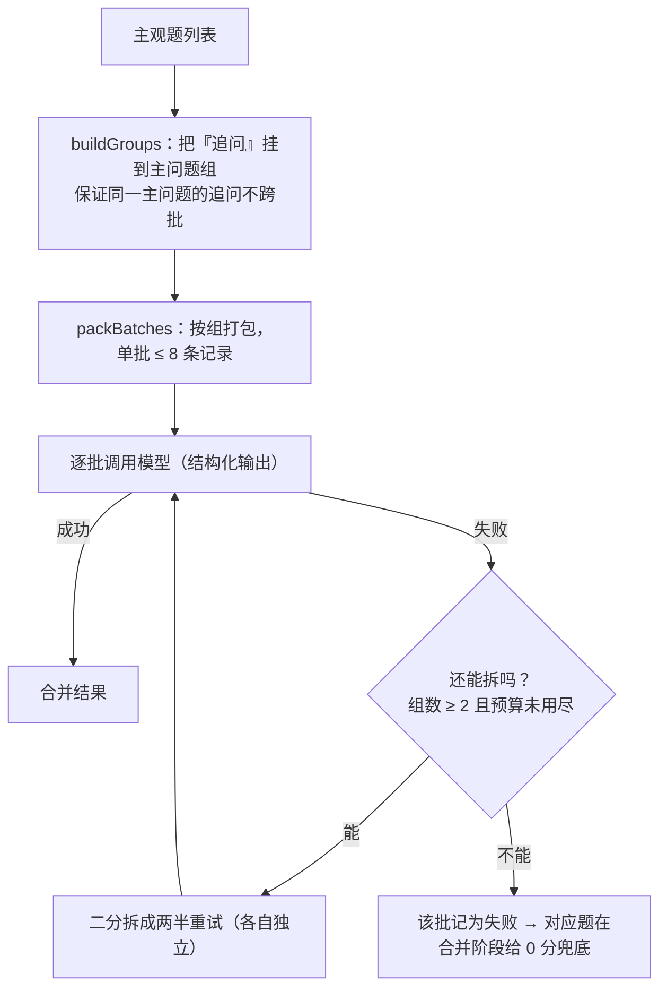
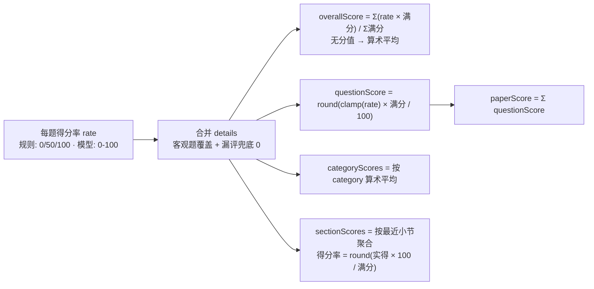

# 作答 / 交卷 / 批改 / 报告 —— 逻辑详解（含代码片段、流程图与完整例子）

> 这是 `docs/design/试卷分析全流程说明.md` 的**深入版**：那篇讲"整体为什么这么设计"，
> 这一篇讲"这一段代码具体怎么跑"——每一步都带真实代码片段、请求/响应形状、数据库字段，
> 以及一个从头到尾算得通的完整例子。
>
> 阅读顺序建议：先看 §0 总览图 → §1 数据与状态（口径必须记牢）→ §2~§5 四个阶段 → §6 完整例子自己推一遍。

---

## 0. 总览

### 0.1 全链路（大图）

```
[前端] 作答页                  [后端] 同步请求            [Redis Stream] 异步批改        [前端] 报告页
─────────────────────────  ─────────────────────────  ────────────────────────  ────────────────────
答完 → 确认弹窗(空题数)
      └─► POST /answers/batch ─► 校验 → 结构化落库 ─┐
                                 会话置 COMPLETED    ├─► 投递 evaluate 任务
                                 返回 {blankCount} ──┘         │
                                                              ▼
                                            消费：claim → 分流判分(客观题规则/主观题模型)
                                                   → 合并 → 写回会话与逐题答案
                                                              │
                                    ┌─────────────────────────┘
                                    ▼
                          轮询 GET /details (2.5s) ──► evaluate_status=COMPLETED ──► 渲染报告
```

### 0.2 主流程图（Mermaid）



---

## 1. 数据与状态（口径先记牢）

### 1.1 两张表的关键字段

`practice_sessions`（作答会话，一次作答一行）：

| 字段 | 含义 | 谁写 |
| --- | --- | --- |
| `session_id` | 16 位随机串，前端 URL 里的会话标识 | 切题阶段创建 |
| `paper_json` | **试卷层级树**（唯一题目数据源，含题干/选项/分值/解析） | 切题阶段写入 |
| `status` | `CREATED → IN_PROGRESS → COMPLETED → EVALUATED` | 交卷置 `COMPLETED`，批改完成置 `EVALUATED` |
| `evaluate_status` | `PENDING → PROCESSING → COMPLETED / FAILED` | 异步批改任务 |
| `overall_score` | **综合得分率**（0~100） | 批改完成后写回 |
| `owner_id` | 归属人，越权一律 404 | 创建时写入 |

`practice_answers`（逐题作答 + 判分结果）：

| 字段 | 含义 |
| --- | --- |
| `question_index` | 与 `paper_json` 展平后的题目顺序一一对应，**全链路唯一索引** |
| `user_answer` | 作答文本：选择题是选项字母拼接（如 `"BD"`），其他题型是文本 |
| `answer_json` | 结构化作答：`{"selectedKeys":["B","D"],"text":""}` |
| `score` | **该题得分率（0~100）**，注意不是卷面分 |
| `feedback` | 评语（客观题自带解析与考点，主观题来自模型） |
| `reference_answer` | 批改时写入的参考答案 |

### 1.2 三个分数口径（面试最容易被追问的地方）

| 名字 | 算法 | 例子 |
| --- | --- | --- |
| 单题 `score`（得分率） | 客观题由规则直接给出；主观题来自模型，取值 0~100 | 6 分题答对一半 → `60` |
| 单题卷面分 `questionScore` | `round(得分率 × 该题满分 / 100)` | `round(60×6/100)=4` |
| 综合得分率 `overallScore` | `Σ(得分率 × 满分) / Σ满分`（**按分值加权**；全都没有分值时才退化成算术平均） | 见 §6 的例子 → `78` |
| 卷面得分 `paperScore` | **逐题卷面分四舍五入后求和** `Σ round(...)` | 3+2+4+17 = `26` |

> 小提醒：`paperScore` 与 `round(overallScore × 卷面总分 / 100)` 可能差 ±1 分——
> 因为前者是"逐题先舍入再求和"。报告里两个数都会给出，讲的时候可以主动说明这是舍入口径差异。

---

## 2. 作答（前端）

### 2.1 一份作答在前端长什么样

`frontend/src/components/QuestionAnswerInput.tsx`：

```ts
export interface AnswerValue {
  selectedKeys: string[];   // 选择题：选中的选项 key（多选会 sort）
  text: string;             // 填空 / 简答 / 写作：文本答案
}

export const EMPTY_ANSWER: AnswerValue = { selectedKeys: [], text: '' };

export function isAnswerEmpty(value?: AnswerValue | null): boolean {
  return value.selectedKeys.length === 0 && !value.text.trim();
}

export function toSubmitAnswer(value?: AnswerValue | null): { selectedKeys: string[]; answer: string } {
  const safe = value ?? EMPTY_ANSWER;
  return {
    selectedKeys: safe.selectedKeys,
    answer: safe.selectedKeys.length > 0 ? safe.selectedKeys.join('') : safe.text.trim(),
  };
}
```

**为什么选择题要同时送 `selectedKeys` 和 `answer`**：`selectedKeys` 是"意图"（判分只认它，
不会被文本里的字母干扰），`answer` 是"展示文本"（报告里直接给人看）。

### 2.2 交卷前的确认与暂存

`frontend/src/pages/PaperAnalysisPage.tsx`：

```ts
const handleSubmit = async () => {
  if (!sessionId) return;
  const blank = questions.filter(q => isAnswerEmpty(answers[q.questionIndex])).length;
  const confirmed = window.confirm(
    blank > 0
      ? `还有 ${blank} 道题没有作答，交卷后这些题按 0 分计。确定交卷吗？`
      : '确定交卷吗？交卷后将立即开始批改。'
  );
  if (!confirmed) return;

  setSubmitting(true);
  try {
    await interviewApi.submitWholePaper(
      sessionId,
      questions.map(question => {
        const submit = toSubmitAnswer(answers[question.questionIndex]);
        return {
          questionIndex: question.questionIndex,
          questionType: question.questionType ?? null,
          selectedKeys: submit.selectedKeys,
          answer: submit.answer,
        };
      })
    );
    localStorage.removeItem(ANSWERS_STORAGE_PREFIX + sessionId);
    setStage('grading');            // 进入"批改中"，开始 2.5s 轮询
    await loadReport(sessionId);
  } finally {
    setSubmitting(false);
  }
};
```

**两个细节**：

- 交卷前用 `isAnswerEmpty` 统计空题并提示"按 0 分计"，把"漏答"的责任提前交给用户确认；
- 答案在作答过程中就写进 `localStorage`（按 `sessionId` 存），刷新页面能恢复——
  交卷成功后再删掉本地副本（上面这行 `removeItem`）。

---

## 3. 交卷（后端一次事务）

### 3.1 接口与请求形状

```java
@PostMapping("/api/interview/sessions/{sessionId}/answers/batch")
@RateLimit(dimension = RateLimit.Dimension.GLOBAL, count = 20)
@RateLimit(dimension = RateLimit.Dimension.IP, count = 5)   // 整卷提交代价高，IP 维度收紧
public Result<BatchSubmitAnswerResponse> submitWholePaper(
        @PathVariable String sessionId,
        @Valid @RequestBody BatchSubmitAnswerRequest request) {
    BatchSubmitAnswerResponse response = sessionService.submitWholePaper(sessionId, request.answers());
    return Result.success(response);
}
```

请求体（4 题、其中 1 题空着）：

```json
{
  "answers": [
    { "questionIndex": 0, "questionType": "SINGLE_CHOICE", "selectedKeys": ["B"], "answer": "B" },
    { "questionIndex": 1, "questionType": "MULTI_CHOICE",  "selectedKeys": ["B"], "answer": "B" },
    { "questionIndex": 2, "questionType": "SHORT_ANSWER",  "selectedKeys": [],    "answer": "①中华文明具有连续性……" },
    { "questionIndex": 3, "questionType": "WRITING",       "selectedKeys": [],    "answer": "" }
  ]
}
```

响应：

```json
{
  "code": 200,
  "data": {
    "sessionId": "eb815a4c71ba48b4",
    "submittedCount": 4,
    "totalQuestions": 4,
    "blankCount": 1,
    "status": "COMPLETED",
    "evaluateStatus": "PENDING"
  }
}
```

### 3.2 交卷流程图



### 3.3 核心代码（`InterviewSessionService#submitWholePaper`）

```java
public BatchSubmitAnswerResponse submitWholePaper(String sessionId,
                                                  List<BatchSubmitAnswerRequest.AnswerItem> answers) {
    CachedSession session = getOrRestoreSession(sessionId);
    if (session.getStatus() == SessionStatus.COMPLETED
        || session.getStatus() == SessionStatus.EVALUATED) {
        throw new BusinessException(ErrorCode.INTERVIEW_ALREADY_COMPLETED);   // 防重复交卷
    }

    List<InterviewQuestionDTO> questions = session.getQuestions(objectMapper);
    if (answers == null || answers.isEmpty()) {
        throw new BusinessException(ErrorCode.BAD_REQUEST, "答案列表不能为空");
    }

    // 索引 → 作答；重复索引视为请求错误，避免静默覆盖学生的作答
    Map<Integer, BatchSubmitAnswerRequest.AnswerItem> submitted = new LinkedHashMap<>();
    for (BatchSubmitAnswerRequest.AnswerItem item : answers) {
        int index = item.questionIndex();
        if (index < 0 || index >= questions.size()) {
            throw new BusinessException(ErrorCode.INTERVIEW_QUESTION_NOT_FOUND, "无效的问题索引: " + index);
        }
        if (submitted.putIfAbsent(index, item) != null) {
            throw new BusinessException(ErrorCode.BAD_REQUEST, "重复的问题索引: " + index);
        }
    }

    List<InterviewPersistenceService.AnswerSubmission> submissions = new ArrayList<>();
    submitted.forEach((index, item) -> {
        InterviewQuestionDTO question = questions.get(index);
        String answerText = buildAnswerText(question, item);
        submissions.add(new InterviewPersistenceService.AnswerSubmission(
            index, answerText, buildAnswerJson(item), question.isChoiceQuestion()));
        questions.set(index, question.withAnswer(answerText));   // 缓存里的题目也带上作答
    });

    persistenceService.saveWholePaperAnswers(sessionId, questions, submissions);
    sessionCache.updateQuestions(sessionId, questions);
    sessionCache.updateCurrentIndex(sessionId, questions.size());
    sessionCache.updateSessionStatus(sessionId, SessionStatus.COMPLETED);
    enqueueEvaluationTask(sessionId);            // evaluate_status=PENDING + 投递 Stream
    ...
}
```

选择题答案规范化（后端统一按 key 拼，前端不用关心展示格式）：

```java
private String buildAnswerText(InterviewQuestionDTO question, BatchSubmitAnswerRequest.AnswerItem item) {
    List<String> keys = item.selectedKeys();
    if (question.isChoiceQuestion() && keys != null && !keys.isEmpty()) {
        return keys.stream()
            .filter(key -> key != null && !key.isBlank())
            .map(key -> key.trim().toUpperCase())
            .distinct().sorted()                    // 去重 + 排序，保证 "DB" 与 "BD" 等价
            .collect(Collectors.joining());
    }
    return normalizeAnswer(item.answer());
}
```

### 3.4 落库为什么"只 flush 一次"

`InterviewPersistenceService#saveWholePaperAnswers`：

```java
@Transactional(rollbackFor = Exception.class)
public void saveWholePaperAnswers(String sessionId,
                                  List<InterviewQuestionDTO> questions,
                                  List<AnswerSubmission> submissions) {
    PracticeSessionEntity session = sessionRepository.findBySessionId(sessionId)
        .orElseThrow(() -> new BusinessException(ErrorCode.NOT_FOUND, "答题记录不存在或无权访问"));

    // 只查一次已有作答（索引 → 实体）
    Map<Integer, PracticeAnswerEntity> existing = answerRepository
        .findBySession_SessionIdOrderByQuestionIndex(sessionId).stream()
        .collect(Collectors.toMap(PracticeAnswerEntity::getQuestionIndex, a -> a, (a, b) -> a));

    List<PracticeAnswerEntity> toSave = new ArrayList<>(submissions.size());
    for (AnswerSubmission submission : submissions) {
        Integer index = submission.questionIndex();
        if (index == null || index < 0 || index >= questions.size()) continue;   // 防御性跳过
        PracticeAnswerEntity answer = existing.get(index);
        if (answer == null) {                       // 没有就新建（支持"先答一题再交卷"的历史数据）
            answer = new PracticeAnswerEntity();
            answer.setSession(session);
            answer.setQuestionIndex(index);
        }
        answer.setUserAnswer(submission.answerText() != null ? submission.answerText() : "");
        answer.setAnswerJson(submission.answerJson());
        answer.setAutoScored(submission.autoScored());
        answer.setScore(0);                         // 分数在批改阶段写回
        answer.setFeedback(null);
        toSave.add(answer);
    }
    answerRepository.saveAll(toSave);               // 一次批量写入

    session.setCurrentQuestionIndex(questions.size());
    session.setStatus(PracticeSessionEntity.SessionStatus.COMPLETED);
    session.setCompletedAt(LocalDateTime.now());
    sessionRepository.save(session);
}
```

**四个设计点（都可以当面试答案）**

| 做法 | 为什么 | 好处 |
| --- | --- | --- |
| 重复 `questionIndex` 直接报错，不覆盖 | 一个人不可能对同一题交两份答案，出现就说明前端/调用方有 bug | 不静默丢作答，问题能暴露 |
| 未作答的题**不落库** | 空答案 = 0 分，批改阶段会按"缺这条记录"处理 | 少写无意义行；批改逻辑天然支持"题记录缺失" |
| 只查一次 + `saveAll` + 只更新一次会话 | 一次整卷交卷可能有几十题 | 避免 N 次数据库往返，交卷是一个短事务 |
| 分数与反馈在这里先置 0 / null | 判分要调模型，属于异步阶段 | 事务里没有 LLM 调用，事务短、不阻塞 |

---

## 4. 批改（异步，一条消息两种判分路径）

### 4.1 任务骨架：claim → 处理 → 完成 / 失败

所有异步任务共用 `AbstractStreamConsumer#processMessage`：

```java
try {
    if (shouldSkip(payload)) {            // 已经 COMPLETED 的消息直接 ACK，保证幂等
        ackMessage(messageId);
        return;
    }
    if (!tryMarkProcessing(payload)) {    // 条件更新：只有 PENDING 才能抢到执行权
        ackMessage(messageId);
        return;
    }
    processBusiness(payload);
    markCompleted(payload);
    ackMessage(messageId);
} catch (Exception e) {
    // 业务异常是确定性失败（素材缺失、参数不合法……），重试不会变好，
    // 直接落库真实原因，避免用户只看到一句 "failed after retry 3"
    if (e instanceof BusinessException) {
        markFailed(payload, truncateError(describeFailure(e)));
        ackMessage(messageId);
        return;
    }
    if (retryCount < AsyncTaskStreamConstants.MAX_RETRY_COUNT) {   // 默认 3
        retryMessage(payload, retryCount + 1);                      // 重新投递（带 retryCount）
    } else {
        markFailed(payload, truncateError(taskDisplayName() + " failed after retry " + retryCount + "：" + describeFailure(e)));
    }
    ackMessage(messageId);
}
```

评估侧只需要实现这几个钩子（`EvaluateStreamConsumer`）：

```java
protected boolean shouldSkip(EvaluatePayload payload) {
    return sessionRepository.findBySessionId(payload.sessionId())
        .map(session -> session.getEvaluateStatus() == AsyncTaskStatus.COMPLETED)
        .orElse(true);                       // 会话已删 = 不用做，ACK 丢弃
}
protected void markProcessing(EvaluatePayload p) { updateEvaluateStatus(p.sessionId(), PROCESSING, null); }
protected void markCompleted(EvaluatePayload p)  { updateEvaluateStatus(p.sessionId(), COMPLETED, null); }
protected void markFailed(EvaluatePayload p, String error) { updateEvaluateStatus(p.sessionId(), FAILED, error); }
```

**这套骨架解决的四个问题**：重复投递（`shouldSkip` + `tryMarkProcessing` 条件领取）、
并发消费（消费组）、失败可见（`markFailed` 写入 `evaluate_error` 直接在界面展示）、
重试有度（最多 3 次，业务异常不重试）。

### 4.2 真正的业务：取数据 → 分流 → 合并

```java
protected void processBusiness(EvaluatePayload payload) {
    String sessionId = payload.sessionId();
    Optional<PracticeSessionEntity> sessionOpt = sessionRepository.findBySessionIdWithResume(sessionId);
    if (sessionOpt.isEmpty()) { return; }                     // 会话被删：ACK 丢弃

    PracticeSessionEntity session = sessionOpt.get();
    List<InterviewQuestionDTO> questions =
        PaperTree.parse(objectMapper, session.getPaperJson()).flattenQuestions();   // 题目以树为准

    // 作答以数据库为准（不信前端重传），按 questionIndex 回填到题目上
    for (PracticeAnswerEntity answer : persistenceService.findAnswersBySessionId(sessionId)) {
        int index = answer.getQuestionIndex();
        if (index >= 0 && index < questions.size()) {
            questions.set(index, questions.get(index).withAnswer(answer.getUserAnswer()));
        }
    }

    ChatClient chatClient = llmProviderRegistry.getChatClientOrDefault(session.getLlmProvider());
    String resumeText = session.getResume() != null ? session.getResume().getResumeText() : "";
    InterviewReportDTO report = evaluationService.evaluateInterview(chatClient, sessionId, resumeText, questions);
    persistenceService.saveReport(sessionId, report);          // 写回会话 + 逐题答案
}
```

### 4.3 判分分流（本项目的核心亮点）

```java
// AnswerEvaluationService#evaluateInterview
Map<Integer, ObjectiveAnswerGrader.Grade> objectiveGrades = new LinkedHashMap<>();
List<InterviewQuestionDTO> subjectiveQuestions = new ArrayList<>();
for (InterviewQuestionDTO question : questions) {
    objectiveAnswerGrader.grade(question).ifPresentOrElse(
        grade -> objectiveGrades.put(question.questionIndex(), grade),
        () -> subjectiveQuestions.add(question)
    );
}
EvaluationReport llmReport = null;
if (!subjectiveQuestions.isEmpty()) {
    String referenceContext = buildQuestionReferenceContext(questions, paperTree);  // 参考答案 + 材料原文
    llmReport = unifiedEvaluationService.evaluate(chatClient, sessionId, qaRecords, resumeText, referenceContext);
} else {
    log.info("本次全部为客观题，跳过模型批改: sessionId={}, 题数={}", sessionId, questions.size());
}
```



> 上面是简化图（只看题型）；**完整版决策树（含"选项不足要回落到模型"）见 §10.1**。

客观题判分器（`ObjectiveAnswerGrader`）三个可讲的设计：

```java
// ① 只认两种形态，避免把主观作答里的字母误判成选项
String upper = text.toUpperCase().trim();
String stripped = upper.replaceAll("[\\s,，、;；/和与及.。()（）]", "");
if (!stripped.isEmpty() && isAllKeys(stripped, valid)) { ... }        // 形态一："B" / "BD" / "B、D"
Matcher matcher = CHOICE_ANSWER_PATTERN.matcher(upper);               // 形态二："答案是 B" / "故选 BD"

// ② 多选漏选给部分分（默认 50%，可配）
if (isMulti) {
    boolean subset = expected.containsAll(student);
    if (subset && properties.isMultiChoicePartialCredit()) {
        return Optional.of(new Grade(properties.getMultiChoicePartialCreditRate(), ...));
    }
    return Optional.of(new Grade(0, "多选题错选不得分。"));
}

// ③ 评语带"为什么"：判分结论 + 题目解析 + 考点
private String withAnalysis(InterviewQuestionDTO question, String conclusion) {
    sb.append("\n解析：").append(analysis.trim());
    sb.append("\n考点：").append(String.join("、", keyPoints));
}
```

填空题的"何时交回模型"：

```java
if (normalizeBlank(question.userAnswer()).equals(normalizeBlank(expected))) return grade(100);
// 纯数字/字母答案（如 1/2、0.5、AB）没有等价改写空间，直接判错；其余交模型判断等价性
if (isPlainAnswer(expected)) return grade(0, "填写错误：……");
return Optional.empty();          // ← 交回模型
```

### 4.4 主观题：按批调用、追问不拆散、失败二分降级

```java
private static final int batchSize = 8;                 // InterviewEvaluationProperties
private static final boolean fallbackSplitEnabled = true;
private static final int fallbackMaxExtraCalls = 6;

// ① 把"追问"归到主问题组，一批里的组不会被拆开
Map<Integer, QaGroup> groupByIndex = new HashMap<>();
for (QaRecord q : qaRecords) { ... groupByIndex.put(q.questionIndex(), target); }

// ② 按组打包，单批不超过 batchSize 条记录
List<List<QaGroup>> batches = packBatches(buildGroups(qaRecords));

// ③ 某批调用失败 → 二分拆成两半再试（总预算 fallbackMaxExtraCalls 次），最后兜底 0 分
```

模型侧被明确约束（`prompts/interview-evaluation-system.st` 摘录）：

```
| 得分率 | 等级 | 标准描述 |
| 90-100 | 优秀 | 答案完全正确，踩分点齐备，表达规范 |
| 75-89  | 良好 | 主要结论正确，个别踩分点或规范细节有瑕疵 |
| 60-74  | 及格 | 思路基本正确但步骤不全、要点缺失 |
| 0      | 未得分 | 未作答、答非所问、无效作答 |

overallScore 为各题得分率按题目分值加权后的综合得分率（无分值信息时取算术平均）
主观题按踩分点给分：答出一部分就给对应比例的分，并在 feedback 中指出还缺哪些要点
questionIndex 必须原样返回，不得重新编号
```

### 4.5 合并与兜底

```java
// ① 模型结果先入表
for (EvaluationReport.QuestionEvaluation qe : llmReport.questionDetails()) {
    details.put(qe.questionIndex(), new QuestionEvaluation(qe.questionIndex(), ..., qe.score(), qe.feedback(), null, null));
}
// ② 客观题结果覆盖进去（同一 index 以规则判分为准，规则不会自相矛盾）
for (InterviewQuestionDTO question : questions) {
    ObjectiveAnswerGrader.Grade grade = objectiveGrades.get(question.questionIndex());
    if (grade != null) details.put(question.questionIndex(), new QuestionEvaluation(..., grade.scoreRate(), grade.feedback(), null, null));
}
// ③ 两条路都没覆盖到的题（模型漏评）给 0 分兜底，避免报告缺题
for (InterviewQuestionDTO question : questions) {
    details.putIfAbsent(question.questionIndex(), new QuestionEvaluation(..., 0, "未获得批改结果，请重新批改。", null, null));
}
```

综合得分率（按分值加权）：

```java
private int weightedScoreRate(List<InterviewQuestionDTO> questions, List<QuestionEvaluation> details) {
    boolean hasFullScore = ...;                     // 有任一分值就按分值加权
    double weighted = 0, weight = 0;
    for (QuestionEvaluation detail : details) {
        double w = hasFullScore ? fullScoreOf(detail.questionIndex()) : 1;   // 没分值 → 权重都是 1 = 算术平均
        if (w == 0) continue;
        weighted += detail.score() * w;
        weight += w;
    }
    return weight == 0 ? 0 : (int) Math.round(weighted / weight);
}
```

写回（`InterviewPersistenceService#saveReport`）：会话写 `overall_score / overall_feedback / strengths /
improvements / reference_answers`，状态置 `EVALUATED`；逐题答案写 `score / feedback / reference_answer`，
**没作答的题也会补一条记录**（`user_answer = null`），这样报告不会缺行。

---

## 5. 报告（从数据库到界面）

### 5.1 报告数据流



### 5.2 小节得分怎么聚合（这段代码面试很值得讲）

```java
private List<InterviewDetailDTO.SectionScoreDTO> buildSectionScores(PaperTree tree, List<PracticeAnswerEntity> answers) {
    Map<Integer, PracticeAnswerEntity> answerByIndex = ...;            // 索引 → 作答
    Map<String, int[]> accumulator = new LinkedHashMap<>();            // 小节 id → [题数, 满分, 实得]
    Map<String, PaperNode> sectionOf = new LinkedHashMap<>();

    for (PaperNode questionNode : tree.questionNodes()) {
        PaperNode section = tree.nearestSection(questionNode.questionIndex()).orElse(null);  // 最近的祖先小节
        String key = section != null ? section.id() : "__none__";
        int fullScore = questionNode.meta().fullScore();
        int rate = answer.getScore();                                   // 得分率 0~100
        int score = fullScore > 0 ? (int) Math.round(rate * fullScore / 100.0) : 0;   // 折算成卷面分
        int[] acc = accumulator.computeIfAbsent(key, ignored -> new int[3]);
        acc[0] += 1; acc[1] += fullScore; acc[2] += score;
    }
    // 每小节输出：题数、满分、实得、得分率 = round(实得 × 100 / 满分)
}
```

**为什么这样做**：题目本来就挂在层级树上（大题 → 小节 → 题目），
所以"这一大题丢了多少分"不需要额外统计表——遍历一次树、把每题得分折算后累加到最近小节即可。

### 5.3 前端怎么用

- 交卷后前端进入 `grading` 阶段，**每 2.5 秒**轮询 `GET /sessions/{id}/details`：
  `evaluateStatus === 'COMPLETED'` → 切到报告页；`'FAILED'` → 切到报告页并把 `evaluateError` 显示成红色提示；
- 报告页（`PaperAnalysisPage` 的 `ReportPanel`）：顶部总分（综合得分率 + 卷面得分/总分）、
  知识点得分（`categoryScores`）、**小节得分表（`sectionScores`）**、逐题卡片
  （你的答案 / 正确答案 / 得分 / 评语 / 解析），底部「导出报告」调 `/export` 由服务端生成 PDF。

---

## 6. 完整例子（照着这张表自己推一遍就能讲）

### 6.1 试卷与作答

| idx | 题型 | 满分 | 参考答案 | 学生作答 | 判分路径 | 得分率 | 卷面分（折算） |
| --- | --- | --- | --- | --- | --- | --- | --- |
| 0 | 单选 | 3 | B | B | 规则 | 100 | 3 |
| 1 | 多选 | 3 | BD | B（漏选） | 规则 | 50（可配） | round(1.5)=2 |
| 2 | 简答 | 6 | 3 个要点 | 答出 2 个 | 模型 | 60 | round(3.6)=4 |
| 3 | 写作 | 20 | 评分细则 | 结构完整表达一般 | 模型 | 85 | round(17)=17 |

### 6.2 算出来的分数

- **综合得分率**：`(100×3 + 50×3 + 60×6 + 85×20) / (3+3+6+20) = 2510 / 32 = 78.4 → 78`
  （注意这里是按分值加权，不是 `(100+50+60+85)/4 = 73.75`——3 分的题和 20 分的题权重必须不同）
- **卷面总分** 32；**卷面得分** = 3 + 2 + 4 + 17 = `26`

### 6.3 数据库里最终长什么样

```sql
-- 会话
select status, evaluate_status, overall_score from practice_sessions where session_id = 'eb815a4c71ba48b4';
--  EVALUATED | COMPLETED | 78

-- 逐题（score 是得分率，不是卷面分）
select a.question_index, a.score, left(coalesce(a.user_answer,''), 12) as user_answer, left(a.feedback, 24) as feedback
from practice_answers a join practice_sessions s on s.id = a.session_id
where s.session_id = 'eb815a4c71ba48b4' order by a.question_index;
--  0 | 100 | B   | 选择正确。正确答案：B\n解析：……
--  1 |  50 | B   | 漏选：B 未选全，正确答案 BD，按漏选给 50% 分。
--  2 |  60 | ……  | 答出了连续性、创新性两点，缺少"统一性"要点，建议……
--  3 |  85 | ……  | 结构完整、中心明确，语言表达略平，建议加强……
```

### 6.4 报告接口返回（节选）

```json
{
  "sessionId": "eb815a4c71ba48b4",
  "totalQuestions": 4,
  "overallScore": 78,
  "totalFullScore": 32,
  "paperScore": 26,
  "categoryScores": [
    { "category": "现代文阅读", "score": 75, "questionCount": 2 },
    { "category": "古诗文阅读", "score": 60, "questionCount": 1 },
    { "category": "写作", "score": 85, "questionCount": 1 }
  ],
  "questionDetails": [
    { "questionIndex": 0, "score": 100, "fullScore": 3,  "questionScore": 3,  "feedback": "选择正确。正确答案：B" },
    { "questionIndex": 1, "score": 50,  "fullScore": 3,  "questionScore": 2,  "feedback": "漏选：B 未选全，正确答案 BD" },
    { "questionIndex": 2, "score": 60,  "fullScore": 6,  "questionScore": 4,  "feedback": "缺少\"统一性\"要点……" },
    { "questionIndex": 3, "score": 85,  "fullScore": 20, "questionScore": 17, "feedback": "语言表达略平……" }
  ],
  "sectionScores": [
    { "title": "一、现代文阅读", "questionCount": 2, "fullScore": 6,  "score": 5,  "scoreRate": 83 },
    { "title": "二、古代诗文阅读", "questionCount": 1, "fullScore": 6,  "score": 4,  "scoreRate": 67 },
    { "title": "三、写作", "questionCount": 1, "fullScore": 20, "score": 17, "scoreRate": 85 }
  ],
  "strengths": ["写作板块得分率最高（85%）", "选择题基础扎实"],
  "improvements": ["古诗文阅读失分最多，建议先补实词与句式", "简答题注意踩分点齐全"]
}
```

**两个维度别混**：`sectionScores` 是**试卷结构**维度（哪一大题丢分），
`categoryScores` 是**知识点**维度（哪个知识板块弱）——前者来自 `paper_json` 层级树，
后者来自每题的 `category`，所以同一个大题下的题也可能分属不同知识点。

---

## 7. 排障速查（线上出问题先看这些）

| 现象 | 先查什么 | 常见原因 |
| --- | --- | --- |
| 一直停在"正在批改" | `practice_sessions.evaluate_status / evaluate_error`；日志 `docker logs smart-quiz-app \| grep 评估` | 任务没投递 / 消费者没起来 / 模型调用慢；`evaluate_error` 会写人话（额度不足、密钥失效等） |
| 报告里分数全是 0 | `practice_answers.user_answer` 是否为空 | 交卷时答案没传（前端 `selectedKeys` 没带上）、或会话被删导致 `processBusiness` 直接 return |
| 交卷报"重复/无效的问题索引" | 前端持有的题目是不是旧版（`paper_json` 被重新切题过） | 重新切题会生成新的树，旧页面里的 `questionIndex` 可能失效 → 刷新页面重进作答 |
| 交卷报 `INTERVIEW_ALREADY_COMPLETED` | `practice_sessions.status` | 重复点交卷（前端有 `submitting` 防连点，但刷新页面后可能重复提交） |
| 判分"不公平" | 逐题 `score` + `autoScored` 字段 | 客观题是规则判分（不会变），争议在主观题——看 `feedback` 与参考答案要点 |
| 批改失败后想重来 | 目前**没有一键重批入口** | 会话状态已是 `COMPLETED`，`/complete` 会被拒；运维上把手动重投（见待优化清单登记） |

```sql
-- 一次交卷/批改的全部状态，一条 SQL 看完
select s.session_id, s.status, s.evaluate_status, left(coalesce(s.evaluate_error,''), 60) as err,
       s.overall_score, (select count(*) from practice_answers a where a.session_id = s.id) as answer_rows
from practice_sessions s where s.session_id = '<16位会话串>';
```

---

## 8. 关键代码地图

| 环节 | 位置 |
| --- | --- |
| 前端作答与交卷 | `frontend/src/pages/PaperAnalysisPage.tsx`（`handleSubmit` / 阶段机 / 2.5s 轮询）、`components/QuestionAnswerInput.tsx` |
| 交卷接口 | `modules/interview/InterviewController#submitWholePaper` |
| 交卷业务 | `modules/interview/service/InterviewSessionService#submitWholePaper`（`buildAnswerText` / `buildAnswerJson` / `enqueueEvaluationTask`） |
| 交卷落库 | `modules/interview/service/InterviewPersistenceService#saveWholePaperAnswers` |
| 异步骨架 | `common/async/AbstractStreamConsumer#processMessage`、`common/constant/AsyncTaskStreamConstants`（`MAX_RETRY_COUNT=3`） |
| 批改消费者 | `modules/interview/listener/EvaluateStreamConsumer`（`shouldSkip` / `processBusiness` / `markFailed`） |
| 判分分流 | `modules/interview/service/AnswerEvaluationService#evaluateInterview` |
| 客观题判分 | `modules/interview/service/ObjectiveAnswerGrader`（选项比对 / 填空归一化 / 多选部分分） |
| 主观题批改 | `common/evaluation/UnifiedEvaluationService`（按 8 题分批、追问同组、失败二分降级）、`common/evaluation/InterviewEvaluationProperties` |
| 批改提示词 | `resources/prompts/interview-evaluation-system.st` / `-user.st`（0-100 得分率、按踩分点给分、questionIndex 原样返回） |
| 结果写回 | `modules/interview/service/InterviewPersistenceService#saveReport` |
| 报告组装 | `modules/interview/service/InterviewHistoryService#getInterviewDetail` / `#buildSectionScores` |
| 报告 DTO | `modules/interview/model/InterviewReportDTO`、`InterviewDetailDTO`（含 `SectionScoreDTO`） |
| 报告界面 | `frontend/src/pages/PaperAnalysisPage.tsx` 的 `ReportPanel`（含小节得分表） |

---

## 9. 这一段最值得讲的四个点（一句话版）

1. **交卷是一个短事务**：校验 + 结构化落库 + 状态迁移 + 投递任务，**事务里没有大模型调用**；
   分数先置 0，留给异步批改写回——保证接口快、事务短、失败不影响用户作答数据。
2. **判分分流**：客观题用规则（零 token、零幻觉、可复现），只有主观题交给模型，
   并且把参考答案、要点、材料原文一起给模型，要求按踩分点给 0-100 的得分率。
3. **两条判分路合并有兜底**：以 `questionIndex` 为键合并，模型漏评的题给 0 分并注明"可重新批改"，
   报告永远不缺题；综合得分率按**分值加权**，不是简单平均。
4. **报告是"树 + 逐题得分"的二次聚合**：一道题先折算成卷面分，再按层级树聚到最近小节，
   于是"哪一大题丢分最多"和"哪个知识点最弱"两个视角都能给出，而数据源只有一份 `paper_json`。

---

## 10. 【深入】判分分流与分数计算（逐分支 + 逐公式 + 例子）

这一节把两件事拆到底：**① 一道题最终是谁判的（分流）；② 分数是怎么一步步算出来的（口径）**。

### 10.1 分流总入口：一次决策，三种归宿

```java
// ObjectiveAnswerGrader#grade —— 返回 empty 就表示"我判不了，交回模型"
public Optional<Grade> grade(InterviewQuestionDTO question) {
    if (question == null) return Optional.empty();

    String answer = question.userAnswer();
    boolean blank = answer == null || answer.isBlank();
    String questionType = question.questionType();

    if (question.isChoiceQuestion()) {                    // 选择题：一定能判（包括未作答）
        if (blank) return Optional.of(new Grade(0, withAnalysis(question, "未作答。正确答案：" + question.referenceAnswer())));
        return gradeChoice(question);
    }
    if (InterviewQuestionDTO.TYPE_FILL_BLANK.equals(questionType)) {
        return gradeFillBlank(question, blank);            // 填空：可能判不了 → empty
    }
    return Optional.empty();                               // 简答 / 阅读 / 写作 / 其他 → 模型
}
```

**题型判定本身就有一层兜底**：

```java
/** 是否为选择题（单/多选）。选项齐全才按选择题渲染与判分。 */
public boolean isChoiceQuestion() {
    return options != null && options.size() >= 2
        && (TYPE_SINGLE_CHOICE.equals(questionType) || TYPE_MULTI_CHOICE.equals(questionType));
}
```

> 为什么要求"选项 ≥ 2"：规则判分靠**选项 key 集合比对**，如果切题时没抽到选项（题干型号老试卷），
> 比对就没有依据。这时宁可回落到模型（让它按参考答案判），也不能瞎判——这是"能判才判"的原则。

完整决策树（`?` 是决策点，`→` 是归宿）：



### 10.2 分支 A：选择题（5 种结局 + 两种作答形态）

```java
private Optional<Grade> gradeChoice(InterviewQuestionDTO question) {
    Set<String> student  = extractChoiceKeys(question.userAnswer(),      question.options());
    Set<String> expected = extractChoiceKeys(question.referenceAnswer(), question.options());
    if (expected.isEmpty()) {
        return Optional.empty();                 // 参考答案不是选项字母 → 交回模型
    }
    if (student.isEmpty()) {
        return Optional.of(new Grade(0, withAnalysis(question, "未作答。正确答案：" + String.join("", expected))));
    }
    if (student.equals(expected)) {
        return Optional.of(new Grade(100, withAnalysis(question, "选择正确。正确答案：" + String.join("", expected))));
    }
    boolean isMulti = InterviewQuestionDTO.TYPE_MULTI_CHOICE.equals(question.questionType())
        || expected.size() > 1;                  // 参考答案是多字母，也按多选处理
    if (isMulti) {
        boolean subset = expected.containsAll(student);          // 只少选，没有错选
        if (subset && properties.isMultiChoicePartialCredit()) {
            int rate = properties.getMultiChoicePartialCreditRate();     // 默认 50
            return Optional.of(new Grade(rate, withAnalysis(question,
                "漏选：" + String.join("", student) + " 未选全，正确答案 "
                    + String.join("", expected) + "，按漏选给 " + rate + "% 分。")));
        }
        return Optional.of(new Grade(0, withAnalysis(question,
            "选择错误：你的选择了 " + String.join("", student)
                + "，正确答案 " + String.join("", expected) + "。多选题错选不得分。")));
    }
    return Optional.of(new Grade(0, withAnalysis(question,
        "选择错误：你选了 " + String.join("", student) + "，正确答案 " + String.join("", expected) + "。")));
}
```

**"作答 → 选项集合"的两种识别形态**（这是避免误判的关键）：

```java
// 形态一：整串就是选项字母与分隔符，如 "B" / "BD" / "B、D" / "(A)"
String stripped = upper.replaceAll("[\\s,，、;；/和与及.。()（）]", "");
if (!stripped.isEmpty() && isAllKeys(stripped, valid)) { ... }

// 形态二："答案/故选/选择 + 选项字母"，如 "答案是 B"、"故选 BD"
private static final Pattern CHOICE_ANSWER_PATTERN =
    Pattern.compile("(?:答案|故选|选择|选)\\s*[:：是为]?\\s*[（(]?([A-H]{1,8})[）)]?");
```

> 为什么不用 `text.contains("B")`：主观作答里出现字母就会被误判
> （例如"我不选 B，因为材料说的是……"会被判成选了 B）。只认上面两种形态，
> 认不出来就 `student = 空集`，宁可当"未作答"或交回模型，也不猜。
> 另外 `extractChoiceKeys` 用 `TreeSet` 收集并用 `distinct().sorted()` 规范化，保证 `"DB"` 与 `"BD"` 等价。

| # | 参考答案 | 学生作答 | expected / student | 命中分支 | 得分率 | 评语（节选） |
| --- | --- | --- | --- | --- | --- | --- |
| 1 | B | `B` | {B} / {B} | 相等 | **100** | 选择正确。正确答案：B |
| 2 | B | `D` | {B} / {D} | 单选不等 | **0** | 选择错误：你选了 D，正确答案 B。 |
| 3 | BD | `DB` | {B,D} / {B,D} | 相等 | **100** | 排序后等价，不会因为顺序扣分 |
| 4 | BD | `B` | {B,D} / {B} | 漏选（subset） | **50**（可配） | 漏选：B 未选全，正确答案 BD，按漏选给 50% 分。 |
| 5 | BD | `BC` | {B,D} / {B,C} | 错选（非 subset） | **0** | 多选题错选不得分。 |
| 6 | BD | `""` | — / {} | 未作答 | **0** | 未作答。正确答案：BD |
| 7 | `都是对的` | `B` | {} / {B} | expected 为空 | 交回模型 | 切题没给出选项字母时不做规则判分 |
| 8 | B | `我觉得是B吧` | {B} / {B} | 形态二匹配 | **100** | 容忍"答案是/故选"这类自然写法 |
| 9 | B | `不选B，因为……` | {B} / {} | 形态一、二都不命中 | **0**（当未作答） | 宁可不给分，也不猜（可通过改判规则放宽） |

### 10.3 分支 B：填空题（归一化比较 + 两个"交回模型"的出口）

```java
private Optional<Grade> gradeFillBlank(InterviewQuestionDTO question, boolean blank) {
    String expected = question.referenceAnswer();
    if (expected == null || expected.isBlank()) {
        return Optional.empty();                                  // 出口①：没有参考答案，交回模型
    }
    if (blank) {
        return Optional.of(new Grade(0, withAnalysis(question, "未作答。正确答案：" + expected)));
    }
    if (normalizeBlank(question.userAnswer()).equals(normalizeBlank(expected))) {
        return Optional.of(new Grade(100, withAnalysis(question, "填写正确。")));
    }
    // 纯数字/字母答案（如 1/2、0.5、AB）没有等价改写空间，直接判错；其余交模型判断等价性
    if (isPlainAnswer(expected)) {
        return Optional.of(new Grade(0, withAnalysis(question,
            "填写错误：你的答案「" + question.userAnswer().trim() + "」，正确答案「" + expected.trim() + "」。")));
    }
    return Optional.empty();                                      // 出口②：可能只是表述不同，交回模型
}

/** 归一化：全角空格→半角、去掉所有空白、去掉标点、转小写 */
private String normalizeBlank(String text) {
    return text.replace('\u3000', ' ')
        .replaceAll("\\s+", "")
        .replaceAll("[。．.,，；;：:！!？?、\"'“”‘’（）()《》<>]", "")
        .toLowerCase();
}

/** 纯数字/字母/运算符构成的答案：没有"换个说法"的空间 */
private boolean isPlainAnswer(String text) {
    String normalized = normalizeBlank(text);
    return !normalized.isBlank() && normalized.matches("[0-9a-z/\\-+.=]+");
}
```

| # | 参考答案 | 学生作答 | 归一化后 | 命中分支 | 得分率 |
| --- | --- | --- | --- | --- | --- |
| 1 | `光合作用` | ` 光合作用。` | 光合作用 / 光合作用 | 相等 | **100** |
| 2 | `光合作用` | `光合作用` | 相等 | 相等 | **100** |
| 3 | `光合作用` | `光合作用的过程` | 不等；不是纯数字/字母 | **交回模型** | 模型按"是否等价"判 |
| 4 | `100` | `100` | 相等 | 相等 | **100** |
| 5 | `100` | `100.0` | 100 / 100.0 不等；是纯数字 | 直接判错 | **0** |
| 6 | `1/2` | `0.5` | 不等；是纯数字 | 直接判错 | **0**（⚠️ 已知取舍，见下） |
| 7 | `A、B` | `B，A` | `ab` / `ba`（去标点、转小写，但**不排序**） | 不等；是纯字母 | 直接判错 | **0**（⚠️ 顺序不敏感没做，见下） |
| 8 | 空 | 任意 | — | 出口① | 交回模型 |

> ⚠️ **第 5、6、7 行是同一个已知取舍**：只要参考答案属于"纯数字/字母/运算符"，
> 规则判分就做**精确比较**——不做数值等价（`1/2` vs `0.5`）、不做尾零等价（`100` vs `100.0`）、
> 也不做顺序无关（`A、B` vs `B，A`，去标点后是 `ab` vs `ba`）。
> 好处是零成本、可复现（不引模型就没有幻觉）；代价是这些等价写法会被判错。
> 已记入 `docs/待优化事项.md`（3.14），修法有三种（数值规范化 / 交回模型 / 加配置开关），以后再动。

### 10.4 分支 C：主观题（为什么必须按批、追问不能拆、失败怎么兜）

只有"规则判不了"的题才会走到这里，进入 `UnifiedEvaluationService`：

```java
private int batchSize = 8;                     // app.interview.evaluation.batch-size
private boolean fallbackSplitEnabled = true;    // 批次失败后按问答组二分重试
private int fallbackMaxExtraCalls = 6;          // 一次评估共享的额外调用预算
private int fallbackMinGroups = 2;              // 小于该组数就不再拆，整段再试
```



模型被明确约束（`interview-evaluation-system.st`）：

| 得分率 | 等级 | 标准 |
| --- | --- | --- |
| 90-100 | 优秀 | 答案完全正确，踩分点齐备，表达规范 |
| 75-89 | 良好 | 主要结论正确，个别踩分点或规范细节有瑕疵 |
| 60-74 | 及格 | 思路基本正确但步骤不全、要点缺失 |
| 40-59 | 不及格 | 存在明显知识性错误或关键步骤缺失 |
| 1-39 | 较差 | 思路偏离题意，仅有零散正确内容 |
| 0 | 未得分 | 未作答、答非所问、无效作答 |

并要求：**按踩分点给分**（答出一部分就给对应比例）、**等价正确必须给满分**、
**空答案必须 0 分**、**`questionIndex` 原样返回**（不许重新编号）。

### 10.5 分数计算全链路（每一步都有代码和公式）



四段关键代码：

```java
// ① 综合得分率：有分值按分值加权，都没有分值才退化成算术平均
boolean hasFullScore = fullScoreOf.values().stream().anyMatch(score -> score > 0);
for (QuestionEvaluation detail : details) {
    double w = hasFullScore ? fullScoreOf.getOrDefault(detail.questionIndex(), 0) : 1;
    if (w == 0) continue;                        // 该题没有分值 → 不参与加权
    weighted += detail.score() * w;
    weight += w;
}
return weight == 0 ? 0 : (int) Math.round(weighted / weight);

// ② 卷面总分 = 各题分值之和（过滤 null / ≤0）
return questions.stream().map(InterviewQuestionDTO::fullScore)
    .filter(Objects::nonNull).filter(s -> s > 0).mapToInt(Integer::intValue).sum();

// ③ 单题卷面分：先 clamp 到 [0,100] 再折算并四舍五入
return (int) Math.round(Math.max(0, Math.min(100, scoreRate)) * fullScore / 100.0);

// ④ 知识点得分：按 category 求算术平均（注意：这里不是加权）
acc[0] += detail.score(); acc[1] += 1;           // 求和 + 计数
score = Math.round((float) acc[0] / acc[1]);
```

### 10.6 用一个例子把每个数字都算出来

题目同 §6（4 题、32 分）：单选 3 分答对、多选 3 分漏选、简答 6 分得 60%、写作 20 分得 85%。

| idx | 满分 | rate | `rate × 满分 / 100` | `questionScore = round(…)` | 舍入增量 |
| --- | --- | --- | --- | --- | --- |
| 0 | 3 | 100 | 3.00 | 3 | 0 |
| 1 | 3 | 50 | 1.50 | **2** | +0.5 |
| 2 | 6 | 60 | 3.60 | **4** | +0.4 |
| 3 | 20 | 85 | 17.00 | 17 | 0 |
| Σ | **32** | — | **25.10** | **26** | +0.9 |

- **综合得分率** = `(100×3 + 50×3 + 60×6 + 85×20) / 32 = 2510 / 32 = 78.44` → **78**
- **卷面得分** = `3 + 2 + 4 + 17` = **26**（注意 = 25.10 + 0.9 的舍入增量）
- 如果反过来用 `78 × 32 / 100 = 24.96 ≈ 25`，就和 26 差 1 分——**差的就是逐题四舍五入那 +0.9**

> 面试可以主动讲这个细节：报告同时给"综合得分率"和"卷面得分/卷面总分"，
> 卷面得分是**逐题先折算再求和**（和逐题明细能对上），所以和"得分率×总分"可能差 ±1；
> 讲清口径比藏起来更可信。若要让两者严格一致，只需把 `paperScore` 改成
> `round(overallScore × totalFullScore / 100)`（代价是逐题明细相加对不上总分）。

**知识点得分与综合得分的口径差异**（同一个例子里的两个视角）：

| 视角 | 算法 | 例子 |
| --- | --- | --- |
| `overallScore`（总分） | **按分值加权** | 78 |
| `categoryScores`（知识点） | **算术平均**（不参与总分） | 现代文阅读 `(100+50)/2 = 75`、古诗文阅读 `60`、写作 `85` |
| `sectionScores`（大题） | 先把每题折算成卷面分，再按小节求和 | 一 `5/6=83%`、二 `4/6=67%`、三 `17/20=85%` |

为什么 `categoryScores` 用算术平均：它只是"知识点掌握度"的粗粒度指示（用来生成复习建议），
一个板块里题数少、分值悬殊时加权反而抖。举个数：某板块 3 分题 100% + 20 分题 50%，
算术平均 = 75%，按分值加权 = 69.6%——两种都"对"，看你回答的是"这个知识点会不会"还是"这次丢了多少分"。
**总分一定用加权**，因为它是分数。

### 10.7 边界清单（都来自代码，不是推测）

| 情况 | 行为 | 代码位置 |
| --- | --- | --- |
| `rate` 越界 | `paperScoreOf` 先 `clamp(0,100)` 再折算 | `paperScoreOf` |
| 某题 `fullScore` 为 null / ≤0 | 不计入卷面总分，也不参与加权 | `sumFullScore` / `weightedScoreRate` |
| 全卷都没有分值 | 加权自动退化为算术平均 | `weightedScoreRate` 的 `hasFullScore` |
| 未作答 | 规则给 0；`saveReport` 会补一条 `user_answer = null` 的记录，报告不缺行 | `saveReport` |
| 模型漏评某题 | 兜底 0 分 + "未获得批改结果，请重新批改。" | `mergeReports` 第三次循环 |
| 整卷全客观题 | 跳过模型，总评/优势/改进由板块得分生成（≥80 掌握较好、<60 需要加强，各取前 3） | `buildObjectiveFeedback` / `buildCategoryHighlights` |
| 参考答案不是选项字母 | 选择题不做规则判分，交回模型 | `gradeChoice` 首行 |
| 纯数字/字母填空 | 精确比较，不等即 0（不做 `1/2 == 0.5` 这类等价） | `isPlainAnswer`（⚠️ 3.14） |

### 10.8 可调参数（怎么改判分口径）

| 配置（`app.interview.evaluation.*`） | 默认 | 环境变量 | 影响 |
| --- | --- | --- | --- |
| `batch-size` | 8 | `APP_INTERVIEW_EVALUATION_BATCH_SIZE` | 主观题每批记录数，越小越稳但调用次数越多 |
| `fallback-split-enabled` | true | `APP_INTERVIEW_EVALUATION_FALLBACK_SPLIT_ENABLED` | 批次失败是否二分重试 |
| `fallback-max-extra-calls` | 6 | `APP_INTERVIEW_EVALUATION_FALLBACK_MAX_EXTRA_CALLS` | 一次评估的额外调用预算 |
| `fallback-min-groups` | 2 | `APP_INTERVIEW_EVALUATION_FALLBACK_MIN_GROUPS` | 小于该组数不再拆 |
| `multi-choice-partial-credit` | **true** | `APP_INTERVIEW_EVALUATION_MULTI_CHOICE_PARTIAL_CREDIT` | 多选题漏选是否给分 |
| `multi-choice-partial-credit-rate` | **50** | `…_MULTI_CHOICE_PARTIAL_CREDIT_RATE` | 漏选给的得分率 |

> 后两项在 `application.yml` 里没有显式列（用代码默认值），需要调整时用环境变量注入即可，
> 不用改代码；改口径属于"教学策略"而不是"技术细节"，所以做成了配置。

### 10.9 我会怎么自测这套判分（面试常被问"你怎么保证判分是对的"）

1. **客观题判分器是纯函数**（输入题目 + 作答 → 输出得分率），最适合单测：把 §10.2 / §10.3 表格里的
   9 + 8 个分支各写一条断言（单选对/错、多选全对/漏选/错选、未作答、参考答案非选项、自然语言作答、
   填空全角与标点、大小写、纯数字、可能等价的表述）。
2. **混合卷**：一份卷子同时含客观题与主观题，断言 `overallScore` 等于"逐题 rate × 分值"的加权（§10.6 的手算）。
3. **幂等**：同一会话重复投递评估消息，第二次应被 `shouldSkip` 直接 ACK，不产生第二份报告。
4. **兜底**：把模型返回里故意删掉一题，断言该题在报告里是 0 分且带"请重新批改"提示。
5. **回归**：改成配置（例如把漏选部分分调成 30）后，断言分数随配置变化。
