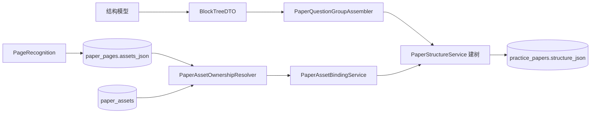

# 试卷资源归属与材料题组确定性改造-设计稿

> 状态：已实施并通过真实样本端到端验收（2026-10-30）；P0/P1 已落地，
> 决策见第 15 节，验证结果见第 16 节
> 关联问题：试卷 `paperId=35`（四年级（上）语文第五单元情景测试卷）第 4 题的图片资源
> `p1a4` 被挂到第 3 题，第 4 题只显示四个空图片占位。
> 关联优化：连续多段材料共同对应一组题目时，当前树只能把题目挂到最后一段材料下，
> 前面的材料变成孤立节点。

## 1. 定位

把“哪张图属于哪道题”从结构模型的概率输出中移出，改成后端基于几何位置的确定性计算。
结构模型只回答“哪几行是一道题、是什么题型、选项是文字还是图片”，不再决定资源归属。

同时把“哪几道题属于哪个材料组”从 `currentMaterial` 的顺序副作用中移出，改成后端按行号、
小节边界和节点类型确定性生成 `QUESTION_GROUP`。结构模型只标注 MATERIAL / QUESTION 的行范围，
不输出父子关系。

这不是前端问题，也不是单份数据的修补；它是切题阶段的资源绑定模型错误，会重复出现在
任何两道相邻、锚点文本相同的图形选项题上；材料分组同样会在一段多个材料共享题目时重复出错。

## 2. 现状问题

### 2.1 复现链路

1. 视觉识别给第 1 页生成两个资源：
   - `p1a3`：第 3 题的 `TABLE/OPTIONS`，rect `[0.120,0.625,0.780,0.123]`，`layout=2x2`；
   - `p1a4`：第 4 题的 `OPTION_ROW/OPTIONS`，rect `[0.117,0.746,0.883,0.117]`，`layout=1x4`。
2. 两个资源的 `anchorText` 都是 `"A."`，落库时 `anchor_line` 都是 `null`。
3. `PaperStructureService.resolveAnchors()` 从全卷第一行开始查找包含 `"A."` 的行，
   两个资源都被临时解析成第 1 页第 16 行（第 3 题选项 A）。
4. `buildAssetInfo()` 只把 `key/page/kind/role/count/anchor/line` 传给模型，不带 bbox。
5. 模型收到两个几乎不可区分的资源，把 `["p1a3","p1a4"]` 都写给第 3 题。
6. 后处理把 `p1a4` 计为“已被引用”，第 4 题的图形选项兜底因此不再拿它，最终错位。

### 2.2 直接责任点

- `app/src/main/java/interview/guide/modules/resume/service/PaperStructureService.java`
  - `build()`：`structure_hash` 只由 `sha256(numberedText)` 生成，资产几何变化不失效缓存。
  - `resolveAnchors()`：取全卷第一条匹配文本，不用 bbox 距离消歧。
  - `buildAssetInfo()`：不输出 rect、同一栏、纵向距离等定位信息。
  - `assemble()`：用全局 `referenced` 集合判断未使用 `OPTION_ROW`，错误引用会阻断兜底。
- `app/src/main/java/interview/guide/modules/resume/service/PaperRecognitionService.java`
  - `finishRecognition()` / `saveRecognizedAssets()`：识别得到 `PageRecognition.lines` 与
    最终资源 rect，但没有作为几何快照持久化，切题阶段只能重新猜锚点。
- `app/src/main/java/interview/guide/modules/resume/service/PaperPageRecognitionProcessor.java`
  - `RecognizedPage` 只保留 text/hasFigure/notes/model，丢弃 lines/assets。

### 2.3 材料题组现状

`PaperStructureService.assemble()` 用一个可变的 `currentMaterial` 决定后续题目父节点：

```text
MATERIAL 材料一
MATERIAL 材料二
QUESTION 10
QUESTION 11
```

处理到材料二时，`currentMaterial` 被覆盖为材料二，因此第 10、11 题都挂到材料二下面；
材料一仍是 SECTION 下的同级节点。这个结构无法表达“材料一 + 材料二共同对应第 10～13 题”。

`PaperTree.materialsOf()` 虽然会收集题目分支之前的同级材料，能在批改上下文上部分补救，
但学生端层级、材料折叠、结构预览和后续题组统计仍然看到了错误的父子关系。

## 3. 目标与非目标

### 3.1 目标

- 资源归属由后端确定性计算，模型输出不再作为资源归属事实来源。
- 相同锚点文本 `"A."` 的相邻资源，按同一栏 + 纵向距离 + 题号行正确消歧。
- `OPTION_ROW` 只能进入 IMAGE 题的 `QuestionOption.assetId`，不能成为 TEXT 题的题干图。
- 连续 MATERIAL 形成材料包，后续连续 QUESTION 归入同一个 `QUESTION_GROUP`。
- `QUESTION_GROUP` 不跨 SECTION/PART，不在新的 MATERIAL 出现后继续吞并题目。
- 一个题组可包含多个 MATERIAL；批改上下文收集题组内全部材料。
- 资产几何或锚点变化时，结构缓存必须失效并重新切题。
- 新的归属组件无共享可变状态，适配现有 `BoundedExecutor` 与 Redis Stream 消费模型。

### 3.2 非目标

- 不引入新的视觉 provider，不新增 Redis Stream 生产消费逻辑。
- 不改 `paper_assets` 的表结构，不重建存量图片文件。
- 不修 OCR/视觉模型识别质量；前端只增加 `QUESTION_GROUP` 的渲染分支，不重做交互。
- 本轮不做答案键、错题本、批改报告的联动改造。

## 4. 结构

### 4.1 目录与依赖

```text
app/src/main/java/interview/guide/modules/resume/
  model/
    PageRecognitionGeometrySnapshot.java   # 新：页级几何快照，序列化到 paper_pages.assets_json
  service/
    PaperAssetOwnershipResolver.java        # 新：纯计算，资源 key -> PaperAssetBinding
    PaperAssetBindingService.java           # 新：把 binding 挂到 PaperNode / QuestionOption
    PaperQuestionGroupAssembler.java        # 新：按行号生成 MATERIAL + QUESTION 题组
    TextPageGeometry.java                   # 新：为 TEXT 页生成行几何与合成 rect
    PaperRecognitionService.java            # 改：识别完成时保存几何快照
    PaperPageRecognitionProcessor.java      # 改：RecognizedPage 携带几何快照
    PaperStructureService.java              # 改：结构 hash、题组建树、绑定、校验
```

### 4.2 新增类型

```java
/**
 * 一页的几何快照。lines 保存 PageRecognition 的行级 bbox，
 * assets 保存最终裁图 key、归一化 rect、kind/role/anchorText。
 */
record PageRecognitionGeometrySnapshot(
    int version,
    int pageNo,
    List<PageRecognition.PageLine> lines,
    List<PageAssetGeometry> assets
) {}

record PageAssetGeometry(
    String assetKey,
    String kind,
    String role,
    String anchorText,
    double[] rect,
    String layout,
    Integer optionCount
) {}

record PaperAssetBinding(
    String assetKey,
    int pageNo,
    int anchorLine,   // 全卷连续行号
    String kind,
    String role,
    double[] rect
) {}

/**
 * 题组计划：一轮连续 MATERIAL 及其后连续 QUESTION。
 * 只描述确定性分组，不携带图片资源。
 */
record QuestionGroupPlan(
    String groupId,
    int startLine,
    int endLine,
    List<BlockNodeDTO> materials,
    List<BlockNodeDTO> questions
) {}
```

### 4.3 组件职责

| 组件 | 职责 | 谁创建它 |
| --- | --- | --- |
| `PageRecognitionGeometrySnapshot` | 把视觉结果里的行坐标与最终资源 rect 固化 | 识别阶段 |
| `PaperAssetOwnershipResolver` | 输入几何快照和全局行偏移，输出每个资源的唯一 `anchorLine` | Spring 单例，无状态 |
| `PaperAssetBindingService` | 输入树和 binding，把资源挂到 MATERIAL / QUESTION / QuestionOption | Spring 单例，无状态 |
| `PaperQuestionGroupAssembler` | 输入规范化块节点，输出连续材料与其后题目的 `QuestionGroupPlan` | Spring 单例，无状态 |
| `PaperStructureService` | 编排“模型切题 -> 题组组装 -> 建树 -> 资源绑定 -> 校验 -> 缓存” | Spring Service |

依赖方向：



### 4.4 树与前端契约

`PaperNode` 新增：

```java
public static final String TYPE_QUESTION_GROUP = "QUESTION_GROUP";
```

题组节点不承载正文和题目，只作为 MATERIAL 与 QUESTION 的共同父节点：

```text
QUESTION_GROUP
  ├─ MATERIAL
  ├─ MATERIAL
  ├─ QUESTION
  └─ QUESTION
```

`PaperTree.flattenQuestions()`、`pathTo()`、`contextOf()` 本身按 `children` 递归，新增节点类型
不需要改变扁平题目提取；`contextOf()` 继续通过 `materialsOf()` 收集题目之前的全部材料。

前端需要：

- `frontend/src/types/interview.ts` 的类型注释加入 `QUESTION_GROUP`；
- `frontend/src/components/PaperTreeView.tsx` 增加 `QUESTION_GROUP` 渲染分支；
- 该分支按“题组卡片/可折叠小节”渲染，不把题组标题当成材料正文；
- 其余答题、分页和题目索引继续读取 `QUESTION` 子节点。

### 4.5 TEXT 页的几何来源

没有经过视觉模型的 TEXT 页也必须进入同一套确定性归属流程：

- PDF 文字页保留 PDFBox 解析出的真实 `rect`，并用资源锚点所在文本行的页内行号补齐提示。
- DOCX 的内嵌图片没有像素坐标，解析器在把资源挂到某个 `LineDraft` 时记录页内行号；
  `TextPageGeometry` 再把行号转换成与合成行带对齐的 `rect`。
- 历史 TEXT 页没有 `assets_json` 时，`PaperStructureService` 使用已落库的 `rect_json`
  或唯一锚点文本生成候选。没有 rect 且锚点文本重复的资源保持 `UNBOUND_ASSET`，
  不恢复旧的“第一条文本匹配”猜测，也不把旧 `anchor_line` 静默改成页内行号。

## 5. 调用链

### 5.1 识别阶段（保存几何快照）

```text
PaperRecognitionService.processPaper(paperId, attemptId)
  -> PaperPageRecognitionProcessor.process(...)
  -> recognizePage(page, pageAttemptId, pageCount)
  -> PaperPageVisionRecognizer.recognize(...)          返回 PageRecognition
  -> finishRecognition(...)
  -> saveRecognizedAssets(...)                         落 paper_assets，得到最终 rect
  -> buildGeometrySnapshot(page, resolvedAssets, lines) 生成 PageRecognitionGeometrySnapshot
  -> pageRepository.markPageReadyIfClaimed(...)         把快照写回 paper_pages.assets_json
```

`RecognizedPage` 需要从 4 个字段扩展为携带 `PageRecognitionGeometrySnapshot`，
`markPageReadyIfClaimed` 需要多接收一个 `assetsJson` 参数。

### 5.2 切题阶段（确定性绑定）

```text
PaperStructureService.build(paperId)
  1. 读取 READY 页，构造全卷 lines 与 pageRanges
  2. 读取每页 PageRecognitionGeometrySnapshot
  3. PaperAssetOwnershipResolver.resolve(...)
     -> Map<String, PaperAssetBinding>  每个资源得到唯一 anchorLine
  4. hash = sha256(numberedText + canonicalGeometry)
  5. 若缓存不命中，callModelChunked(...) 只返回块类型和行号，不再信任 assetRefs
  6. normalizeBlocks(...) 合并材料续页、标记 EXCERPT
  7. PaperQuestionGroupAssembler.assemble(...) 生成 QuestionGroupPlan
  8. assemble(...) 按题组计划和行范围建树
  9. PaperAssetBindingService.bind(...)
     -> OPTION_ROW 走 QuestionOption，FIGURE/TABLE 走 meta.assetIds
  10. PaperAssetOwnershipValidator 校验（见 8.1）
  11. storeSnapshot(...)
```

### 5.3 参数与返回值流

- `PaperAssetOwnershipResolver.resolve(snapshot, pageLineStart)`：
  输入页几何快照 + 该页在全卷的起始行号；输出每个 `assetKey` 对应的 `anchorLine`。
- `PaperAssetBindingService.bind(rootNode, bindings, assetEntities)`：
  输入树、binding、实体列表；输出绑定后的树，并把失败写入 warnings。
- `PaperQuestionGroupAssembler.assemble(nodes)`：
  输入按 `startLine` 排序且已归一化的块节点；输出互不重叠的 `QuestionGroupPlan` 列表。
- `PaperStructureService.build(paperId)`：输入试卷 id，输出 `BuiltStructure`。

## 6. 最小示例

### 6.1 调用方视角

外部入口不变：

```java
PaperStructureService.BuiltStructure built = structureService.build(paperId);
```

内部解析示例：

```java
// 第 1 页，该页在全卷中的行偏移从 1 开始
Map<String, PaperAssetBinding> bindings =
    ownershipResolver.resolve(page1Snapshot, 1);

// p1a3 -> anchorLine 16（第 3 题选项 A）
// p1a4 -> anchorLine 21（第 4 题选项 A）
```

### 6.2 题组组装规则

```text
在同一 SECTION/PART 内按 startLine 顺序扫描：
  1. 连续 MATERIAL 加入 materials，不切换“当前材料”
  2. 第一批 QUESTION/SUB_QUESTION/BLANK 加入 questions
  3. 遇到 MATERIAL：
       - questions 为空：继续加入当前材料包
       - questions 非空：关闭当前组，开启新组
  4. 遇到 SECTION/PART/ANSWER_KEY：关闭当前组
  5. EXCERPT：跳过，不创建组，也不关闭当前组
  6. questions 为空：不生成 QUESTION_GROUP
```

试卷 35 的栏目三应生成：

```text
QUESTION_GROUP G3 (startLine=58,endLine=76)
  MATERIAL 材料一 (58-60)
  MATERIAL 材料二 (61-64)
  QUESTION 10-13 (65-76)
```

栏目二没有 MATERIAL，因此第 6～9 题仍直接挂在 SECTION 下，不生成空题组。

### 6.3 消歧规则

```text
对每个资源 rect：
  1. 候选行 = anchorText 归一化匹配 且 与 rect 同一栏或水平区间有交集
  2. score = 行中心 y 与 rect 中心 y 的差
  3. 取 score 最小的行作为 anchorLine
  4. 若两个候选 score 相同，标记 UNBOUND_ASSET，不猜测
```

`anchorText` 相同不再是问题，因为纵向距离把 `p1a3` 指向第 16 行、`p1a4` 指向第 21 行。

### 6.4 绑定规则

```text
对每个 PaperAssetBinding：
  if role == OPTIONS && kind in (OPTION_ROW, OPTION_ITEM):
      owner = 包含 anchorLine 且位于同一 QUESTION_GROUP/SECTION 的 QUESTION
      if owner.optionType == IMAGE:
          split -> QuestionOption.assetId
      else:
          拒绝，写入 INVALID_OPTION_OWNER warning
  else if role == STEM:
      owner = startLine..endLine 包含 anchorLine 的 MATERIAL 或 QUESTION
      owner.meta.assetIds += assetKey
  else:
      UNBOUND_ASSET
```

## 7. 缓存失效改造

`PaperStructureService.build()` 当前：

```java
String hash = sha256(numbered);
```

改为：

```java
String hash = sha256(numbered + canonicalAssetGeometry + hierarchySchemaVersion);
```

`canonicalAssetGeometry` 必须包含每个资源的稳定字段，按 key 排序后拼接：

```text
assetKey|pageNo|kind|role|rect[0]|rect[1]|rect[2]|rect[3]|layout|optionCount
```

这样同一份文本重新识别、资源 rect 或锚点变化时，旧结构快照自动失效，不会继续复用错误归属。

同时把 `PaperStructureSnapshot.CURRENT_SCHEMA_VERSION` 升到 4，旧的 v3 缓存不兼容时按
`loadCached()` 现有分支重新调用模型，或显式返回 null 触发重建。

`hierarchySchemaVersion` 用于题组规则变更；即使文本和资源几何都没变，只要题组组装语义升级，
也应使旧结构失效。

## 8. 校验与失败模式

### 8.1 新校验

- 每个 `PaperAssetBinding.anchorLine` 必须落在恰好一个节点的行范围内。
- `OPTION_ROW/OPTION_ITEM` 不能写入 `PaperNode.meta.assetIds`。
- TEXT 选择题不能接收 `OPTION_ROW/OPTION_ITEM`。
- IMAGE 选择题必须拿到至少一个 `OPTION_ROW`，否则标记 warning 并保持未绑定。
- 同一资源不能被两个节点引用。
- 每道 QUESTION 最多属于一个 `QUESTION_GROUP`。
- `QUESTION_GROUP` 至少包含一个 MATERIAL 和一个 QUESTION。
- `QUESTION_GROUP` 不得跨 SECTION/PART，组内行号必须覆盖其 materials/questions。
- 同一份试卷内 `groupId` 必须唯一且按 startLine 稳定排序。

### 8.2 失败模式

| 场景 | 行为 | 调用方是否重试 |
| --- | --- | --- |
| 缺少页几何快照或 version 不匹配 | 该页视为识别不完整，返回 `PAPER_RECOGNITION_FAILED`，提示重新识别该页 | 重试单页识别 |
| anchorText 匹配不到行 | 该资源 `UNBOUND_ASSET`，不挂给相邻题 | 不需要重试，走校对页 |
| 两个候选行 score 相同 | `UNBOUND_ASSET`，不随机选择 | 走校对页 |
| `OPTION_ROW` 切分失败 | 沿用现有降级：整行图作为单个选项或保持空占位，并记录 warning | 走校对页 |
| 文本未变但几何变了 | hash 变化，重新切题 | 不需要手动清缓存 |
| 并发重复 build | 只读计算 + 短暂落库，靠 hash 幂等，重复结果一致 | 可重试 |
| 连续 MATERIAL 后没有 QUESTION | 不生成题组；MATERIAL 留在 SECTION 下并写 `ORPHAN_MATERIAL` warning | 走校对页 |
| 题目出现在材料前 | 题目直接挂 SECTION；不向后寻找未来材料 | 走校对页 |
| 同一 SECTION 内出现第二个材料包 | 关闭前一组，创建新组；组边界写入 warning 供核对 | 走校对页 |
| 题组含重复 questionIndex | 拒绝保存结构，返回 `PAPER_EXTRACTION_FAILED` | 修复模型输出后重试 |

## 9. 与存量数据的关系

现有 READY 页没有 `PageRecognitionGeometrySnapshot`。上线后不能静默走旧锚点逻辑，否则问题复现。

处理方式二选一，建议选 A：

- A：几何快照缺失的 READY 页一律要求“重新识别该页”，不提供旧逻辑兜底。
- B：提供一次性“补几何快照”后台任务，对历史卷按页重跑视觉几何并写回 `assets_json`。

`paperId=35` 修复后需要重新生成 `practice_papers.structure_json`，并新建练习会话；
历史会话 `e3b1773b4afa46b2` 的 `paper_json` 是旧快照，不会自动纠正。

旧 `PaperTree` 没有 `QUESTION_GROUP`，结构快照重建后需要整体替换；不能只给旧树补若干节点，
否则同一小节可能同时存在旧的材料父节点和新题组。

## 10. 并发说明

`PaperAssetOwnershipResolver`、`PaperAssetBindingService` 与 `PaperQuestionGroupAssembler` 是纯函数：

- 不持有可变状态，不依赖 ThreadLocal，不直接写 Redis。
- 输入全部显式传入，输出全部显式返回。
- 只读 `paper_pages` / `paper_assets` 一次批量加载，避免循环 DB 查询。

这使页级识别 worker 扩容后仍能安全复用；本轮不改变 `AbstractStreamConsumer`、
`BoundedExecutor` 或 Redis 的生产消费语义。

## 11. 实施分期

### 11.1 P0：确定性归属 + 题组组装 + 缓存失效

1. 新增 `PageRecognitionGeometrySnapshot` / `PageAssetGeometry` / `PaperAssetBinding`。
2. 识别完成时保存几何快照，扩展 `RecognizedPage` 与 `markPageReadyIfClaimed`。
3. 新增 `PaperAssetOwnershipResolver`，用 rect + 同栏 + 纵向距离消歧。
4. 新增 `PaperAssetBindingService`，把资源按行范围确定性绑定。
5. 新增 `PaperQuestionGroupAssembler` 和 `QuestionGroupPlan`。
6. `PaperNode` 增加 `QUESTION_GROUP`，`assemble()` 改为先生成题组计划再建树。
7. 前端增加 `QUESTION_GROUP` 渲染分支和类型注释。
8. `PaperStructureService.build()` 改用文本 + 几何 + `hierarchySchemaVersion` 的 hash。
9. `PaperStructureSnapshot.CURRENT_SCHEMA_VERSION` 升到 4。
10. 保留 `BlockNodeDTO.assetRefs` 字段兼容旧缓存，但扫描路径不再把它当事实来源。
11. TEXT 页上传时写入 `assets_json`；DOCX 用解析行号补齐合成几何。

### 11.2 P1：模型输出收口

1. 结构 Prompt 移除 `assetRefs` 必填约束，模型只输出块类型与行号。
2. 删除 `assemble()` 中的全局 `referenced` + 按顺序补挂 `OPTION_ROW` 逻辑。
3. 把资源绑定统一收敛到 `PaperAssetBindingService`，删除 `resolveAnchors()` 的文本首匹配实现。
4. 删除 `currentMaterial` 可变游标，父子关系统一由 `PaperQuestionGroupAssembler` 生成。

## 12. 裁图边界修复（独立项）

`p1a4` 的裁图下沿混入了第 5 题题干，与“资源挂到第 3 题”是不同缺陷：

- 归属错误：本设计解决。
- 裁图错误：`OPTION_ROW` 下边界需要收紧到最后一个选项 tile，不能包含下一题题号行。

建议单独补测试：`PaperVisualBlockResolverTest` 增加 `OPTION_ROW` 场景，断言裁图下沿不包含
下一题题号文本；修复可独立提交。

## 13. 测试计划

### 13.1 单元测试

- `PaperAssetOwnershipResolverTest`
  - 两道相邻题 anchorText 均为 `"A."`，按纵向距离分别归属；
  - 双栏场景同栏优先，不跨栏；
  - 无候选行、score 相同 -> `UNBOUND_ASSET`；
  - `OPTION_ROW` 被正确指向 IMAGE 题。
- `PaperAssetBindingServiceTest`
  - TEXT 题拒绝 `OPTION_ROW`；
  - `OPTION_ROW` 切分为 A-D 的 `QuestionOption.assetId`；
  - MATERIAL 图挂 MATERIAL，题干图挂 QUESTION。
- `PaperQuestionGroupAssemblerTest`
  - 材料一 + 材料二 + 连续题目 -> 一个 QUESTION_GROUP 包含两段材料和全部题目；
  - 没有材料 -> 不生成空题组；
  - 题目后出现新材料 -> 关闭旧组，生成新组；
  - EXCERPT 不切断题组；
  - 跨 SECTION 强制关闭题组。
- `PaperTreeTest`
  - `contextOf(questionIndex)` 包含题组内全部 MATERIAL；
  - `flattenQuestions()` 不把 QUESTION_GROUP 当题目；
  - 重复 questionIndex 的题组被校验拒绝。

### 13.2 集成测试

- 使用 `paperId=35` 同款页面 fixture，验证第 3 题只有 `p1a3`，第 4 题拿到 `p1a4`。
- 使用栏目三 fixture，验证材料一、材料二都位于同一个 QUESTION_GROUP，第 10～13 题为其子节点。
- 修改资源 rect 后，structure hash 变化且重新切题。

### 13.3 回归

- 后端：`./gradlew :app:test --no-daemon`。
- 前端：`cd frontend && pnpm run build`。

### 13.4 实施验证（2026-10-30）

- `:app:compileJava`、`:app:compileTestJava` 通过（JDK 25，纯 ASCII 路径 `subst Q:`）。
- 资源归属、题组、树与文本页几何的 30 个定向用例全部通过，包括：
  `PaperAssetOwnershipResolverTest`、`PaperAssetBindingServiceTest`、
  `PaperQuestionGroupAssemblerTest`、`PaperStructureResourceOwnershipTest`、
  `PaperReadingMaterialStructureTest`、`PaperTreeTest`、`PaperPageRecognitionProcessorTest`、
  `TextPageGeometryTest`。
- `PaperPageRepositoryTest` 在 H2 + 临时 Redis（`16379`）下通过。
- `interview.guide.modules.resume.*` 全包 96 个测试通过，上传、识别、切题、题组和文本页几何无回归。
- 前端 `pnpm exec vite build --outDir dist-test --emptyOutDir` 通过；仅保留既有 CSS 警告。
- 全量后端 596 例：26 失败、45 跳过；失败仍集中在 `docs/待优化事项.md` 3.1 登记的知识库
  `OwnerScope` / 上传异步化用例，本轮资源归属相关用例无失败。
- 使用同一份《四年级（上）语文第五单元情景测试卷》通过正常注册、上传、识别、确认和切题链路
  生成 `paperId=36`：8 页均为 `READY` 且 `paper_pages.assets_json` 非空，最终结构 19 题 / 100 分。
- `paperId=36` 的第 4 题持久化为 `p1a4:A`～`p1a4:D` 四个图片选项，第 3 题未引用 `p1a4`；
  “栏目三”的 2 段 MATERIAL 与第 10～13 题位于同一个 `QUESTION_GROUP`。
- 本次视觉识别把旧问题中的 `p1a3` 标成了 MATERIAL STEM，未复现“两个相邻资源锚点都是 A.”的
  原始几何；该消歧分支仍由 `PaperAssetOwnershipResolverTest` 的同分 / 相邻 fixture 覆盖。
- 端到端验收补出并修复一个重处理边界：整卷重试把 TEXT 页重置为 `PENDING` 时，协调器会保留
  已保存的几何快照，不再用空快照覆盖；`PaperPageRecognitionProcessorTest` 对应回归用例通过。

## 16. 实施记录

本轮已落地确定性资源归属、连续材料题组、结构 hash/ schema 失效和 TEXT 页几何补齐。
同源真实样本已通过正常用户链路完成端到端验收。`paperId=35` 的存量 READY 图片页仍需按第 9 节
重新识别；旧练习会话不会自动迁移。`p1a4` 裁图下沿仍是独立后续项，见
`docs/待优化事项.md` 1.10。

## 14. 术语表

| 术语 | 说明 |
| --- | --- |
| `PageRecognitionGeometrySnapshot` | 页级行 bbox + 最终资源 rect 的持久化快照；让切题阶段不依赖模型重猜。 |
| `PaperAssetBinding` | 资源 key 与全卷 `anchorLine` 的确定性映射；由几何计算得到。 |
| `anchorLine` | 资源锚点在全卷连续文本中的行号；用于唯一定位资源 owner。 |
| `UNBOUND_ASSET` | 无法唯一归属的资源；保留为未绑定并写入 warning，不静默挂到相邻题。 |
| `canonicalAssetGeometry` | 资源稳定字段的规范化字符串；参与结构缓存 hash。 |
| `QUESTION_GROUP` | 一组材料与共享这些材料的多道题目的共同父节点；由后端按行号确定性生成。 |
| `QuestionGroupPlan` | 组装树之前的中间计划；记录材料包、题目集合与行范围，不包含图片资源。 |
| `材料包` | 连续出现的 MATERIAL 节点集合；多段材料可以共同服务同一个题组。 |

## 15. 评审结论（已确认）

| # | 议题 | 决策 | 理由 |
| --- | --- | --- | --- |
| 1 | 存量 READY 页 | 强制重新识别（A） | 几何快照缺失的页无法走新逻辑；一次性补快照成本高且引入第二套入口。存量卷数量少，逐页重识别最确定；若未来出现大批量历史卷，再评估按需补快照。 |
| 2 | `BlockNodeDTO.assetRefs` | 保留兼容字段，P1 删除 | P0 的模型 Prompt 仍输出该字段，直接删会破坏解析路径与旧缓存反序列化；P1 收口 Prompt 和扫描路径后再删。 |
| 3 | `OPTION_ROW` 切分失败 | 沿用现有降级 + warning + 校对页，不新增状态 | 独立边缘场景，新增状态会带出状态机、前端交互与流转逻辑，扩大本轮范围；记入 `docs/待优化事项.md` 后续单独处理。 |
| 4 | schema v3→v4 | 运行时惰性重建，不写迁移脚本 | `structure_json` 是可再生派生缓存而非主数据；结构 hash 失效后按现有 `loadCached()` 分支重新切题即可，幂等且无数据丢失。 |
| 5 | `QUESTION_GROUP` 前端呈现 | 复用 SECTION 折叠样式，保留独立节点类型 | 交互一致、成本低；数据层已区分节点类型，后续要视觉差异化再改渲染分支。 |
| 6 | 无材料独立题 | 直接挂 SECTION，不生成空题组 | 空题组违反“至少一个 MATERIAL + 一个 QUESTION”校验且噪声大；统计在查询时聚合，不用合成空节点兜底。 |
